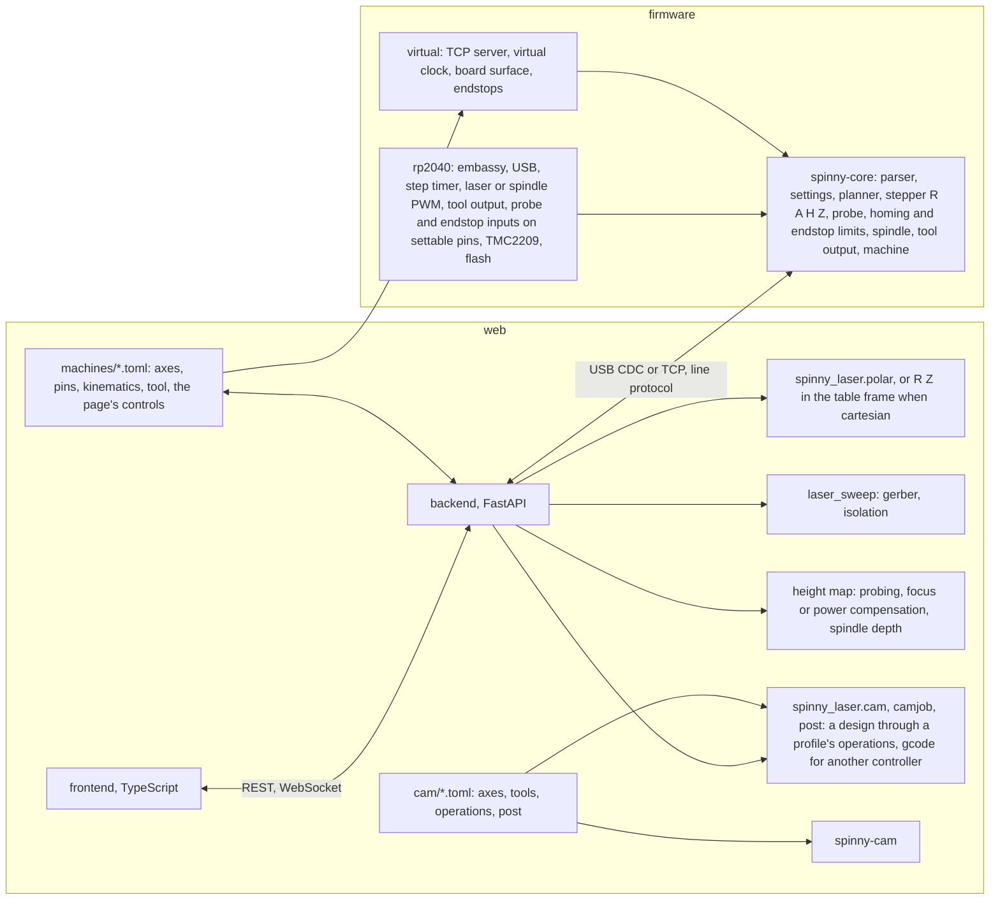
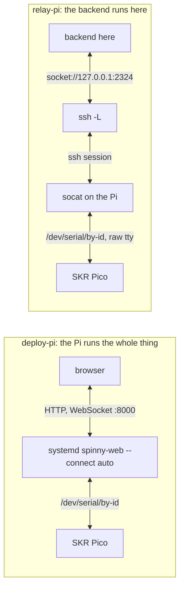

# Architecture

The machine is a joint-space controller on a BTT SKR Pico and a host
that does everything else. The firmware moves the radius (`R`, mm) and
the table angle (`A`, degrees), with the optional focus axis `H` and
cross slide `Z`, as straight lines with a lookahead planner, and ties the
laser power to the speed it reaches. Board geometry never reaches it: the
backend turns gerber, KiCad, SVG and gcode jobs into short joint moves
with the toolpath library's kinematics, so board jogs, independent radius
and turn jogs, and whole jobs all arrive as the same few line commands.

| Part | What | Build, test, run |
| --- | --- | --- |
| `firmware/core` | portable control core: parser, settings, planner, stepper, machine | `cd firmware && cargo test` |
| `firmware/rp2040` | the SKR Pico firmware | `mise run flash` |
| `firmware/virtual` | the core on a TCP socket with a virtual clock | `mise run virtual` |
| `web/backend` | serial link, job import, streaming, probing, API, serves the page | `uv run spinny-web` |
| `web/frontend` | the page | `cd web/frontend && bun run build` |
| `toolpath` | `spinny_laser`: polar kinematics, copper clearing and deposition, centering patterns, machine configs, gcode tools | `uv run pytest toolpath/tests` |
| `machines` | machine configurations in TOML, one per axis setup, with the pins and the page's controls; edited on the page's Config tab | `docs/MACHINES.md` |
| `cam` | CAM profiles in TOML: axes, tools with their cutting settings, operations, the gcode post | `docs/CAM.md`, `uv run spinny-cam` |
| `sim` | plays gcode back on a model of the machine | `cd sim && cargo run -- ../var/out/board.gcode` |

The line protocol is [PROTOCOL.md](PROTOCOL.md), the web API
[WEB_API.md](WEB_API.md), the machine configuration files
[MACHINES.md](MACHINES.md), the CAM profiles [CAM.md](CAM.md).

Each part keeps its own module diagram next to its code:
[firmware/README.md](../firmware/README.md),
[web/backend/README.md](../web/backend/README.md),
[web/frontend/README.md](../web/frontend/README.md),
[toolpath/README.md](../toolpath/README.md).

## Controller on a Raspberry Pi

Two ways, one controller. Only one of them may hold the controller's port
at a time.

**The Pi runs the whole thing.** `mise run deploy-pi -- user@host` builds
the page here and copies the repository, its sibling `kicad-to-gcode` and
the page to the Pi, where uv installs Python 3.12 and the dependencies and
a systemd unit runs the backend with `--connect auto`: it keeps its own
link to the controller up, so a job uploaded to `http://host.local:8000`
streams from the Pi whether or not the page stays open, and a controller
that is replugged, or goes quiet and is given up, is taken up again by
itself. The Pi needs no bun or Rust, and `firmware/` and `sim/` stay
behind. Jobs, the height map and the resume record are the Pi's own.

**The backend runs here.** `mise run relay-pi -- user@host` makes a
controller plugged into a Pi look local: socat on the Pi bridges the tty
to a port on the Pi's loopback, ssh forwards that port here, and the page
connects to `socket://127.0.0.1:2324`. Nothing is installed on the Pi,
and the run lives in the backend here, so it ends if this machine does.
socat prints a dated notice on the terminal for every connection, device
open and error, so when the link goes quiet the relay says whether the
Pi still had the device.

Either way, `mise run usb-log -- user@host` (or with no host, here)
follows the kernel's USB and serial lines, which settle whether the board
dropped off the bus or re-enumerated, and `mise run pi-logs -- user@host`
shows the service's journal and the tails of `spinny.log` and `wire.log`
on a Pi running the backend. `docs/OPERATING.md` has the procedure for a
machine that went quiet.

## Runtime files

Everything the programs write at run time sits under `var/` at the
repository root, which is not tracked: the backend's `jobs/`,
`config.json`, `heightmap.json`, `resume.json` (how far the last run got
and the plan it was made from, written as the run goes), `spinny.log`
(the backend's log, rotated at 1 MB) and `wire.log` (every line over the
link with its time, rotated at 8 MB; `spinny-web --data DIR` moves them
all), and the command line tools' `out/`.
