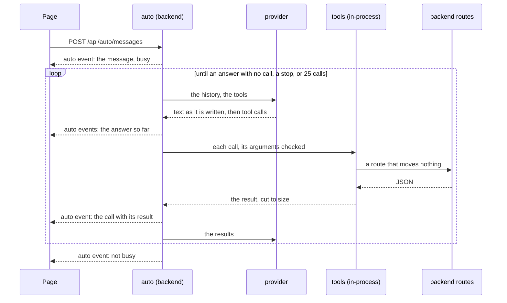
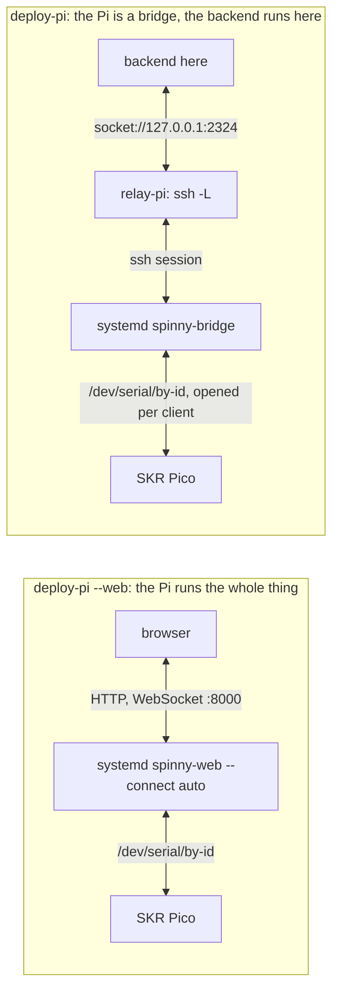

# Architecture

The machine is a joint-space controller on a BTT SKR Pico and a host
that does everything else. The firmware moves the radius (`R`, mm) and
the table angle (`A`, degrees), with the optional focus axis `H` and
cross slide `Z`, as straight lines with a lookahead planner, and ties the
laser power to the speed it reaches. Board geometry never reaches it: the
backend turns gerber, KiCad, SVG and gcode jobs into short joint moves
with the toolpath library's kinematics, so board jogs, independent radius
and turn jogs, and whole jobs all arrive as the same few line commands.
With a paste dispenser the table's driver turns the plunger instead, as
`A` in mm, and a job is dots on the pads; a camera on the head is read
through the sibling pcb-vision repository's `pcbv serve`, which finds the
board in its picture, for measuring the camera's offset from the tool and
lining a job up with the board. For pick and place a second camera,
fixed to the machine and looking up, is read the same way: it centers the
nozzle and sees where a part sits on it, and a board job's parts are read
from its KiCad file. A pick and place machine whose own controller takes
the G-code OpenPnP's GcodeDriver sends (Marlin, Smoothieware,
RepRapFirmware, Grbl) is a machine file with `controller = "gcode"`,
connected in this one's place from the Connection tab: the backend talks to it a
line at a time and serves the page's jog, readout, goto, home, stop and
console with it, its X, Y, Z and turn as the cartesian machine's joints,
and places a board's parts with it, each next line made from what the up
camera, a third camera on that machine's head looking down (fiducials,
feeder marks, parts in their pockets) and its vacuum sensor say. Feeders
on that machine's own bus (Opulo's Photon feeders) are advanced through
its controller before each pick.

| Part | What | Build, test, run |
| --- | --- | --- |
| `firmware/core` | portable control core: parser, settings, planner, stepper, machine | `cd firmware && cargo test` |
| `firmware/rp2040` | the SKR Pico firmware | `mise run flash` |
| `firmware/virtual` | the core on a TCP socket with a virtual clock | `mise run virtual` |
| `web/backend` `virtual_pnp` | a virtual LumenPnP: its Marlin on a TCP socket (moves in time, M400, M410, the vacuum sensor, Photon feeders) and its two cameras drawn from the head's place, served as JPEG snapshots | `mise run virtual-pnp` |
| `web/backend` | serial link (this project's firmware, or a G-code machine's controller), job import (and again for another bit), the Plot page's operations, markers, streaming, probing (grid or pads), dispensing, the cameras through pcbv and the list of those attached, alignment, the parts of a board, the tools a language model gets (the Auto tab's agent, and `spinny-mcp` for any MCP client), an installed release's update from GitHub's releases, API, serves the page | `uv run spinny-web`, `uv run spinny-mcp` |
| `web/frontend` | the page | `cd web/frontend && bun run build` |
| `toolpath` | `spinny_laser`: polar kinematics, copper clearing and deposition, paste stencils, centering patterns, pads and holes of a layer, the alignment fit, simple milling operations, machine configs, gcode tools | `uv run pytest toolpath/tests` |
| `machines` | machine configurations in TOML, one per axis setup, with the pins and the page's controls; or a G-code machine's port, dialect, heights, vacuum sensor, cameras and feeders; edited on the page's Config tab | `docs/MACHINES.md` |
| `cam` | CAM profiles in TOML: axes, tools with their cutting settings, materials, operations, the gcode post | `docs/CAM.md`, `uv run spinny-cam` |
| `carve` | `spinny-carve`: the 3D kernel the CAM runs for an STL model: slicing, offsets, drop cutter, rough, waterline and parallel toolpaths over a stock map, every move checked against the model | `mise run build-carve`, `mise run test-carve` |
| `sim` | plays gcode back on a model of the machine | `cd sim && cargo run -- ../var/out/board.gcode` |
| `deploy` | the Pi's services and `deploy-pi.sh`; `release.py`, the archives that run with nothing installed: a standalone Python with the locked packages, the page and the shipped machine and CAM files, the Rust programs linked for glibc 2.28, the firmware | `mise run deploy-pi`, `mise run release` ([RELEASE.md](RELEASE.md)) |
| [pcb-vision](https://github.com/tmpk13/pcb-vision), checked out beside this one | `pcbv`: the camera's capture and the localizer that finds a KiCad board in its picture, served to the backend over JSON lines | `mise run build-pcbv`; its own `mise run test` |

The line protocol is [PROTOCOL.md](PROTOCOL.md), the web API
[WEB_API.md](WEB_API.md), the machine configuration files
[MACHINES.md](MACHINES.md), the CAM profiles [CAM.md](CAM.md).

```mermaid
flowchart LR
    subgraph web
        FE[frontend, TypeScript] <-->|REST, WebSocket| BE[backend, FastAPI]
        BE --> KIN[spinny_laser.polar, or R Z in the table frame when cartesian]
        BE --> LS[laser_sweep: gerber, isolation]
        BE --> PROBE[probing_part: Backend's probing methods: the map probed, a touch, focus here, the compensation a run follows]
        PROBE --> HM[height map: probing a grid or the pads, focus or power compensation, spindle depth, a dispenser's gap]
        BE --> GCP[gcode_part: Backend's G-code machine: connected from the Connection tab, its jog, goto, position, home, stop, motors and console, its place read once a second]
        GCP --> GD
        BE --> PLP[placing_part: Backend's placing with the G-code machine: references, the cameras' places, lights and vacuum, feeders, a run, kept per machine]
        PLP --> OPNP
        ST[stores: one TOML store for machines/ and cam/: read, checked, saved whole, a value at a time] --> BE
        BE --> CAM[spinny_laser.cam, camjob, post: a design through a profile's operations, gcode for another controller]
        BE --> AL[alignment: marks from the tool or the camera, a turn and a shift fitted and applied to the job]
        BE --> MILL[mill: the Plot page's jobs of operations, drill, holes, line, face, pocket, profile with square or rounded corners, applied in place, and a job made again for another width]
        BE --> TH[thumbs: a job drawn small as SVG for the job list]
        BE --> MK[markers: named board positions in config.json]
        BE --> TODO[todo: the top bar's to-do list in var/todo.json, put whole on the revision it was changed from]
        BE --> REP[reports: bug reports from the page kept in var/reports, handed on as a GitHub new-issue page or a post]
        REP -->|HTTP POST, JSON| HOOK[the report link: any address that takes reports]
        BE --> PLUG[plugins: page modules in var/plugins, on only as the text the operator turned on]
        FE -->|imports the modules turned on| PLUG
        BE --> AUTO[auto: the Auto tab's agent, one conversation, a turn at a time, at most 25 tool calls]
        AUTO --> TOOLS[tools: what a model may call, thin calls on the API, only routes that move nothing]
        TOOLS -->|in-process ASGI, no port| BE
        AUTO <-->|HTTPS, Messages API with tools, streamed| ANT[Anthropic API]
        AUTO <-->|HTTP, chat completions with tools| OAI[an OpenAI-compatible server: OpenAI, OpenRouter, ollama]
        AUTO -->|a subprocess a turn, stream-json back| CC[claude: Claude Code in print mode, its own tools taken away]
        CC <-->|stdio, MCP| MCP[spinny-mcp: the same tools over MCP]
        EXT[Claude Code or another MCP client] <-->|stdio, MCP| MCP
        MCP --> TOOLS2[tools, over HTTP]
        TOOLS2 -->|HTTP| BE
        BE --> PNP[pick and place: a board's parts and fiducials from its KiCad file, the nozzle centered over the bottom camera, its runout, a part's offset, size and angle on it]
        PNP --> OPNP[openpnp: a G-code machine file's own tables read, the board fitted from references, the program as planned, a goto's lines]
        OPI[page openpnp.ts: OpenPnP's machine.xml and a job read into a G-code machine file and references] -->|the file saved, references taken| BE
        OPNP --> PLC[placer: a run part by part, from the cameras' looks and the vacuum's reads, failed picks retried]
        PNP --> PLC
        TOPC[topcam: a G-code machine's top camera, its offset from a mark, fiducials, feeder marks, pockets] --> PLC
        PCAM[pnp PickCamera: one base for the up and top cameras: settings, pcbv, a routine at a time] --> TOPC
        PCAM --> PNP
        PLC --> GD[gcode_link: a line at a time, each answered ok, a poll only when nothing else is in flight]
        PLC --> FBUS[feederbus: packets to feeders on a bus, framed as the machine file's bus says: a feeder found by its id, initialized, advanced, waited for]
        FBUS -->|the bus's send line, its reply read back| GD
        GD <-->|M485 packets carried on RS-485| PHO[Photon feeders in a LumenPnP's slots]
        GD <-->|USB serial or TCP, G-code| PPM[a pick and place machine: Marlin, Smoothieware, RepRapFirmware, Grbl, an Opulo LumenPnP]
        GD <-->|TCP, G-code| VPNP[spinny-virtual-pnp: a LumenPnP's Marlin, its feeders and nozzle]
        PV2 -->|JPEG snapshots over HTTP| VCAM[spinny-virtual-pnp's bottom and top cameras, drawn from the head's place]
        PV3 -->|JPEG snapshots over HTTP| VCAM
        BE <-->|JSON lines over stdio or TCP| PV[pcb-vision pcbv serve: capture, board localizer, frame, spot]
        BE <-->|a second pcbv serve| PV2[pcb-vision pcbv serve: the bottom camera's frame and spot with its smallest rectangle]
        TOPC <-->|a third pcbv serve| PV3[pcb-vision pcbv serve: the top camera's frame and spot]
        PV --> VID[/dev/videoN on the head]
        PV -->|JPEG snapshots over HTTP, forwarded by relay-pi| UST[ustreamer on a bridge Pi: spinny-camera unit]
        UST --> VIDPI[/dev/v4l/by-id camera on the Pi]
        PV2 --> VID2[/dev/videoM fixed to the machine, looking up]
        BE --> FIND[cameras: the ones attached for the device lists, from pcbv cameras and from asking the forwarded ports for ustreamer state]
        BE --> LOOK[boardlook: the head and top cameras' poses read into guesses of where the board lies, the most likely found at the camera's threshold; corners taken by hand; the search over a box]
        LOOK --> PV
        LOOK --> PV3
        LOOK --> SLOG[searchlog: every look and search recorded in var/searchlog: poses, stops, a picture at each, the board file, the outcome; searchreport and spinny-search read them back]
        FIND --> V4L[v4l2-ctl: a camera's controls listed and set, kept per camera and set at each start]
        FIND -.-> VID
        FIND -.-> UST
        MF[machines/*.toml: axes, pins, kinematics, tool, camera, the page's controls; a G-code machine's port, dialect, heights, cameras, feeders] <--> BE
        MF --> OPNP
        CF[cam/*.toml: axes, tools, materials, operations, post] --> CAM
        CF --> CLI[spinny-cam]
        CAM <-->|one JSON request and answer over stdin and stdout| CARVE[carve spinny-carve: an STL sliced, cleared, followed and combed; links over a stock map; a gouge check]
    end
    MF --> VIRT
    BE <-->|USB CDC or TCP, line protocol| CORE
    subgraph firmware
        RP[rp2040: embassy, USB with an E15 lockup guard, step timer, laser or spindle PWM, tool output, probe and endstop inputs on settable pins, TMC2209, flash] --> CORE[spinny-core: parser, settings, planner, stepper R A H Z, probe, homing and endstop limits, spindle, a dispenser's plunger on A, tool output, machine]
        VIRT[virtual: TCP server, virtual clock, board surface, endstops] --> CORE
    end
```

A turn of the Auto tab with a provider that leaves the tools to the
backend (the Anthropic API, an OpenAI-compatible one). With Claude Code the
`claude` command runs the same loop itself, calling the tools through
`spinny-mcp`, and the backend reads its stream into the same events.



Each part keeps its own module diagram next to its code:
[firmware/README.md](../firmware/README.md),
[web/backend/README.md](../web/backend/README.md),
[web/frontend/README.md](../web/frontend/README.md),
[toolpath/README.md](../toolpath/README.md).

## Controller on a Raspberry Pi

Two ways, one controller. Only one of them may hold the controller's port
at a time; installing either service stops the other.

**The Pi is a bridge.** `mise run deploy-pi -- user@host` copies the
repository and its sibling `kicad-to-gcode` to the Pi, where uv installs
Python 3.12 and the dependencies, and a systemd unit runs `spinny-bridge`
(`web/backend/src/spinny_web/bridge.py`): the controller's port served on
the Pi's loopback port 2324, one client at a time, the device looked up
under its by-id name and opened when a client connects and closed when it
leaves, so the firmware greets every connect with its banner and stops
everything when the client goes. `mise run relay-pi -- user@host`
forwards that port here over ssh and the page connects to
`socket://127.0.0.1:2324`; the run lives in the backend here, so it ends
if this machine does. The bridge writes the device only when it is ready,
gives up a device that takes nothing for 3 s and a client that stops
reading, tells the client why in a `[MSG:bridge ...]` line that the
backend logs and names in a failed connect, and lets a new client take
over from one that has gone quiet, so a board that wedges needs nothing on
the Pi restarted. With no bridge installed, `relay-pi` starts socat on the
Pi for the session instead; socat blocks in a write to a board that stops
taking bytes and serves no one after that until the relay is started
again, which is why the bridge exists.

**The Pi runs the whole thing.** `mise run deploy-pi -- --web user@host`
builds the page here and copies it along, and the unit runs the backend
with `--connect auto`: it keeps its own link to the controller up, so a job
uploaded to `http://host.local:8000` streams from the Pi whether or not
the page stays open, and a controller that is replugged, or goes quiet and
is given up, is taken up again by itself. The Pi needs no bun, and
`firmware/` and `sim/` stay behind. Jobs, the height map and the resume
record are the Pi's own.

**Or a release.** The `aarch64-linux` archive from `mise run release`
unpacked on the Pi runs the same backend with nothing else installed
(`bin/spinny-web --connect auto`), its files under
`~/.local/share/spinny`; [RELEASE.md](RELEASE.md). The installed
backend finds its files through `spinny_laser.home`: the repository's
directories in a checkout, else that home, filled on the first start from
the copies the release ships inside `spinny_web`.

**Cameras on the Pi.** With the Pi as a bridge it only streams them: each
`--camera DEV[@WxH[@FPS]]` given to deploy-pi gets a `spinny-camera-<port>`
unit running ustreamer (from apt) on the Pi's loopback, ports 2325, 2326
and on, passing the camera's own MJPEG through without decoding it.
`relay-pi` forwards those with the controller's port, the camera settings
here name `http://127.0.0.1:2325/snapshot` (the camera lists find it by
asking the forwarded ports for ustreamer's `/state`), and the backend starts `pcbv`
here on that URL as on a device: the decoding and the localizer run where
the cycles are, and a Pi Zero 2 W only copies bytes. `pcbv` asks for one
picture at a time, at most the settings' fps a second: the pushed
`/stream` at 1280x720 and 30 fps outran the Zero's WiFi (about 10 Mbit/s),
queued seconds of frames in the tunnel, and delayed the controller's
lines sharing it. The size is the unit's; the settings' size does not
reach it.
Loopback because neither ustreamer nor `pcbv` has a login of its own: the
ssh session is the only way in. On a Pi running the whole thing the
backend starts `pcbv` there on the Pi's own devices; deploy-pi cross
builds it here for aarch64 (a Pi Zero cannot build it), strips it and
installs it as `/usr/local/bin/pcbv`, after checking that it runs against
the Pi's glibc. A `pcbv serve --listen` elsewhere is still reached at a
`socket://` device; the backend then reopens its camera with the settings'
size and fps and leaves it running when it stops.

Either way, `mise run usb-log -- user@host` (or with no host, here)
follows the kernel's USB and serial lines, which settle whether the board
dropped off the bus or re-enumerated, and `mise run pi-logs -- user@host`
shows the bridge's journal, or on a Pi running the backend its journal
and the tails of `spinny.log` and `wire.log`. `docs/OPERATING.md` has the
procedure for a machine that went quiet.



## Runtime files

Everything the programs write at run time sits under `var/` at the
repository root, which is not tracked: the backend's files, listed in
[web/backend/README.md](../web/backend/README.md#files) (`spinny-web
--data DIR` moves them), and the command line tools' `out/`.
