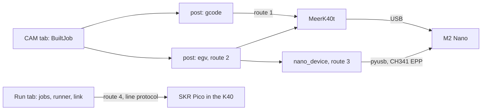

# M2 Nano (K40) support: what it would take

An assessment, not a feature: nothing here is implemented (2026-10-29).
Protocol facts are from MeerK40t's `meerk40t/lihuiyu` and `meerk40t/ch341`.

## The controller

The Lihuiyu M2 Nano is the stock board of K40 CO2 lasers. It cannot be
reflashed and speaks neither G-code nor a serial line protocol.

- USB is a CH341A in EPP parallel mode, `1a86:5512`, bulk OUT `0x02` and IN
  `0x82`, set up with vendor requests `0x9A` (EPP 1.9) and `0xB1` (parallel
  init). It is not a tty, so pyserial and the Pi's spinny-bridge cannot
  carry it.
- On this PC's kernel (7.0) `spi_ch341` claims `1a86:5512` as soon as the
  board is plugged in. It has to be blacklisted or detached before libusb
  can claim the interface, and a udev rule is needed for access without root.
- A frame is `0x00`, 30 command bytes padded with `F`, and a OneWire CRC-8
  of the 30 bytes, written behind the CH341's EPP write command (`0xA6`).
  After each frame the host polls status (`0xA0` on bulk, 6 bytes back, byte
  1): 206 accepted, 238 busy, 207 CRC error (resend), 236 program finished.
  Accepted means buffered, not done, and the board never reports position.
- The language (LHYMICRO-GL) moves in 1/1000 inch steps from home at the
  back left, Y growing toward the front. `B`/`T` set +X/-X, `L`/`R` set
  back/front, `M` steps diagonally, `D`/`U` switch the beam. Distances are
  letters (1 to 51), three digits (52 to 254) and a `z` per 255. `I ... S1P`
  is a rapid move; a speed code, `N`, the directions and `S1E` start a
  program (cutting) block, and `FNSE` or `@NSE` end it. `IPP` homes,
  `IS2P`/`IS1P` unlock and lock the rail, `PN!`/`PN&` pause and resume,
  `I*` resets.
- The speed code (`CV`, a 16-bit timer value, a gear digit, a step value
  and, on M1/M2/B1/B2, a diagonal correction) differs per board model and
  was reverse engineered. MeerK40t's `laserspeed.py` (MIT) is the one to
  port; K40 Whisperer's is GPL-3.
- The M2 has no power control: the tube current is the panel's knob.
  MeerK40t fakes power as pulses per inch (the beam on for that many of
  every 1000 steps) and reads G-code `S` as that number, 0 to 1000. The
  newer M3 Nano adds a power command (`AT1` and two bytes). There is no Z,
  no probe input and no tool output.

A K40's 10.6 um beam ablates paint or resist and cuts Kapton or Mylar
stencils, but it does not ablate bare copper.

## What carries over

The CAM tab's built job (`camjob.BuiltJob`: groups of polylines in mm with
speed, passes and power) holds everything a K40 needs, so isolation, vector
clearing, outlines and the F.Paste stencil carry over. The machine side
does not: the line protocol, the Run tab's runner and link, the height map,
probing, focus and power compensation, speed-tied power, endstop settings
and the `[controls]` jog panel all assume this repo's firmware.

## Routes

| | Route | Code | Result |
| --- | --- | --- | --- |
| 1 | MeerK40t runs the CAM tab's gcode | a `cam/k40.toml` | jobs on the stock board now; power only as PPI; the page does not drive it |
| 2 | An EGV post | about 800 to 1000 lines with tests | `.egv` files that MeerK40t or K40 Whisperer send as written |
| 3 | The backend drives the board over USB | route 2 and about 2000 to 2500 more | the page connects, homes, jogs, runs, pauses and stops the K40 |
| 4 | Replace the M2 with an SKR Pico | a `machines/k40.toml` and wiring | every feature with real power; the stock software no longer works |

1. MeerK40t opens a `.gcode` file as a job and plays it through its Lihuiyu
   driver (`meerk40t/grbl/gcodejob.py`), or takes it as a TCP stream through
   its `grblserver` (port 23). A profile with the K40 bed (about 300 x 200
   mm) and power out of 1000 is the whole change. MeerK40t's device
   transform decides which way up the board lands, so cut an asymmetric
   test mark first.
2. A `[post] format = "egv"` beside the gcode writer in `toolpath`: a speed
   code per group, each polyline rounded to absolute steps (so rounding does
   not drift) and split into orthogonal and diagonal runs (Bresenham),
   travel inside the program block with the beam off or as a rapid move
   depending on its length, Y flipped, passes repeated, and a warning when a
   group asks for less than full power (or PPI). The CAM view needs the file
   type and an export button.
3. Route 2 plus `spinny_web/nano_device.py` on pyusb: frames, CRC, status
   polling, resend, busy back-off, pause, resume, stop, wait for finish,
   home, rapid jogs, and the head's position kept on the host. Then routes
   under `/api`, a device panel like the PnP one with its mock twin, tests
   against a fake CH341, and the blacklist and udev rule in `deploy-pi.sh`.
   The OpenPnP device (f9fdac5, d9c5af4) is the template; it came to about
   4700 lines with tests and docs. The backend has to run on the computer
   the K40 is plugged into (`deploy-pi --web` on the Pi), since the bridge
   carries a serial stream. To test on a board before trusting it: what the
   M2 does when its buffer runs dry inside a program block. A head parked
   with the beam on burns a spot, so the sender must not starve mid-cut.
4. No firmware code: `$cartesian=1`, `$sockets`, `laser_pin`, endstops and
   homing exist (the last two untested on hardware), and
   `machines/cartesian-mill.toml` is the nearest X/Y machine file to copy.
   The work is wiring and bring-up:
   - The K40's ribbon (X motor, both endstops, 5 V) needs a breakout; the
     Y motor has its own plug. K40 conversions usually start near 157.5
     steps/mm at 16 microsteps, to be measured.
   - The supply's `L` (fire, active low) goes to FAN3's switched pin (pin
     2, never pin 1, the fan rail) through a small diode, anode at `L` and
     cathode at FAN3, with the grounds common. FAN3's indicator LED and its
     10K pull that pin toward 24 V while FAN3 is off, and the diode keeps
     that off `L`. FAN3 is a low side MOSFET held off by its gate pull-down
     until the firmware runs, so the beam stays dark through reset,
     flashing and BOOTSEL with `$laser_invert` 0; a GPIO wired straight to
     `L` would fire it in all three. The panel's knob on `IN` stays as the
     current ceiling, and PWM on `L` sets the power under it.
   - The K40's optical endstops can go straight on the STOP headers, which
     carry 5 V on pin 3 and buffer the signal (74LVC2G34, inputs up to
     5.5 V). The cross slide's default endstop, GP22 on the PROBE header,
     has no buffer, so Y goes on Y-STOP by swapping pins with the unused
     table: `$z_stop_pin=3`, `$a_stop_pin=22`.
   - The supply's 24 V ran the M2's two motors and will likely run the
     Pico's at a similar current; a separate 24 V supply with the grounds
     common removes the doubt.
   - Nothing is cut, so the M2 can go back in.

## Recommendation

Start with route 1. It costs one profile and shows whether a K40 does the
PCB work wanted (stencils, resist) before any code is written. If the K40
should then become one of this repo's machines, route 4 gives more for less
code than route 3. Route 3 is for keeping the stock controller.
