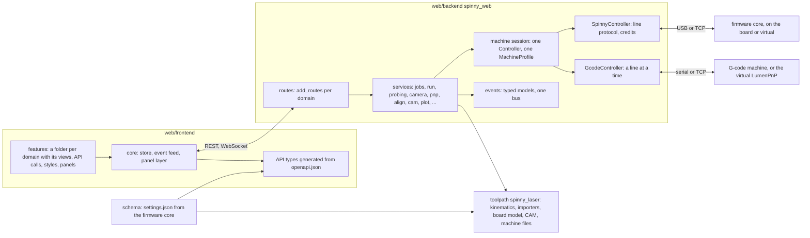

# Restructure plan

A high-level review of the system as of 2026-11-13 (commit 331e2c4) and
a plan to restructure it in steps that keep the machine working
throughout. The decisions only the owner can make are in
[QUESTIONS.md](../QUESTIONS.md) (Q9).

## Where it stands

| Part | Lines (source + tests) | Verdict |
| --- | --- | --- |
| `firmware/` (core, rp2040, rp2040-logic, virtual) | 21k | Sound. Keep it as it is. |
| `carve/`, `sim/` | 4.6k | Sound. Keep them. |
| `toolpath/` (`spinny_laser`) | 15.6k | Sound. A few readers live in the backend instead of here. |
| `web/backend/` (`spinny_web`) | 30k + 20k | One object does everything. Restructure it. |
| `web/frontend/` | 61k + 19k | A third of it is a second backend, and every feature edits the same six files. Restructure it. |
| `docs/` and `notes/` | 660k characters | They restate the code by hand and drift from it. |

The suites at that commit, each run on its own, all pass: firmware 375
tests, carve 34, sim 10, toolpath 548, and the backend 868 (7.5 minutes
with the end to end runs), plus the render and layout checks. The page
passes 930 of 931 tests. The one failure comes from an uncommitted edit
to `cam/cartesian-laser.toml` that a page test reads (problem 8 below).

### What works, and stays

- **The joint-space protocol.** The firmware knows no board geometry and
  the host does the kinematics, so the controller stays small and testable.
- **The firmware's layers.** A portable core, the board's glue,
  hardware-free board logic, and a virtual firmware that runs the real
  core over TCP, so the end to end tests drive production motion code.
- **The Python split.** The library (`spinny_laser`) and the backend
  (`spinny_web`) depend one way only: the backend uses the library and
  never the reverse.
- **Virtual devices for every controller.** The virtual firmware runs as
  the polar laser, the mill or the dispenser, and the virtual LumenPnP
  comes with its feeders and cameras.
- **Machine files as the one description of a machine.** The page follows
  the file instead of having panels per machine.
- **The newest backend modules** (`todo.py`, `reports.py`, `plugins.py`).
  Each is a store class with no FastAPI in it, plus an
  `add_routes(app, store)` function. That is the template for the rest of
  the backend.

### Problems, by what they cost

1. **The page carries a second backend.** `web/frontend/src/mock/` is
   19.2k lines, 32% of the page's source. It reimplements in TypeScript
   the backend's routes, the firmware's behavior (down to its error texts,
   reset transcript and `help`), the CAM post, the DXF, SVG and gcode
   readers, the OpenPnP machine and the Plot operations. Every backend
   feature is written twice, and
   [notes/reviews.md](../notes/reviews.md) lists the places where the copy
   drifted. Five mise tasks (`controls-`, `keys-`, `mill-`, `dxf-` and
   `cam-fixture`) exist only to check copies against Python. 40 of the 79
   page test files run on the mock. The virtual firmware and the virtual
   LumenPnP already provide the real behavior without hardware.
2. **The backend is one object.** The `Backend` class in `app.py` runs
   from line 841 to 3871 with 172 methods. It has 104 more in
   `gcode_part.py`, `placing_part.py` and `probing_part.py`, which are
   mixins that share its 55 attributes. All 176 of `app.py`'s routes are
   defined inside one `create_app()` of about 1,000 lines, and the 840
   lines before the class hold the settings schema and 61 request models.
   `app.py` was touched by 79 of the last 337 commits, and none of it can
   be read or tested on its own.
3. **The contracts are kept by hand, several times over.**
   - API: requests are pydantic models, but every response is a plain
     dict (no route has a `response_model`). `types.ts` (2.1k lines),
     `api.ts` (an `Api` interface of 180 methods, written out again in
     `HttpApi` and in the mock) and `WEB_API.md` (140k characters) are all
     written by hand.
   - Firmware settings are listed in `settings.rs`, the virtual firmware,
     `machines.py`, `machine_keys.py`, `app.py`'s `SETTINGS_SCHEMA`,
     `fake_serial.py`, `machinekeys.ts`, `mock/machines.ts`,
     `mock/backend.ts` and `PROTOCOL.md`.
   - WebSocket events: the backend publishes dicts, and the page's union
     of event types is written by hand.
4. **Two controllers and no interface between them.** The G-code machine
   is handled as a branch: `if self.gcode.connected:` sits at the top of
   jog, goto, set_position, realtime, stop, command, motors, snapshot and
   more (15 places in `app.py`, 25 checks of the G-code link across the
   backend). Its methods borrow the polar machine's joint names
   (r is X, z is Y, h is Z). A third kind of controller would add a third
   branch in each of those places.
5. **The kind of machine is a set of flags.** 83 conditionals in the
   backend and 48 in the page test `cartesian`, `spindle`, `milling` or
   `dispensing`. The backend already sends a small `profile` (kinematics,
   tool, `h_axis`, limits), but most code reads the flags instead.
6. **Every feature on the page goes through the same hubs.** A feature
   edits `index.html` (56 panels), `main.ts` (41 mount calls and the event
   switch), `types.ts`, `api.ts`, `style.css` and the mock. In the last
   month `style.css` and `types.ts` were each changed in 54 commits,
   `api.ts` in 41 and `main.ts` in 38. `style.css` is one 5.2k-line file,
   where a later rule silently beats a reused class name.
7. **The same input is read in several places.**
   - KiCad boards: `toolpath/board.py` (through laser-sweep), the
     backend's `pnp.py` (its own s-expression parser), the page's
     `kicad.ts` (layers) and the mock.
   - OpenPnP's `machine.xml`: the page's `openpnp.ts` (1.1k lines) and
     its mock twin, alongside the backend's `openpnp.py`.
   - File importers (SVG, gcode, gerber, KiCad, JSON) sit in the
     backend's `jobs.py` rather than in the library.
8. **Tests read the files the operator edits.** `cam.test.ts` reads the
   live `cam/cartesian-laser.toml`, and the toolpath and backend CAM and
   machine tests read `cam/` and `machines/`. A change made on the Config
   tab can therefore fail a test.
9. **The docs restate the code.**
   - `WEB_API.md` lists every field by hand.
   - The main diagram in `ARCHITECTURE.md` has about 70 nodes, each
     labeled with a sentence.
   - Module tables are kept in three places, and they have drifted: the
     backend README still names `gcode_device.py`, which is now
     `gcode_link.py`.

## Target



The backend's package, by domain. The domains follow `WEB_API.md`'s
sections:

```
spinny_web/
  app.py         builds the services, calls each domain's add_routes, serves the page
  core/          typed events and their bus, the config store, guards, files, logging
  machine/       the session, the Controller protocol, spinny.py, gcode.py,
                 profile.py, settings, machine files
  jobs/ run/ probing/ camera/ search/ pnp/ align/ cam/ plot/ markers/
  addons/        auto with its providers, tools and MCP; plugins, reports, todo, update
  virtual/       virtual_pnp, virtual_camera
```

Each domain has a `service.py`, which holds the state and logic and
imports nothing from FastAPI, and a `routes.py`, which holds
`add_routes(app, service)` with the request and response models.
Services get their collaborators through their constructors, and the
mixins go away. Routes stay on the app itself rather than on included
routers: since FastAPI 0.142, an included router's routes are missing
from `app.routes`, and that is the list the guard test for the Auto
tools' routes checks ([notes/backend.md](../notes/backend.md)).

The page, by feature:

```
src/
  core/       store, ws, http, dom, panels and layout, format, toml
  api/        types.gen.ts from openapi.json, one small client per domain
  features/   a folder per domain: views, styles, panel declarations, event handlers
  render/     unchanged
  main.ts     walks the list of features
```

## Phases

Each step is one commit, or a few. A step keeps every route's path and
behavior and ends with the suites green. The HTTP API is the contract
the steps hold to, so the page needs no change until phase 4. Feature
work can land between steps; nothing is frozen.

### Phase 0: a safety net (small)

1. Tests read their own copies of the CAM profiles and machine files
   under `tests/fixtures/`. The shipped files are only checked to parse
   and to pass their own checks.
2. `mise run test` runs every suite to the end (`--continue-on-error`) and
   prints one line per suite, so one failure no longer hides the other
   suites' results.
3. A contract snapshot: a test writes the route table (method, path,
   request schema) and compares it with a committed copy. During the
   restructure it changes only on purpose.
4. One helper lists every route, including any on an included router, so
   neither the Auto tools' route guard nor the snapshot can miss one.

### Phase 1: one source per contract (medium)

1. The firmware's settings table becomes `schema/settings.json` (name,
   type, default, bounds, unit, whether a restart is needed, help text). A
   core test writes it and fails when the committed copy differs.
   `machines.py`, `app.py`, `fake_serial.py` and the page read it, and the
   settings table in `PROTOCOL.md` is generated from it.
2. A new route serves the machine keys and the default controls, which
   already live in `spinny_laser`. The Config tab, the settings list and
   the servo bars read them from it instead of from `machinekeys.ts`.
   The page's copies then serve only the mock, and they go with it in
   phase 3.
3. WebSocket events become pydantic models, one per type, in
   `core/events.py`. Their JSON Schema goes into `openapi.json`.

### Phase 2: split the backend (large, about 12 steps)

Domains move from least coupled to most. Each step first moves the code
unchanged, then cuts the dependency.

1. The request models leave `app.py` for each domain's `routes.py`.
2. The small domains: markers, the parts filter, the camera log, the
   search log, update.
3. Align, CAM, Plot (`mill.py`), thumbnails.
4. The head camera, the camera list, vision (`pcbv`), the board look and
   search.
5. PNP with placing, the top camera and the feeder bus. The `PlacingPart`
   mixin goes away.
6. Probing and the height map. The `ProbingPart` mixin goes away.
7. Jobs: the store, imports, patching, combining, width and margin. The
   importers move to `spinny_laser.importers`.
8. Run: the runner, resume and stall detection. The streamer is picked
   from the `MachineProfile`.
9. The machine session: settings, machine files, connect and disconnect.
   A `Controller` protocol (connect, close, snapshot, jog, goto,
   set_position, realtime, command, motors, home, run) gets two
   implementations: `SpinnyController` from `link.py` and the streamers,
   and `GcodeController` from `gcode_link.py` and `GcodePart`. The
   branches on the G-code link go, and the machine file's `controller`
   picks the implementation.
10. `MachineProfile` grows the existing `profile` into capabilities:
    kinematics, tool kind, axes, probe, endstops and servos, worked out
    once and sent in the snapshot. The backend's flag checks read it.
11. Each domain's routes get response models as the domain moves, so
    `openapi.json` ends up describing every answer.
12. `app.py` is left as the place that builds the services, under 300
    lines, and `mise run release` still builds an archive that starts.

### Phase 3: retire the page's mock (large; Q9)

1. `mise run demo` starts the backend on a scratch data directory with
   the virtual firmware and the virtual LumenPnP, then prints the page's
   address.
2. `test-layout`, `shots` and `test-render` run against the demo stack.
   Each state they need (a job loaded, a run going, PNP parts) is set up
   through the API by a script.
3. View tests use a typed fake API that answers only what each test sets
   up. Its types come from `openapi.json`, so a changed response shape
   fails the type check.
4. Delete `src/mock/`, the mock's own tests, the five fixture tasks and
   the copies kept only for the mock: the defaults in `machinekeys.ts` and
   `controls.ts`, and the mock's DXF reader.

Steps 1 and 2 can start at any time. Step 3 needs the response models
from phase 2.

### Phase 4: the page by feature (medium)

1. `types.gen.ts` is generated from `openapi.json` (`mise run api-types`),
   and `test-frontend` checks that it is current. The hand-written
   `types.ts` shrinks to the page's own types.
2. A folder per domain under `features/` holds its views, its API calls,
   its styles (class names prefixed by the feature) and a declaration of
   its panels (id, title, page, default stack). `main.ts` and the panel
   layer read those declarations instead of `index.html`. Plugins are
   given the page's API object as `host.api` ([PLUGINS.md](PLUGINS.md)),
   so it keeps every method name, with the per-domain clients gathered
   behind it.
3. The page asks the `MachineProfile` instead of working the flags out
   again.
4. `style.css` keeps the tokens and the shared controls; each feature's
   rules move into its folder.

### Phase 5: one reader each (small to medium)

1. One KiCad board model in `spinny_laser.board`: layers, outline,
   footprints, pads and fiducials. The backend's `pnp.py` uses it, and the
   page asks the backend for an upload's layers.
2. The OpenPnP import is written in Python next to `openpnp.py`, and the
   page uploads the XML.

### Phase 6: docs that point at the code (small)

1. `WEB_API.md` becomes a generated reference per domain (fields and
   types), plus prose only for what the reference cannot say: order,
   safety and refusals.
2. `ARCHITECTURE.md` gets one diagram of the layers (at most 15 nodes) and
   one diagram per layer. Module tables live only in each part's README.
3. Optional: the 2,000 lines of code in the firmware's `machine.rs` split
   into homing, probe and jog modules.

## Not proposed

- **Moving the backend to asyncio alone.** The threads (the link reader,
  the runner, the prober, the cameras) and their bridges to asyncio work
  and are tested. Rewriting them would put the machine at risk for no
  new behavior.
- **A frontend framework.** The store-and-views pattern is fine. The cost
  is in the hubs, not the pattern.
- **Renaming top-level folders** (`toolpath/`, `web/`). That would change
  every doc and task for little gain.
- **Merging `carve/` and `sim/` into the firmware's cargo workspace.** It
  is possible, but worth little.
- **Going back to pixi.** It was removed on purpose
  ([notes/build.md](../notes/build.md)).

## Done when

- `app.py` is under 300 lines, and no backend module is over 1,000
  lines.
- A firmware setting is added in one table, and a route is added in one
  domain folder per layer.
- No mise task exists only to check one copy of code against another.
- The page's source is about 19k lines smaller.
- Every suite is green after every step, and the contract snapshot
  changed only when a step meant it to.
