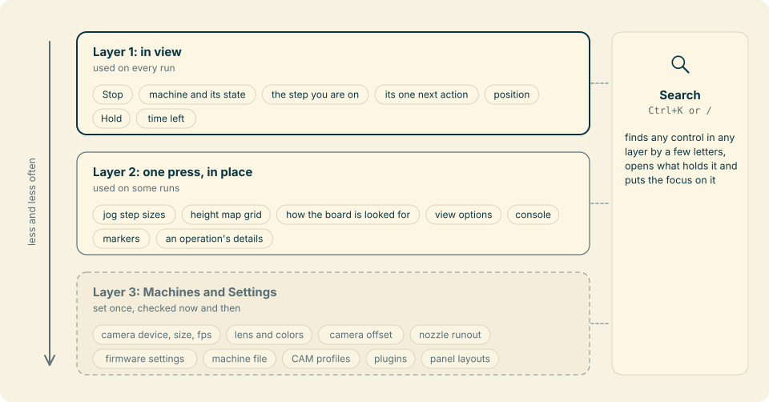
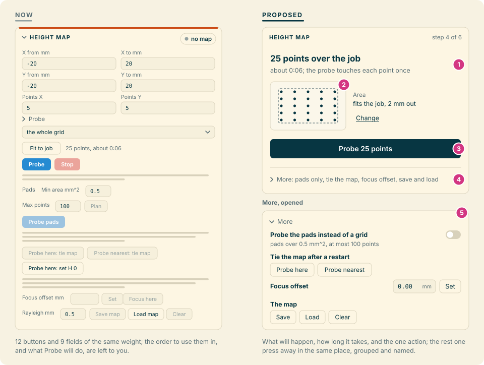
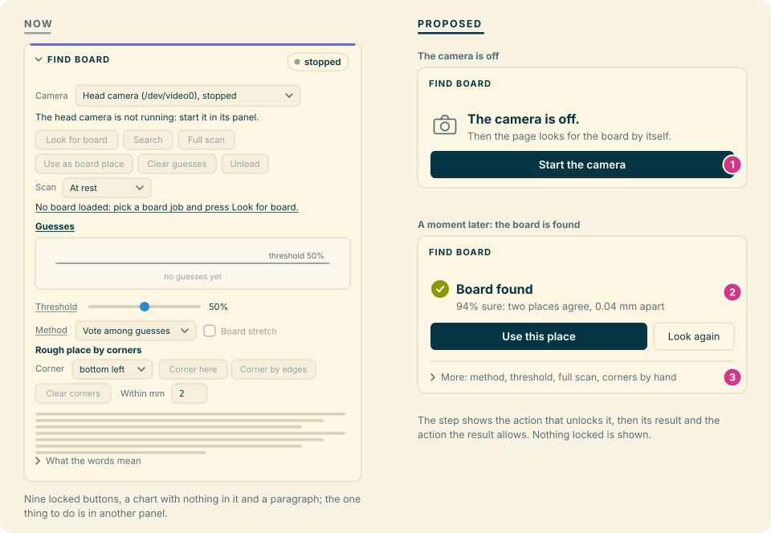
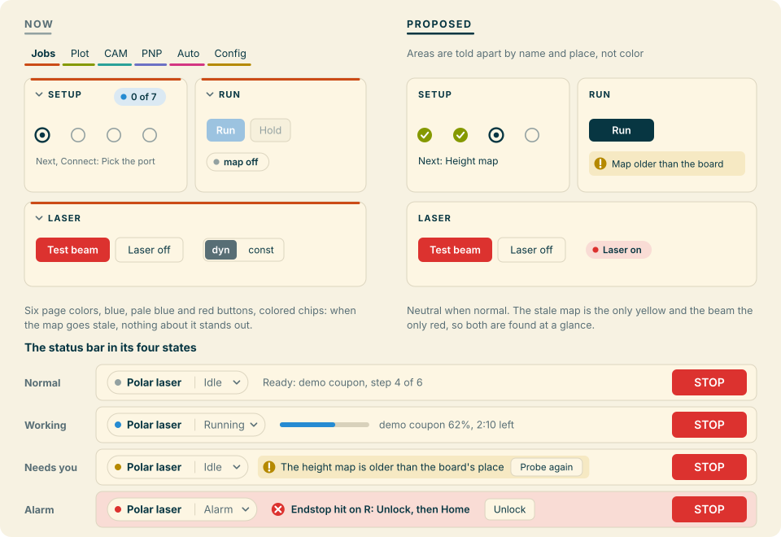
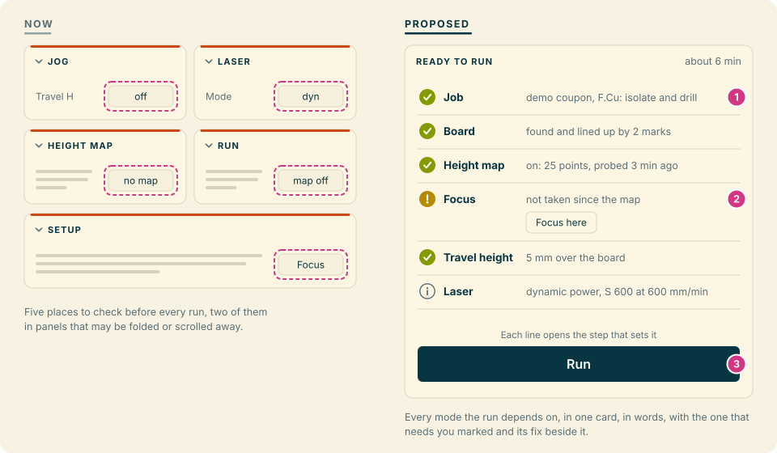
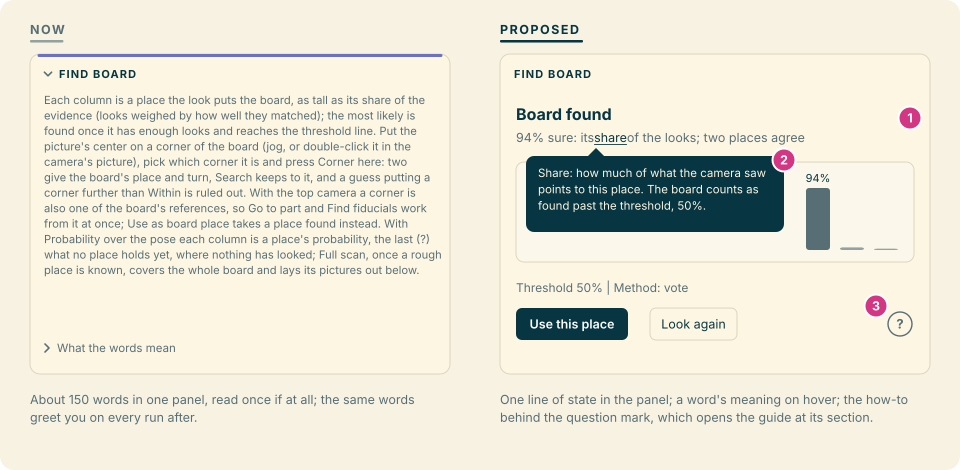
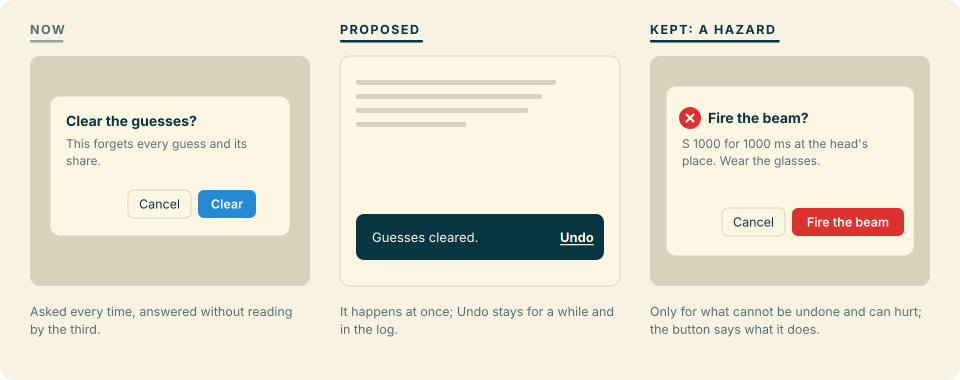

# Designing the page: principles

Rules for anything shown on the page, so it stays easy to use as it
grows. Each rule says what to do, why (the research behind it, listed
under [Sources](#sources) with how strong it is), and how to check a
change against it. [UI_REDESIGN.md](UI_REDESIGN.md) applies them to
today's page, screen by screen.

## Who the page is for

One person at a machine. Their eyes move between the page and the work;
their hands are often on the board, the jog keys or Stop. They know PCBs,
lasers and mills well and this page's insides not at all, and they come
back after days away. Some tasks happen on every run, some once per
machine. A mistake costs a board, an hour, or a part of the machine.

Three things follow. Attention is the scarce resource: working memory
holds about four chunks [Cowan 2001], and whatever is on screen but not
needed for the task competes with the task for it [Sweller 1988]. People
act before they read: they skip instructions and go for the task
[Carroll and Rosson 1987]. And a machine page is closer to a control room
than to an office app, where the rule is a quiet normal state and an
abnormal one nobody can miss [Hollifield and Perez 2012].

## The principles

### 1. Arrange by the work, not by the parts

**Rule.** Areas and screens follow the order the work is done in (make a
job, set it up on the machine, run it), not the parts of the software
(camera, height map, CAM, console). One screen per task holds everything
that task needs, so nothing calls for flipping between tabs; a part used
by several tasks shows up in each, sized for it. Above the task screens
sits one overview; below them, detail and configuration.

**Why.** People find things by following the words that predict their
goal, and leave when the scent is weak [Pirolli and Card 1999]; "Find
the board" predicts a goal, "Picture controls" does not. Screens shown
one at a time hide each other's context, the keyhole effect [Woods 1984];
control-room practice answers with a hierarchy of overview, task screens,
detail and diagnostics, plus a status strip that never goes away
[ISA-101]. What is used together belongs together [Wickens and Carswell
1995].

**Check.** Can each area and step be named as something the operator is
doing? Does any task need two screens at once?

### 2. Three layers, sorted by how often

**Rule.** Every control belongs to one layer:

1. **In view**: used on every run (Stop, the machine's state, the step,
   its next action, position, Hold, time left).
2. **One press, in place**: used on some runs; under a More in the same
   panel, a menu, or the dock opened. Never deeper than that, and never a
   dialog that hides the work.
3. **Machines and Settings**: set once, checked now and then (camera
   devices, lens, calibrations, firmware keys, machine files, profiles,
   plugins, layouts).

How often a control is used decides its layer, not how important or how
new it is. A More that holds a setting changed from its default says so
("More: 2 changed"), so nothing hidden acts unseen. Before adding a field
at all, try to work the value out: detect it, measure it, or default it.
There is no beginner or expert switch: the layers are the same for
everyone, so nothing depends on a mode someone forgot.

**Why.** Progressive disclosure, the frequent things first and the rest
on request, works when the split follows real use and stays at two
levels; deeper designs "typically have low usability" [Nielsen 2006].
Its cost is that hidden things get used and learned less: hidden
navigation was used in 27% of cases against 48% when visible
[Pernice and Budiu 2016], and trimmed interfaces cut awareness of the
rest [Findlater and McGrenere 2010], which is why layer 3 is for the
rare, and why search finds everything (principle 11). A reduced first
layer helps newcomers start [Carroll and Carrithers 1984; Shneiderman
2003], and more features make a product more attractive before use and
less satisfying in it [Thompson et al. 2005]. Complexity that cannot be
removed can still be moved into the software, out of the operator's way
[Tesler]. Maker software splits the same way: PrusaSlicer's Simple,
Advanced and Expert modes, Cura's Recommended and Custom settings, and
LightBurn's Beginner Mode, which resets the settings it hides to their
defaults.

**Check.** Name the layer of every control you add, with the reason. A
layer 1 control needs a run that uses it every time.

### 3. One next action

**Rule.** Each screen has at most one primary button, drawn dark: the
thing to do next. Its label says what it does and how much ("Probe 25
points"), and the screen says what will happen before it does (where the
probe will touch, how long it takes). Everything else is an ordinary
button or sits in layer 2. Every default is the safe and usual choice for
this machine.

**Why.** People mostly take defaults (organ donor consent ran 82% where
it was the default and 42% where it was not), and across 58 studies the
effect held, at d = 0.68 [Johnson and Goldstein 2003; Jachimowicz et al.
2019].
A newcomer searches an unfamiliar screen item by item [Cockburn et al.
2007], so one marked action is found first. Saying what will happen
before it does closes the gap between pressing and understanding
[Norman 2013] and is the "what comes next" of situation awareness
[Endsley 1995].

**Check.** Is there exactly one dark button on the screen? Does its label
name the action and its size? Could the operator say what it will do
before pressing it?

### 4. Show what the moment allows

**Rule.** A step shows the controls the machine's state allows now. When
nothing can happen until one thing is done, show that one thing as the
next action ("Start the camera"), not the locked controls behind it. A
section that cannot apply to this machine (a pick and place head on a
laser) is not shown at all. A single locked control is fine when its
place matters; its tooltip says why it is locked, as today.

**Why.** System status should always be visible, and the way out of a
state should be in view [Nielsen 1994, heuristics 1 and 3]. Locked
controls take room and attention while teaching nothing after the first
visit; the training-wheels study that locked choices did so to keep
learners out of error states, with a message saying why [Carroll and
Carrithers 1984], not to fill a screen.

**Check.** Count the locked controls in each state of the screen. More
than one or two means the screen is showing another state's controls.

### 5. Places stay put

**Rule.** Every screen keeps the same regions in the same places:
machine and Stop at the top, the areas on the left, the steps across the
top of Run, the work in the middle, the step's controls on the right, the
dock at the foot ([the frame](UI_REDESIGN.md#the-frame)). A state change
changes what a region holds, never where the region is. The page never
reorders itself by use; it may highlight, or copy into the quick bar,
but never move. Arranging panels by hand stays the operator's choice.

**Why.** Menus that rearranged themselves by use were slower than fixed
ones and liked least, while menus people arranged themselves did as well
as fixed ones and were preferred [Findlater and McGrenere 2004].
Adaptive layouts helped when predictable, and when they copied items to
a separate strip instead of moving them [Gajos et al. 2006]. With a
stable layout, practice turns search into going straight to the place
[Cockburn et al. 2007]. In machine work, a control that moved is a
control pressed by mistake.

**Check.** Does any change move a region, or a control within a region,
depending on state or use?

### 6. Quiet when normal

**Rule.** Color carries a state, nothing else. Normal is neutral:

| Color | Means | For example |
|---|---|---|
| none | normal | panels, buttons, chips at rest, the areas |
| dark ink fill | the next action | one button per screen |
| blue | working | running, moving, probing, a progress bar |
| yellow | needs you | a stale map, an unsaved edit, a low feeder |
| red | danger, or stopped | Stop, the beam or spindle on, an alarm |
| green | done | a step finished, a check passed |

A color always comes with a word or an icon, never alone. Areas are told
apart by name and place, not color. Nothing moves or blinks except an
alarm. A normal job raises almost no alerts; each alert names the action
it wants, a cascade shows its first cause, and routine events go to a log
instead. An alarm or a lost link stays in the top bar until acknowledged,
even after it clears, and the log keeps it with its time. The page's
Stop is a software stop: it is called Stop, never emergency stop, and
does not replace the machine's hardware emergency stop.

**Why.** High-performance HMI practice keeps displays gray and uses
bright color for abnormal states only [Hollifield and Perez 2012]; a
target is found fastest among uniform distractors unlike it [Duncan and
Humphreys 1989]. In a plant simulator study, operators on such displays
caught an event before its first alarm 48% of the time against 10%, and
handled it 96% against 70% (21 operators, run by the group promoting the
displays) [Errington et al. 2006]. Airbus crews run a "dark cockpit":
with everything normal, nothing on the overhead panel is lit [Airbus].
The alarm guidance behind EEMUA 191 asks for at most about one alarm per
10 minutes in normal running; at Milford Haven two operators faced 275
alarms in the last 11 minutes before an explosion [HSE CHIS6]. Changes
seen out of the corner of an eye are missed while attention is elsewhere
[Simons and Chabris 1999], so they must latch. Color alone fails for
color-blind users and in bad light [WCAG 2.2, 1.4.1]. A software graphic
may not serve as an emergency stop [NFPA 79, 10.7.2.3].

**Check.** List every colored thing on the screen in its normal state.
Anything besides the next action's button is a fault.

### 7. Modes in plain sight

**Rule.** Anything that changes what a run or a move does (height map on,
focus, travel height, laser mode, which machine, mock or real, the jog
step) is shown in words where it acts: the Ready card before Run, the
run's own summary during it, the dock for the step, the top bar for the
machine. A ready line states the value ("on: 25 points, probed 3 min
ago"), not a tick. When the page acts on its own (compensating heights,
applying a camera finding, resuming), it says what it did, in the line
or toast, with Undo where it can. Dangerous momentary actions are held,
not toggled: hold to move, as the jog does today.

**Why.** Mode errors, the right action in the wrong mode, come from modes
set in one place that act in another [Norman 1981]; the active mode needs
strong visual difference, and no modes at all where a slip is costly
[Laubheimer 2019; Raskin 2000]. Automation that acts by itself creates
new mode-awareness errors [Sarter and Woods 1995] and leaves people the
hardest part of the job [Bainbridge 1983]. Checklists work when each
response states a value and the list is short and split by task [Degani
and Wiener 1993]. Awareness has three levels, seeing the state,
understanding it, and projecting what comes next [Endsley 1995]; the
Ready card covers all three.

**Check.** For each mode the run depends on, where does the operator see
it just before pressing Run, and does it show its value?

### 8. One line of state, meaning on hover, how-to in the guide

**Rule.** A panel says what is so, in one line, as meaning rather than a
raw number ("Board found, 94% sure; two places agree", "done at 14:32",
"focus 0.3 mm low"). Limits and margins (travel, bed, power range) are
drawn, so they are seen instead of worked out. A word that needs
explaining is explained on hover, in one sentence. How to do something
is in the guide, one question mark away, opened at its section. Names
come from the trade (fiducial, isolation, focus), not from the code
(posterior, tie map, dyn). The rules for text in notes still hold: a
tooltip is one phrase, a hint one or two sentences, a confirm the
question and its one consequence.

**Why.** People do not read instructions on screens they use; they act,
and look for help only when stuck [Carroll and Rosson 1987]. Help built
around the task at hand and around recovering from errors beat standard
manuals in tests [Carroll et al. 1987]. Text that is always there turns
into background, as banners do [Pernice 2018]. A display should not make
the operator compute what it could show [Vicente and Rasmussen 1992],
and recognizing beats recalling [Nielsen 1994, heuristic 6].

**Check.** Does any panel hold more than two lines of text that never
change? Does every term mean something to someone who knows PCBs but not
this code?

### 9. Undo instead of asking

**Rule.** An action that can be undone happens at once and offers Undo
(the camera changes' log already works this way). Ask first only when the
action cannot be undone and can hurt someone or something: firing the
beam, starting the spindle, a move into a limit. The question states the
consequence with its values, and the button names the action ("Fire the
beam"), never OK. For the rarest and most dangerous, the operator touches
the value that matters (types the power, holds the button) instead of
pressing through.

**Why.** Attention to a repeated warning falls within days, visibly in
the brain, and warnings that vary resist it longer [Anderson et al. 2015;
Vance et al. 2018]; in the field, one browser's warning was clicked
through 70% of the time and another's 33%, so design matters [Akhawe and
Felt 2013]. A confirm asked every time is answered by habit, while Undo
leaves the person in control without stopping them [A. Raskin 2007;
NN/g 2018]. Dialogs that made people swipe over or retype the critical
value kept working where plain ones were habituated [Bravo-Lillo et al.
2014].

**Check.** Can this be undone? Then no dialog. Can it hurt? Then a
dialog with its values, whose button is the verb.

### 10. One set of machine controls

**Rule.** Position, jog and the quick bar are one component, the dock,
the same on every screen and every machine; the machine file decides
which axes and buttons it holds. One step level (Fine, Normal, Coarse)
serves every axis, each axis mapping it to its own step
([the dock](UI_REDESIGN.md#the-dock)). A new kind of machine gets a
machine file, not new panels.

**Why.** Consistency lets one learned skill work everywhere [Nielsen
1994, heuristic 4], and a stable place is what practice turns into speed
(principle 5). Three copies of the jog drift apart in behavior and in
what they show, and each is one more thing to keep right in tests.

**Check.** Does a change add machine controls anywhere but the dock, or a
step that needs them for a moment?

### 11. Everything findable

**Rule.** Every control in every layer is reachable by search (Ctrl+K or
`/`), which opens what holds it and puts the focus on it, as the feature
search does today; it finds a control by the name it shows. Keys that
move the machine are shown beside the controls they stand for. A routine
that guides step by step can be skipped by someone who knows it.

**Why.** Hiding costs the people who need the hidden thing unless it can
be found again at once [Pernice and Budiu 2016; Nielsen 2006]. Guidance
that helps newcomers slows experts down [Kalyuga et al. 2003], and
people rarely move to faster methods unless the faster way is shown
where they work [Cockburn et al. 2014].

**Check.** Type the control's name in search. Does it come first, and
does Enter show it?

### 12. Answer every press at once

**Rule.** Every press shows a change within a tenth of a second, before
the machine or the backend answers: the button pressed, the move
"sent", the field "saving". Past a second, say what is being waited
for; past about ten seconds, show progress and a way to stop. The page
never freezes while it waits (connecting, disconnecting, probing).

**Why.** About 0.1 s feels instant, 1 s keeps the flow of thought, and
10 s is the limit of attention without progress shown [Miller 1968;
Card et al. 1991; Nielsen 1993].

**Check.** Press it with the machine slow or unplugged. Does anything
show within a tenth of a second, and can the operator still do something
else?

### 13. A budget, measured

**Rule.** Each screen, in its default state, holds at most 40 controls
and 200 words, frame included; Run and Job screens should sit well under
it. The counts come from `mise run shots -- docs/ui/budget.json OUT`
(the [redesign](UI_REDESIGN.md#what-overloads-the-page-today) has today's
numbers) and will become a check in `mise run test-layout`. Going over
means something belongs in another layer, not that the budget is wrong.

**Why.** The numbers are this project's rule, not a law of cognition:
no study gives a limit of buttons per screen (see the claims below). A
budget is still worth having: feature passes add to the page every few
days, cleanups take some away now and then, and only a number in a test
makes the trade visible before a screen fills up.

**Check.** Run the counts before and after a change.

## Before adding anything to the page

1. Can the page work it out instead of asking (detect, measure,
   default)? Then it needs no control.
2. Which step of which area is it used in? If none, it belongs in
   Machines (per machine) or Settings (the page).
3. How often is it used? That is its layer.
4. In which states can it act? Outside them it is not shown; inside them,
   if it is still locked, its tooltip says why and the unlocking action
   is beside it.
5. Is it the next action? Only then is it dark.
6. Does it carry a state? Only then does it get a color, from the table,
   with a word.
7. What does it say? A name from the trade, one line of state as
   meaning, meaning on hover, how-to in the guide.
8. Can it be undone? Then no confirm. Can it hurt? Then a confirm with
   its values, whose button is the verb.
9. Does it answer within a tenth of a second?
10. Is it in search, under the name it shows?
11. Does the screen stay inside its budget?

## Claims to leave out

Popular rules that the research does not support, so they do not end up
as reasons here:

- **Seven plus or minus two items per menu.** Miller's figure concerns
  judging and recalling, not items in view, which are recognized
  [Miller 1956]; memory holds nearer four chunks anyway [Cowan 2001], and
  a broad page of 512 links beat a deep one [Larson and Czerwinski 1998].
- **Fewer options is always better.** Across experiments with 5,036
  people the average effect of more options was near zero; overload
  shows up only with hard tasks, complex options or no clear preference
  [Scheibehenne et al. 2010; Chernev et al. 2015]. It bites in first-time
  setup, where one recommended choice should lead. The reason for layers
  here is attention and errors, not choice paralysis.
- **Hick's law explains every screen.** It describes practiced choices,
  whose time grows only with the logarithm of their number, so on its own
  it argues little for fewer controls. Newcomers search item by item;
  practice in a stable layout turns that into going to the known place
  [Cockburn et al. 2007]. The case for fewer controls in view is the
  newcomer's search and the operator's attention.
- **The three-click rule.** In 620 tasks, people quit no more often after
  three clicks than after twelve, and satisfaction did not track clicks
  [Porter 2003; Laubheimer 2019]. What matters is that each step smells
  of the goal.
- **Users do not scroll.** They do, but 57% of viewing time goes to the
  first screenful [Fessenden 2018]: critical state belongs in the first
  view, which is where the frame keeps it.

## Sources

Strength: **E** controlled experiments, **F** field or simulator study,
**S** standard or industry practice, **X** expert opinion or theory.
Where only a summary or excerpt was available, the entry says so.

- Airbus. Avoiding fuel spills on A320 family aircraft (the dark cockpit philosophy). Safety First. https://safetyfirst.airbus.com/avoiding-fuel-spills-on-a320-family-aircraft/ (S)
- Akhawe, D., Felt, A. P. (2013). Alice in Warningland: a large-scale field study of browser security warning effectiveness. USENIX Security. https://devd.me/papers/alice-in-warningland.pdf (F)
- Anderson, B. B., Kirwan, C. B., Jenkins, J. L., Eargle, D., Howard, S., Vance, A. (2015). How polymorphic warnings reduce habituation in the brain: insights from an fMRI study. CHI 2015. https://doi.org/10.1145/2702123.2702322 (E)
- Bainbridge, L. (1983). Ironies of automation. Automatica 19(6). https://doi.org/10.1016/0005-1098(83)90046-8 (X)
- Bravo-Lillo, C., Cranor, L., Komanduri, S., Schechter, S., Sleeper, M. (2014). Harder to ignore? Revisiting pop-up fatigue and approaches to prevent it. SOUPS 2014. https://www.usenix.org/system/files/soups14-paper-bravo-lillo.pdf (E)
- Card, S. K., Robertson, G. G., Mackinlay, J. D. (1991). The information visualizer, an information workspace. CHI 1991. https://doi.org/10.1145/108844.108874 (X)
- Carroll, J. M., Carrithers, C. (1984). Training wheels in a user interface. Communications of the ACM 27(8). https://doi.org/10.1145/358198.358218 (E)
- Carroll, J. M., Rosson, M. B. (1987). Paradox of the active user. In Interfacing Thought, MIT Press. https://research.cs.vt.edu/ns/cs5724papers/4.mental.mental.carroll.paradox.pdf (X)
- Carroll, J. M., Smith-Kerker, P. L., Ford, J. R., Mazur-Rimetz, S. A. (1987). The minimal manual. Human-Computer Interaction 3(2). https://doi.org/10.1207/s15327051hci0302_2 (E)
- Chernev, A., Boeckenholt, U., Goodman, J. (2015). Choice overload: a conceptual review and meta-analysis. Journal of Consumer Psychology 25(2). https://doi.org/10.1016/j.jcps.2014.08.002 (E)
- Cockburn, A., Gutwin, C., Greenberg, S. (2007). A predictive model of menu performance. CHI 2007. https://doi.org/10.1145/1240624.1240723 (E)
- Cockburn, A., Gutwin, C., Scarr, J., Malacria, S. (2014). Supporting novice to expert transitions in user interfaces. ACM Computing Surveys 47(2). https://doi.org/10.1145/2659796 (review)
- Cowan, N. (2001). The magical number 4 in short-term memory. Behavioral and Brain Sciences 24(1). https://doi.org/10.1017/S0140525X01003922 (E)
- Degani, A., Wiener, E. L. (1993). Cockpit checklists: concepts, design, and use. Human Factors 35(2). https://doi.org/10.1177/001872089303500209 (F)
- Duncan, J., Humphreys, G. W. (1989). Visual search and stimulus similarity. Psychological Review 96(3). https://doi.org/10.1037/0033-295X.96.3.433 (E)
- Endsley, M. R. (1995). Toward a theory of situation awareness in dynamic systems. Human Factors 37(1). https://doi.org/10.1518/001872095779049543 (X)
- Errington, J., et al. (2006). ASM outperforms traditional interface. Chemical Processing. https://www.chemicalprocessing.com/automation/automation-it/article/11376291/process-engineering-asm-outperforms-traditional-interface-chemical-processing (F, small and industry-run)
- Fessenden, T. (2018). Scrolling and attention. Nielsen Norman Group. https://www.nngroup.com/articles/scrolling-and-attention/ (F)
- Findlater, L., McGrenere, J. (2004). A comparison of static, adaptive, and adaptable menus. CHI 2004. https://doi.org/10.1145/985692.985704 (E)
- Findlater, L., McGrenere, J. (2010). Beyond performance: feature awareness in personalized interfaces. International Journal of Human-Computer Studies 68(3). https://doi.org/10.1016/j.ijhcs.2009.10.002 (E)
- Gajos, K. Z., Czerwinski, M., Tan, D. S., Weld, D. S. (2006). Exploring the design space for adaptive graphical user interfaces. AVI 2006. https://doi.org/10.1145/1133265.1133306 (E)
- Hollifield, B., Perez, H. (2012). The high performance HMI: overview. PAS white paper. https://www.isa.org/getmedia/06130a38-f7af-4b35-8c9c-2c34f25c1977/The-High-Performance-HMI-Overview-v2-01.pdf (S; the 2008 High Performance HMI Handbook it summarizes is not online)
- HSE. Better alarm handling. Chemicals Information Sheet CHIS6. https://www.hse.gov.uk/pubns/chis6.pdf (S; cites EEMUA 191, which is paywalled)
- ISA-101.01-2015, Human Machine Interfaces for Process Automation Systems. https://www.isa.org/products/isa-101-01-2015-human-machine-interfaces-for (S; paywalled, read through its contents and summaries)
- Jachimowicz, J. M., Duncan, S., Weber, E. U., Johnson, E. J. (2019). When and why defaults influence decisions: a meta-analysis of default effects. Behavioural Public Policy 3(2). https://doi.org/10.1017/bpp.2018.43 (E)
- Johnson, E. J., Goldstein, D. (2003). Do defaults save lives? Science 302(5649). https://doi.org/10.1126/science.1091721 (E)
- Kalyuga, S., Ayres, P., Chandler, P., Sweller, J. (2003). The expertise reversal effect. Educational Psychologist 38(1). https://doi.org/10.1207/S15326985EP3801_4 (E)
- Larson, K., Czerwinski, M. (1998). Web page design: implications of memory, structure and scent for information retrieval. CHI 1998. https://doi.org/10.1145/274644.274649 (E)
- Laubheimer, P. (2019). Modes in user interfaces. Nielsen Norman Group. https://www.nngroup.com/articles/modes/ (X)
- Laubheimer, P. (2019). The 3-click rule for navigation is false. Nielsen Norman Group. https://www.nngroup.com/articles/3-click-rule/ (X)
- LightBurn. Beginner Mode. https://docs.lightburnsoftware.com/latest/Reference/BeginnerMode/ (vendor documentation)
- Miller, G. A. (1956). The magical number seven, plus or minus two. Psychological Review 63(2). https://doi.org/10.1037/h0043158 (E)
- Miller, R. B. (1968). Response time in man-computer conversational transactions. AFIPS Fall Joint Computer Conference. https://doi.org/10.1145/1476589.1476628 (X)
- NFPA 79, Electrical Standard for Industrial Machinery, 10.7.2.3, as quoted in: Standards guide the use of e-stops (2023). Control Design. https://www.controldesign.com/safety/safety-components/article/21526010/standards-guide-the-use-of-e-stops (S; the standard is paywalled)
- Nielsen, J. (1993). Response times: the 3 important limits. Nielsen Norman Group. https://www.nngroup.com/articles/response-times-3-important-limits/ (X)
- Nielsen, J. (1994). 10 usability heuristics for user interface design. Nielsen Norman Group. https://www.nngroup.com/articles/ten-usability-heuristics/ (X)
- Nielsen, J. (2006). Progressive disclosure. Nielsen Norman Group. https://www.nngroup.com/articles/progressive-disclosure/ (X)
- NN/g (2018). Confirmation dialogs can prevent user errors, if not overused. Nielsen Norman Group. https://www.nngroup.com/articles/confirmation-dialog/ (X)
- Norman, D. A. (1981). Categorization of action slips. Psychological Review 88(1). https://doi.org/10.1037/0033-295X.88.1.1 (F)
- Norman, D. A. (2013). The Design of Everyday Things, revised edition. Basic Books. (X)
- Pernice, K. (2018). Banner blindness revisited: users dodge ads on mobile and desktop. Nielsen Norman Group. https://www.nngroup.com/articles/banner-blindness-old-and-new-findings/ (F)
- Pernice, K., Budiu, R. (2016). Hamburger menus and hidden navigation hurt UX metrics. Nielsen Norman Group. https://www.nngroup.com/articles/hamburger-menus/ (E)
- Pirolli, P., Card, S. (1999). Information foraging. Psychological Review 106(4). https://doi.org/10.1037/0033-295X.106.4.643 (E, model)
- Porter, J. (2003). Testing the three-click rule. User Interface Engineering. https://articles.centercentre.com/three_click_rule/ (F)
- Prusa Research. Simple, Advanced and Expert modes. https://help.prusa3d.com/article/simple-advanced-expert-modes_1765 (vendor documentation)
- Raskin, A. (2007). Never use a warning when you mean undo. A List Apart. https://alistapart.com/article/neveruseawarning/ (X)
- Raskin, J. (2000). The Humane Interface. Addison-Wesley. https://archive.org/details/humaneinterfacen00rask (X; read through summaries)
- Sarter, N. B., Woods, D. D. (1995). How in the world did we ever get into that mode? Mode error and awareness in supervisory control. Human Factors 37(1). https://doi.org/10.1518/001872095779049516 (F)
- Scheibehenne, B., Greifeneder, R., Todd, P. M. (2010). Can there ever be too many options? A meta-analytic review of choice overload. Journal of Consumer Research 37(3). https://doi.org/10.1086/651235 (E)
- Shneiderman, B. (2003). Promoting universal usability with multi-layer interface design. CUU 2003. https://doi.org/10.1145/957205.957206 (X, not evaluated)
- Simons, D. J., Chabris, C. F. (1999). Gorillas in our midst: sustained inattentional blindness for dynamic events. Perception 28(9). https://doi.org/10.1068/p281059 (E)
- Sweller, J. (1988). Cognitive load during problem solving: effects on learning. Cognitive Science 12(2). https://doi.org/10.1207/s15516709cog1202_4 (E)
- Tesler, L. Interview on the law of conservation of complexity, in D. Saffer, Designing for Interaction. http://web.archive.org/web/2007/http://www.designingforinteraction.com/tesler.html (X)
- Thompson, D. V., Hamilton, R. W., Rust, R. T. (2005). Feature fatigue: when product capabilities become too much of a good thing. Journal of Marketing Research 42(4). https://doi.org/10.1509/jmkr.2005.42.4.431 (E; read through summaries)
- UltiMaker. Cura settings: Recommended and Custom modes, setting visibility. https://support.ultimaker.com/s/article/1667337954453 (vendor documentation, read through a search excerpt)
- Vance, A., Jenkins, J. L., Anderson, B. B., Bjornn, D. K., Kirwan, C. B. (2018). Tuning out security warnings: a longitudinal examination of habituation through fMRI, eye tracking, and field experiments. MIS Quarterly 42(2). https://doi.org/10.25300/MISQ/2018/14124 (E)
- Vicente, K. J., Rasmussen, J. (1992). Ecological interface design: theoretical foundations. IEEE Transactions on Systems, Man, and Cybernetics 22(4). https://doi.org/10.1109/21.156574 (X)
- W3C (2023). Understanding success criterion 1.4.1: use of color. WCAG 2.2. https://www.w3.org/WAI/WCAG22/Understanding/use-of-color.html (S)
- Wickens, C. D., Carswell, C. M. (1995). The proximity compatibility principle. Human Factors 37(3). https://doi.org/10.1518/001872095779049408 (E)
- Woods, D. D. (1984). Visual momentum: a concept to improve the cognitive coupling of person and computer. International Journal of Man-Machine Studies 21(3). https://doi.org/10.1016/S0020-7373(84)80043-7 (X)
