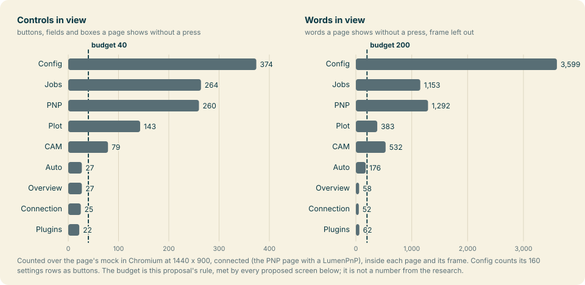
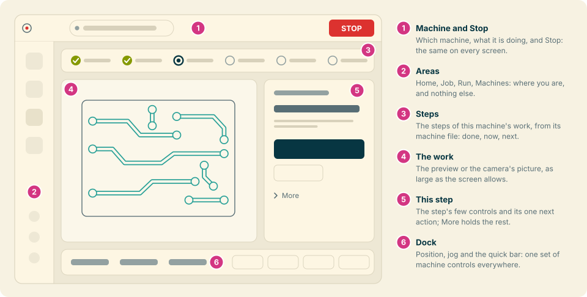
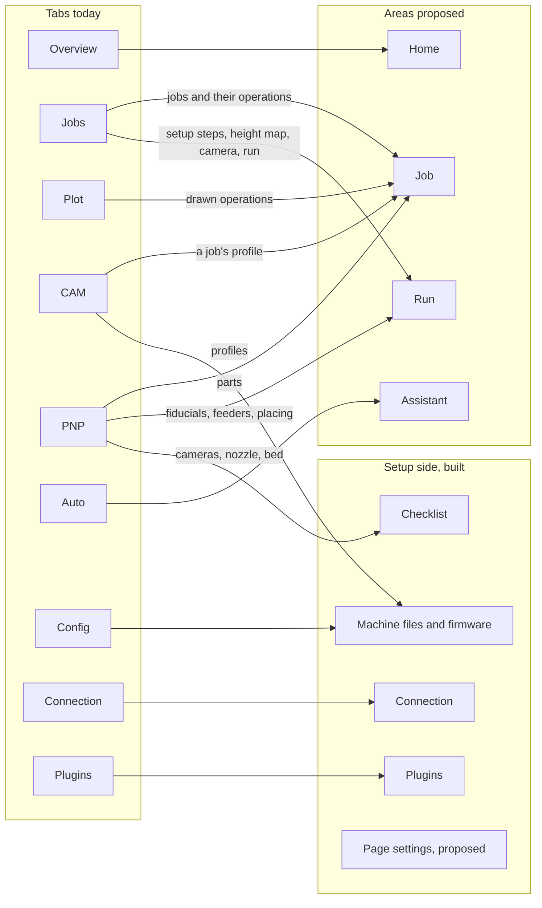
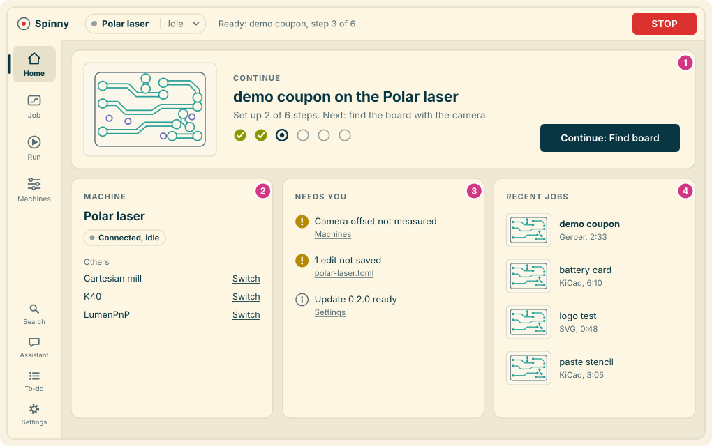
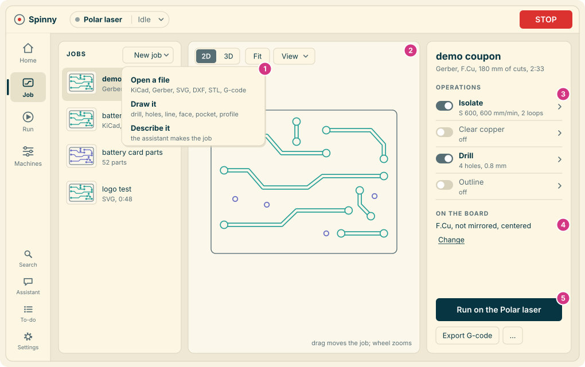
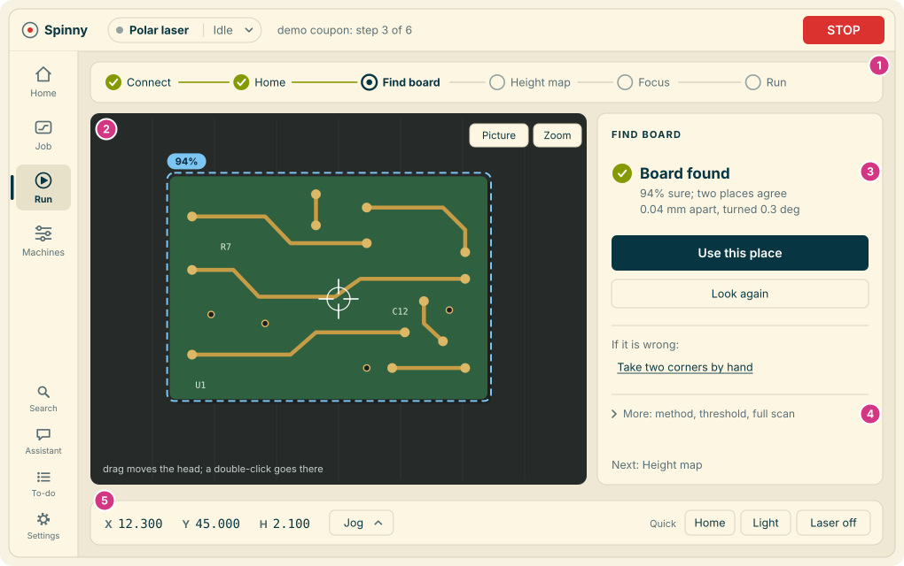
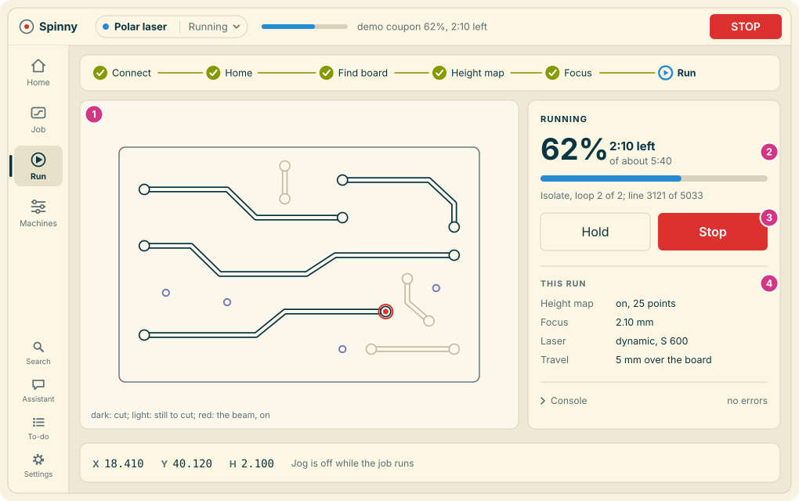
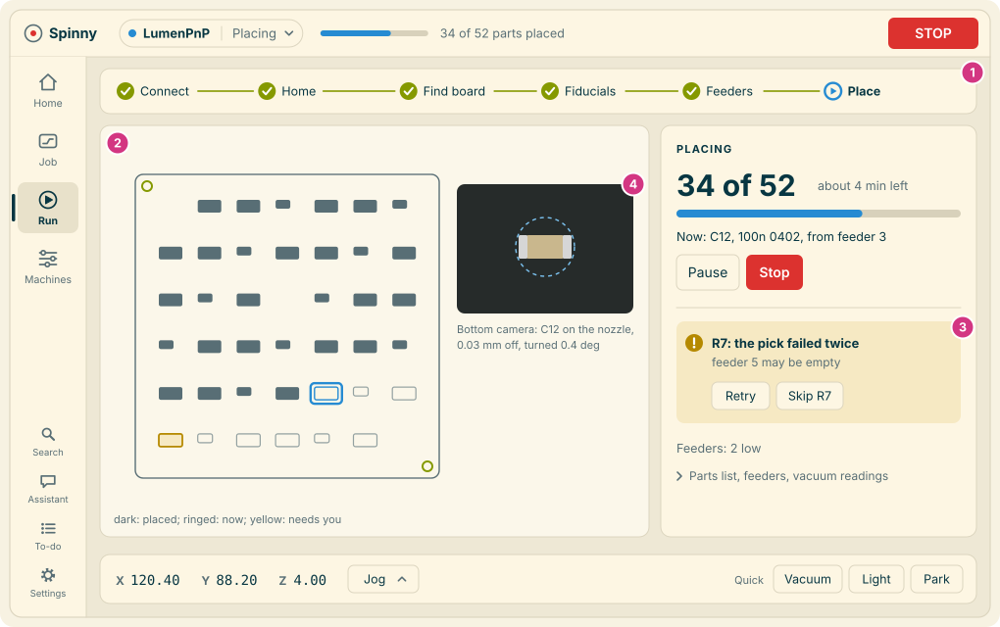
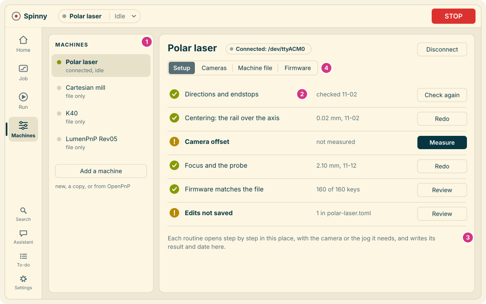
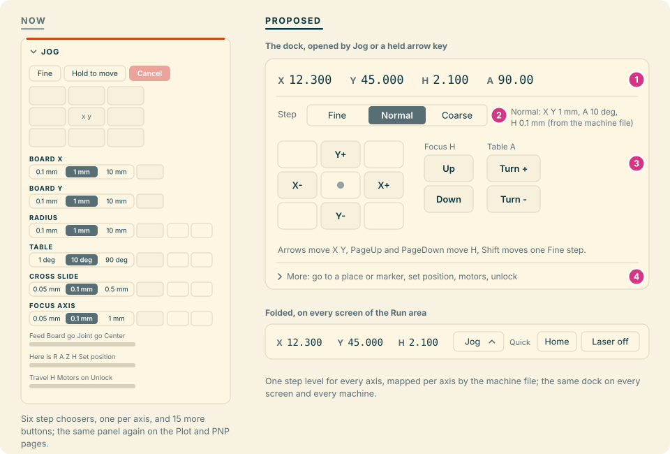

# Redesigning the page

A proposal for the whole page, applying [UI_PRINCIPLES.md](UI_PRINCIPLES.md)
to what is there today. It covers what overloads the page now, the new
frame and areas, each proposed screen, where every current panel goes, and
the order to build it in. Nothing here is built yet; the open choices are
in [QUESTIONS.md](../QUESTIONS.md) (Q43 to Q47), and the mockups apply the
recommended answer to each.

Since 46611f5 the page is two sides, Use and Setup
([UI_SPLIT.md](UI_SPLIT.md)): the Machines area proposed below became the
Setup side, a press, a pane or a tab away from the work rather than one
more area among it. The rest of this proposal now applies to the Use
side.

[UI_PANELS.md](UI_PANELS.md) sorts what is inside the panels (one
home per control, the panels after, new names). It was built on
2026-11-16 with the rail and the three areas Home, Job and Run below
(phase 4's frame, in part); its last section says what was built and
what of this proposal is still open (the steps as the spine, the dock).

The figures are drawn by [ui/figures.py](ui/figures.py) (`mise run
ui-figures`). Magenta numbers on a figure are notes, explained under it;
they are not part of the page.

## What overloads the page today

Counted over the mock in Chromium, connected, with everything a page
shows before any press (`mise run shots -- docs/ui/budget.json
var/ui-budget` prints the counts):

| Page | Controls in view | Words in view | Panels |
|---|---:|---:|---:|
| Config | 374 | 3,599 | 5 |
| Jobs | 264 | 1,153 | 15 |
| PNP, LumenPnP connected | 260 | 1,292 | 14 |
| Plot | 143 | 383 | 7 |
| CAM | 79 | 532 | 3 |
| Auto | 27 | 176 | 2 |
| Overview | 27 | 58 | 1 |
| Connection | 25 | 52 | 1 |
| Plugins | 22 | 62 | 1 |

The patterns behind the numbers:

1. **Every feature at once.** The Jobs page shows 15 panels: position,
   jog, laser, markers, setup steps, preview, job JSON, six camera panels,
   find board, console, jobs, height map, align and tests, and run. A run
   uses a handful of them at a time.
2. **Panels are features, not steps.** The Height map panel holds 12
   buttons and 9 fields of the same weight; the order to use them in is
   left to the reader ([figure](UI_PRINCIPLES.md#3-one-next-action)).
3. **Walls of locked controls.** With the camera off, Find board shows
   nine locked buttons, an empty chart and a paragraph, while the one
   action that unlocks them sits in another panel
   ([figure](UI_PRINCIPLES.md#4-show-what-the-moment-allows)).
4. **Setup mixed into operation.** The PNP page puts the camera's device,
   size and frame rate, lens and colors, and the nozzle calibration
   (mm per pixel, roll, runout) beside Place. They are set once per
   machine and checked now and then.
5. **Three copies of the machine controls.** Position and Jog appear on
   Jobs, Plot and PNP; one jog panel holds six step choosers (board X and
   Y, radius, table, cross slide, focus) and fifteen more buttons.
6. **Color everywhere.** Each page has its color on its tab and along its
   panels' edges; buttons are blue, pale blue and red; chips are colored.
   A stale height map gets no more color than a page name
   ([figure](UI_PRINCIPLES.md#6-quiet-when-normal)).
7. **Instructions inside panels.** Find board carries a 150-word
   paragraph and a "What the words mean" fold; many panels end in gray
   help lines ([figure](UI_PRINCIPLES.md#8-one-line-of-state-meaning-on-hover-how-to-in-the-guide)).
8. **Modes scattered.** Travel height, laser mode, map on or off and
   focus are set in five panels, some folded or scrolled away
   ([figure](UI_PRINCIPLES.md#7-modes-in-plain-sight)).
9. **Four tabs to make a job.** Jobs (from a file), Plot (drawn by hand),
   CAM (from a profile) and Auto (described) each make jobs on their own
   page.
10. **Heavy frame.** Nine tabs, five icons, four status chips, To-do and
    Stop, and an Overview page whose cards repeat the tabs.
11. **Coping features.** Folders, stacks, side by side, named layouts and
    peeking let the page be arranged by hand. They help, but they exist
    because the defaults show too much, and each is one more thing to
    learn.

The frame of the page is sound: Stop is always in reach, the feature
search finds any button, locked buttons say why, camera changes have an
Undo log, the setup steps already say what comes next. The proposal keeps
all of these and builds on them.

## The frame

Every screen has the same six regions, each with one job
([principle 5](UI_PRINCIPLES.md#5-places-stay-put)):

1. **Machine and Stop** (top bar): which machine, what it is doing in
   words, and Stop. A press on the machine opens the switch list (the
   Connection tab's one-press switching). Version, "live" and the mock
   chip leave the bar; the mock chip shows only on the mock, and a lost
   link shows only when lost.
2. **Areas** (rail, left): Home, Job, Run, and the Setup side's name,
   which swaps to it ([UI_SPLIT.md](UI_SPLIT.md)); below them Search,
   Assistant, To-do and Settings. This is the vertical side panel from
   TODO.md; the tabs at the top become the groups inside an area (the
   steps of Run, the Setup side's pages).
3. **Steps**: in Run, the machine's steps, read from its machine file
   (the TODO.md item "steps as part of the config per machine"). Done,
   now and next, each one press to open.
4. **The work**: the preview or a camera's picture, as large as the
   screen allows.
5. **This step**: the current step's few controls and its one next
   action ([principle 3](UI_PRINCIPLES.md#3-one-next-action)); More
   holds the rest in place.
6. **Dock**: position, Jog and the quick bar (the TODO.md "quick bar for
   common actions, default bar"), the same on every screen of every
   machine; the quick bar's buttons come from the machine file's
   `[controls]`, like the jog controls today.

## The areas

| Area | Holds | Groups inside it |
|---|---|---|
| Home | where you left off, the machine, what needs you, recent jobs | none |
| Job | the jobs; a job is its operations and its place on the board | New job: Open a file, Draw it, Describe it |
| Run | doing a job on the connected machine | the machine file's steps, ending in Run |
| Setup (the other side, [UI_SPLIT.md](UI_SPLIT.md)) | what the machine knows and where each value came from, every machine file, its connection, calibration, cameras, firmware settings; CAM profiles; plugins | its pages: Checklist, Config, Connection, Plugins; later Cameras |
| Settings (rail) | the page itself: look, layouts, bug reports, version and updates; proposed to move to the Setup side | sections in a sheet |
| Assistant (rail) | the Auto chat, as a drawer over any screen | none |

A pick and place job is a job like any other: its parts are its
operations, and Run walks the pick and place machine's own steps. That
follows the rule that a new kind of machine is a machine file driven
through the shared page, not a page of its own.

## The screens

### Home

1. **Continue** says where the work stands and what is next, with one
   button that goes there. Situation awareness is mostly "what happens
   next" ([principle 7](UI_PRINCIPLES.md#7-modes-in-plain-sight)).
2. The machine connected and its state; the others one press away.
3. **Needs you** gathers what today hides in chips, tab counts and
   panels: a calibration missing, an edit not saved, an update ready.
   Each line opens where it is fixed.
4. Recent jobs with their thumbnails. The Overview's eight cards, which
   repeat the tabs, go.

### Job

1. **New job** is one door for every way to make a job: open a file
   (KiCad, Gerber, SVG, DXF, STL, G-code), draw it (the Plot operations:
   drill, holes, line, face, pocket, profile), or describe it to the
   assistant. Plot and Auto stop being tabs of their own.
2. The preview is the largest thing on the screen. Its eleven view
   buttons become 2D or 3D, Fit, and a View menu (heights, grid, box
   select, speed, top view, turns, reset, trail, lock rotation).
3. **Operations** are rows with the numbers that matter (power, speed,
   loops; holes and their size). A row opens the operation's details in
   place: floor, height, pattern, passes, the CAM profile it follows.
   Today's per-job fields (power, speed, spot, anchor, offsets, layer,
   mirror, board, clear copper) all live here.
4. **On the board** sums the job's layer, mirror and place in one line,
   with Change.
5. **Run on the Polar laser** goes to Run with this job. Export G-code
   (the CAM page's export) and Combine, Save, Duplicate, Delete and Job
   JSON sit in the menu beside it.

### Run: a setup step

1. The steps of this machine, from its machine file: done (green), now
   (ringed), to do (empty). A press opens any step; nothing forces the
   order.
2. The camera's picture takes the screen while the step needs it. Picture
   controls (exposure, gain, focus) open from the picture's own button.
3. The step's result in words ("Board found, 94% sure; two places
   agree") and the action it allows. The guesses chart, method,
   threshold, scan and corners wait under More.
4. More holds every control the Find board panel has today, grouped and
   named, in the same place.
5. The dock, folded to position, Jog and the quick bar.

The other steps follow the same pattern: Height map
([figure](UI_PRINCIPLES.md#3-one-next-action)) shows what probing will do
and one Probe button; Focus opens the dock with the focus axis and Focus
here; the last step is the Ready card
([figure](UI_PRINCIPLES.md#7-modes-in-plain-sight)), where every mode the
run depends on is listed in words beside Run.

### Run: while a job runs

1. The preview shows what is cut, what is left, and the beam's place
   (red only while it is on).
2. Progress as a number and as time left: the question during a run is
   "how long".
3. Hold and Stop, large, side by side; the bar's Stop stays too.
4. The run's modes in words, so a wrong one shows before the end. The
   console waits folded at the foot; an error opens a line in the top bar
   that leads to it.

Jog is off while a job runs, and the dock says so instead of showing
locked buttons.

### Run with a pick and place machine

1. The same frame and steps as the laser, with this machine's own steps
   from its machine file: Connect, Home, Find board, Fiducials, Feeders,
   Place.
2. The board from above, each part drawn by its state: placed, now,
   still to place, needing you.
3. One issue at a time, with its two ways on (Retry, Skip), instead of a
   log to read.
4. A camera's picture shows itself while it has something to show (the
   part on the nozzle, a fiducial) and goes when done; its settings live
   on the Setup side.

### Setup

The Machines area became the Setup side; its first page, the Checklist,
is built and described in [UI_SPLIT.md](UI_SPLIT.md#the-checklist). The
mockup below was drawn before the split and still shows where the
machine list and the routines are meant to go.

1. One list of machines: today's Connection tab, the Config tab's machine
   pick and Use this machine, and New, in one place. Add a machine makes a
   new one, a copy, or one from OpenPnP's machine.xml.
2. **Setup** is a checklist of the machine's calibrations and checks, each
   with its result and date: directions and endstops, centering, camera
   offset, focus and probe, nozzle runout, firmware against the file,
   edits not saved. Today these are panels and buttons spread over Jobs
   (Tests), PNP (Nozzle, Head, camera panels) and Config.
3. Each check opens as a routine in this place, step by step, with the
   camera or the jog it needs, and writes its result back to the list.
   Routines suit tasks done rarely, whose steps nobody remembers between
   times; OpenPnP's Issues and Solutions walks a machine's setup the same
   way, showing only what is due so far. Someone who knows a routine can
   skip its guidance.
4. Cameras (device, size, frame rate, lens and colors, spots, the log of
   changes with Undo), the machine file editor, and the firmware settings
   (showing only the keys that differ, by default) are one tab away.

### The dock

1. Position in the axes this machine has, large enough to read from the
   machine.
2. One step level, Fine, Normal or Coarse, for every axis. The machine
   file maps a level to each axis's own step (Normal: X and Y 1 mm, A 10
   deg, H 0.1 mm), so six choosers become one.
3. The pad for X and Y, the focus axis and the table, each where its keys
   are: arrows, PageUp and PageDown, Shift for one Fine step.
4. More: go to a place or a marker, set position, motors, unlock, travel
   height, the per-axis custom steps.

Folded, the dock is one line with position, Jog and the quick bar. It is
the one set of machine controls; the Plot page's and the PNP page's
copies go ([principle 10](UI_PRINCIPLES.md#10-one-set-of-machine-controls)).

## Where every panel goes

Layer 1 is in view on its screen, layer 2 one press away in place, layer
3 on the Setup side ([principle 2](UI_PRINCIPLES.md#2-three-layers-sorted-by-how-often),
[principle 14](UI_PRINCIPLES.md#14-use-and-setup-are-two-sides)).

| Today | Goes to | Layer |
|---|---|---|
| **Frame** | | |
| Status chips (state, machine, version, live, mock) | top bar: one machine chip with its state; version to Settings; live and mock only when they matter | 1 |
| Tabs | rail of areas | 1 |
| Search, scroll to top and to end, bug, gear | rail: Search, Settings (bug report in its menu); the scroll arrows go | 1, 2 |
| To-do | rail drawer | 2 |
| Toasts | the top bar's message line; Undo toasts stay | 1 |
| Overview | Home | 1 |
| **Jobs page** | | |
| Position | dock, folded | 1 |
| Jog | dock, opened | 2 (1 in steps that jog) |
| Laser: Test beam, Laser off | quick bar | 2 |
| Laser: power, duration of the test | Test beam's More | 2 |
| Laser: mode dyn or const | the operation's details; shown on the Ready card | 2 |
| Markers | dock More: go to a marker; Draw it: Add here | 2 |
| Setup steps | the step strip | 1 |
| Preview | Job and Run canvas; view buttons to the View menu | 1, 2 |
| Job JSON | a job's menu | 3 |
| Camera view | Run canvas in the steps that use the camera | 1 |
| Camera: Start, Stop, Look once | in the step that needs the camera | 1 |
| Camera: device, size, fps, spots | Setup, Cameras | 3 |
| Camera: offset, Center nozzle, runout | Setup, Setup routines | 3 |
| Picture controls | the picture's own popover | 2 |
| Lens and colors | Setup, Cameras | 3 |
| Camera changes | Undo toasts; Setup, Cameras, Changes | 1, 3 |
| Find board | Run step Find board: result and action; method, threshold, scan, corners in More | 1, 2 |
| Console | Run step panel, folded; errors in the top bar | 2 |
| Jobs: list, drop, pick a file | Job list and New job | 1 |
| Jobs: power, speed, spot, anchor, offsets, layer, mirror, board, clear copper | Job operations and On the board | 1, 2 |
| Jobs: Combine, Save job, Delete all | the job menu | 2 |
| Height map | Run step Height map: what probing will do and Probe; the rest in More | 1, 2 |
| Align | Find board's More: line up by marks (its own step on a machine without a camera) | 2 |
| Tests | Setup, the Checklist page (moved, 46611f5) | 3 |
| Run | Run step Run: the Ready card; Hold and Stop while running; pick up at a line in More | 1, 2 |
| **Plot page** | | |
| Position, Jog | dock | 1, 2 |
| Spindle | quick bar (on, off); speed in the operation | 2 |
| Preview, Run | Job canvas, Run area | 1 |
| Operation | Job, New job, Draw it; Add an operation | 1 |
| Markers | dock More; Draw it: Add here | 2 |
| **CAM page** | | |
| Profile pick | Job, an operation's details | 2 |
| Axes, tools, operations, the profile file | Setup, CAM profiles | 3 |
| Preview | Job canvas | 1 |
| Export | Job menu: Export G-code | 2 |
| **PNP page** | | |
| Parts, Board | Job, a pick and place job: parts as its operations, the board as its canvas | 1 |
| PNP jog | dock | 1, 2 |
| Find board | Run step Find board, shared with every machine | 1, 2 |
| Bottom and top camera, five panels each | as the Jobs page's camera panels | 1, 2, 3 |
| PNP steps | the step strip | 1 |
| Placing | Run step Place: progress, Pause, Stop, the issue; run the rest, window, repeat in More | 1, 2 |
| Head: Light, Park, Vacuum | quick bar | 2 |
| Head: nozzle and camera moves, Read vacuum, Tune | Setup, Setup routines | 3 |
| Board on the machine | Run step Fiducials: Find fiducials and the result; references by hand in More | 1, 2 |
| Feeders | Run step Feeders: what is low or missing; slots on the Setup side | 1, 3 |
| Machine view | Setup, Bed; the bed map as Find board's canvas without a camera | 3 |
| Nozzle | Setup, Setup routine Nozzle and up camera | 3 |
| **Other pages** | | |
| Auto, What it can do | Assistant drawer; New job, Describe it | 2 |
| Machine file | Setup, Machine file | 3 |
| Import from OpenPnP | Setup, Add a machine | 3 |
| Version | Settings, About and updates; Home, Needs you | 3 |
| Bug reports | Settings, Bug reports | 3 |
| Settings (firmware keys) | Setup, Firmware, differences only by default | 3 |
| Connection | Setup, Connection; the top bar's machine chip | 1, 3 |
| Plugins | Settings, Plugins | 3 |
| Panel layouts, hidden panels | Settings, Layout (Q47) | 3 |

## Building it

Each phase ships on its own and leaves the page better than it found it;
the smallest come first.

0. **Two sides** (built, 46611f5): Use and Setup, swapped, side by side
   or in tabs of their own, linked both ways; the Checklist; the backend's
   `changed` event ([UI_SPLIT.md](UI_SPLIT.md)).

1. **Quiet the page.** Color only for states: "Colors for tabs and panels"
   off by default, the next action's button dark, blue only for work in
   progress (Q44). Instructions out of panels: hints to tooltips, the
   "What the words mean" folds to hover meanings (the TODO.md item),
   procedures to the guide behind a question mark. Locked walls replaced
   by the action that unlocks them. Undo in place of confirms where the
   action can be undone. Alarms and a lost link latch in the top bar until
   acknowledged; every press shows a change within a tenth of a second.
2. **One dock.** One position, jog and quick bar component in place of the
   three; one step level mapped per axis in `[controls]` (Q46); the quick
   bar's default in the machine file.
3. **Steps as the spine.** Step lists in the machine file; a step shows
   its own panel; each panel split into its layer 1 and More; the Ready
   card before Run.
4. **Areas.** The rail (Q43); Job takes Jobs, Plot, CAM's profile pick
   and Auto's job making (Q45); Run takes the setup steps and placing;
   the Setup side takes the camera settings, calibrations
   and CAM profiles; Home replaces Overview.
5. **Hold the line.** The budget becomes a check in `mise run
   test-layout`: each screen's default state within 40 controls and 200
   words ([principle 13](UI_PRINCIPLES.md#13-a-budget-measured)).

The panel layer (folds, stacks, folders, side by side, named layouts)
keeps working throughout, since a step shows panels; Q47 asks what it
should become once screens fit their budget.

## Checking that it worked

- The counts: `mise run shots -- docs/ui/budget.json var/ui-budget`
  before and after each phase, against the budget.
- A timed run: from opening the page to a running job on the demo
  coupon, and to a placed board on the virtual LumenPnP, counting presses
  (the bug report already logs the last 200).
- A cold start: someone who has not used the page runs the demo coupon
  with no help but the page; where they stop is the next thing to fix.
