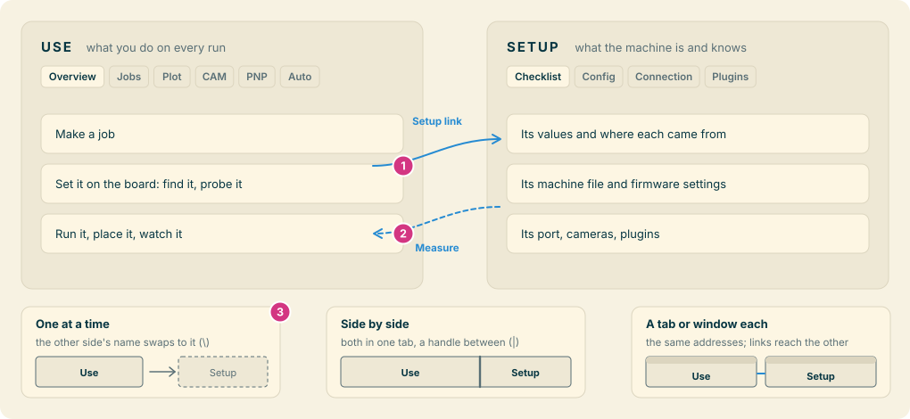
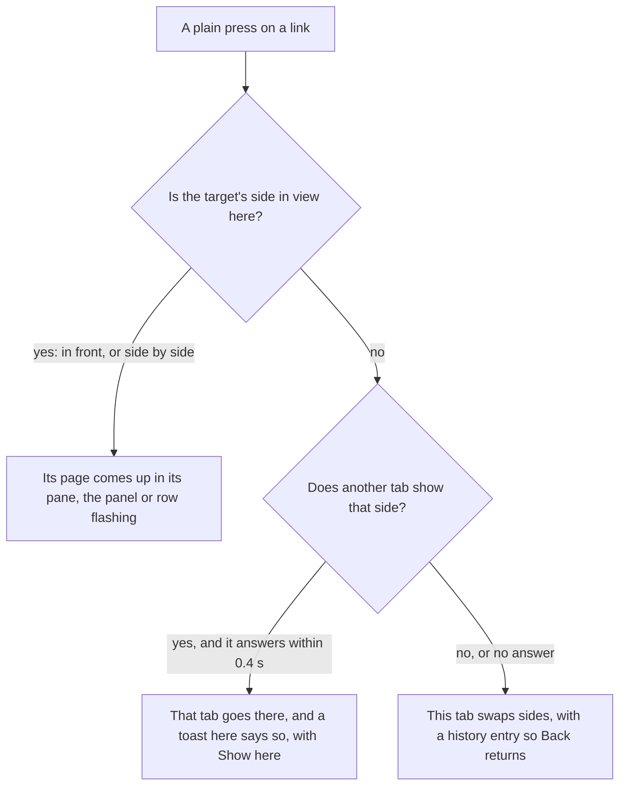
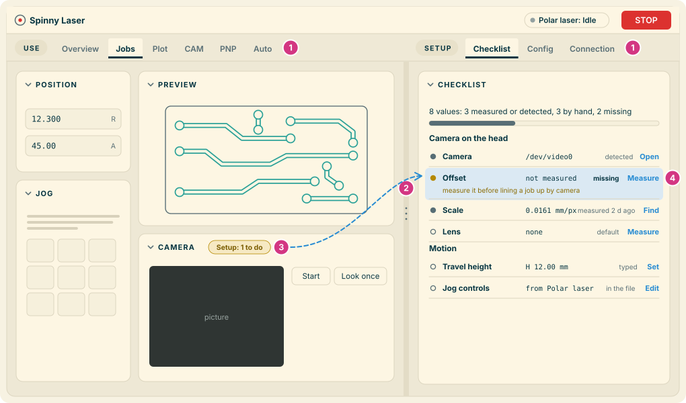
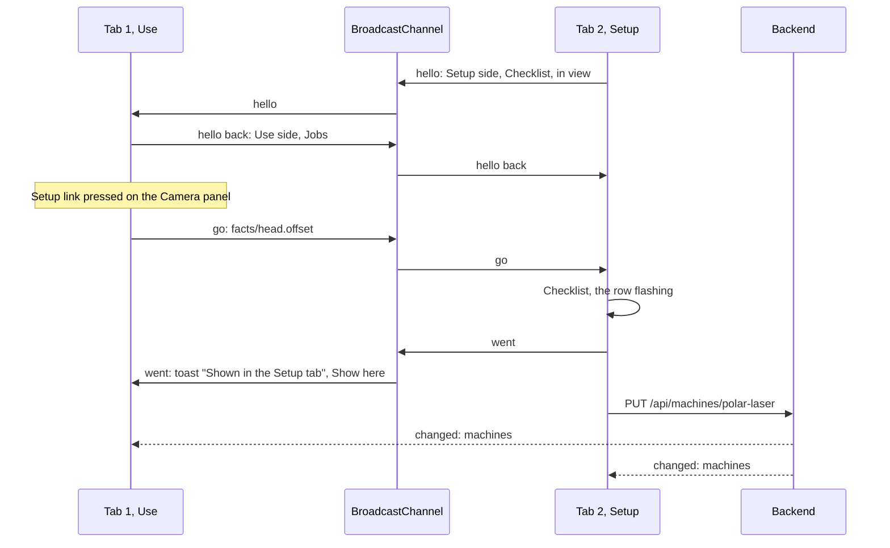
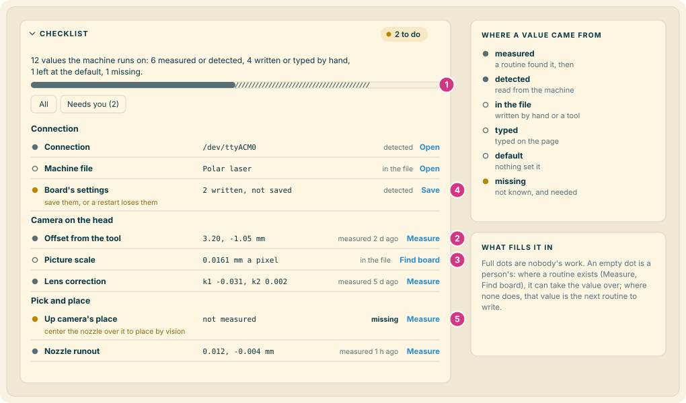
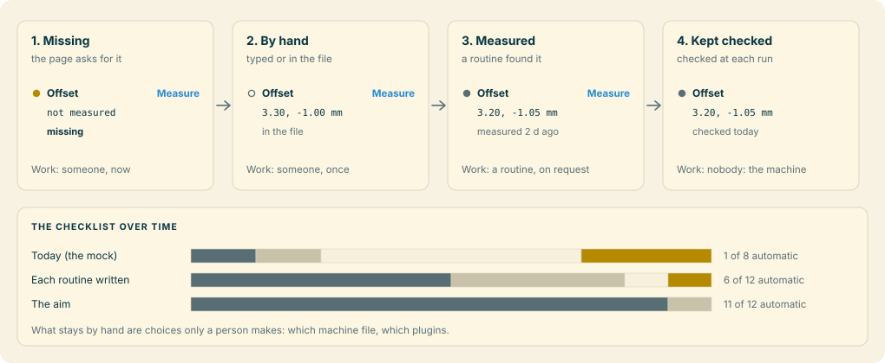

# Use and Setup: the page's two sides

The page has two sides. **Use** is what is done on every run: make a
job, set it on the board, run it, place it. **Setup** is what the machine
is and knows: its values and where each came from, its machine file and
firmware settings, its connection, the plugins. Either side swaps in with
one press, both can show side by side in one browser tab, and each has
an address of its own, so it can sit in a tab or window of its own beside
the other. Links run between them: a Use panel links to the setup values
it runs on, and a setup value links to the routine that measures it.

The aim on the Setup side is that people set as little as possible. Its
first page, the Checklist, lists every value the machine runs on with
where it came from (measured, detected, written by hand, the default,
missing), so the share still set by hand is the list of routines to
write next.

This applies [UI_PRINCIPLES.md](UI_PRINCIPLES.md) (principle 14) and
replaces the Machines area of [UI_REDESIGN.md](UI_REDESIGN.md). The sides,
the links, the tabs that know of each other, side by side and the
Checklist are built (46611f5); keeping values checked by themselves and
moving the rest of the setup panels are proposals, marked as such. The
figures come from [ui/figures.py](ui/figures.py) (`mise run
ui-figures`); magenta numbers are notes, explained under each figure.

## Why two sides

1. A Use panel that runs on a setup value links to it, instead of holding
   it.
2. A setup value links to the routine that measures it, wherever that
   routine lives.
3. Both sides at once, three ways: swap them, put them side by side, or
   give each a tab or window of its own.

The audit's fourth pattern was setup mixed into operation: the camera's
device, size and frame rate, its lens and colors, and the nozzle
calibration sat beside Place, set once per machine and checked now and
then ([UI_REDESIGN.md](UI_REDESIGN.md#what-overloads-the-page-today)).
The redesign moved them into a Machines area among Home, Job and Run,
which still treats setting the machine up as one more task of the
running page. Two sides make the split part of the frame instead:

- **Different rhythms.** Use is every run; Setup is once per machine and
  now and then after. Mixed, the rare controls cost attention on every
  run [Sweller 1988], and the frequent ones get lost among them.
  Control-room practice keeps the operator's displays apart from the
  engineering and maintenance ones, by role [ISA-101].
- **Seen together when it matters.** Swapping screens hides one while the
  other shows, the keyhole effect [Woods 1984]. Setting a value up while
  watching what it does (the camera's picture and its offset, the jog
  and its steps) is when both are needed at once, so either side can
  show beside the other, in one tab or two windows.
- **Most of it should run itself.** A value a routine measured or the
  page detected needs nobody, only a place to see it and a way to measure
  it again. Software can take complexity off the operator only where it
  can work the value out [Tesler]; where it cannot yet, the Checklist
  says so. Automation that hides what it did leaves people unable to
  catch it when it is wrong [Bainbridge 1983], so every value shows
  where it came from and when.

Sources are listed in [UI_PRINCIPLES.md](UI_PRINCIPLES.md#sources).

## What goes on which side

The rule: a value or a control that changes with the job or the run is
Use's; one that describes the machine (set once, measured, checked now
and then) is Setup's; a routine that measures a setup value belongs with
it. A Use panel never holds a setup value; it links to it.

| Side | Pages now | Holds |
|---|---|---|
| Use | Home, Job, Run (areas on a rail since 2026-11-16, [UI_PANELS.md](UI_PANELS.md)) | jobs and how they are made, the preview, finding the board, heights and focus, the cameras' pictures, runs, placing, the machine's position and jog |
| Setup | Checklist, Machines, Cameras, CAM, Page | what the machine knows and where each value came from, the calibration tests, the machine files, the connection and firmware settings, each camera's settings and routines, a pick and place head and bed, the CAM profiles, the page's version, bug reports and plugins |

Moved so far: the machine files, connection and plugins; the calibration
Tests panel; and since 2026-11-16 each camera's device, size, rate,
spots, lens and colors, picture controls, changes and calibration
routines (Find mark, Measure camera, Center nozzle, runout), the pick and
place Head's moves and tuning, the Machine view, and the CAM profiles.
Proposed next: the page settings beyond the gear's quick ones.

## Addresses

An address names a side, a page and a target in it:

    /?side=setup&page=facts#facts/head.offset
    /?side=setup&page=machines#machine-file/polar-laser
    /?page=run&split=1

- `side`: `use` or `setup`. Alone, the side opens on the page it showed
  last in this browser.
- `page`: a page id. A page implies its side; an old page's name opens
  where its panels went (`?page=config` the Machines page, `?page=pnp`
  the Run area).
- `#panel/detail`: a panel's id, and after the slash what that panel is
  asked to show in itself (a fact's id, a machine file's id, a setup in
  the steps panel). The view hears the detail as a `spinny:goto` event.
- `split=1` shows both sides for this load; the bar's button keeps it.
- Every other parameter (`mock`, `api`) is kept in every link, so a link
  opened in a new tab talks to the same backend, or the same mock.

Once the page moves on by its own tabs, the address goes back to the
plain one, so a reload opens where the tab was last rather than where an
old link led.

## Links

Links are real `<a href>` links. The browser's own ways work: the middle
button or Ctrl opens the target in a new tab, a right click copies the
address, a drag drops it in the tab bar. A plain press is followed by
the page:

- **Setup links in Use panels.** A Use panel whose work depends on setup
  values (the camera, Find board, Align, the height map, the jog panels,
  the PNP run) carries a Setup link in its head. All set, it is quiet;
  when a value it runs on needs someone, it turns the color for "needs
  you" and counts: "Setup: 1 to do". Its tooltip lists each value with
  its source.
- **Back.** Back (the browser's, or the other side's name in the bar)
  returns to the page shown before the link.
- **The top bar.** The machine's state opens the Connection panel, on
  the Setup side's Machines page: in view, in the tab that shows it, or
  here.

## Both at once

1. Each side's name and tabs sit over its own pane; the side folded away
   shows only its name, which swaps to it (`\`).
2. The handle between the panes sets their widths; the arrow keys move
   it, a double click gives back the usual share. `|` (or the bar's
   button) puts the sides side by side and back.
3. The Camera panel's Setup link, in the color for "needs you": the
   offset from the tool is missing.
4. Pressed, the row it names flashes in the other pane; nothing swaps.

Side by side, each pane lays its page out by its own width, not the
window's (CSS container queries): on a 1920 px screen the Use side keeps
its three columns and the Setup side stacks its panels in one. A window
narrower than about 1000 px (64 rem) shows one side at a time.

Two tabs or two windows work the same way, and a browser that shows two
tabs side by side, or two windows snapped side by side, gives the same
view as the split with each side at the full height. The tabs know of
each other:

- **Which tab a link goes to.** One that shows the target's side (or
  both); a tab in view before one behind others; then the one that had
  the focus last. A tab that does not answer within 0.4 s is forgotten
  and the link goes here. A browser lets a tab bring itself to the front
  only now and then, so the toast says where the target went.
- **One channel per backend.** Tabs talk only to tabs of the same backend
  (`?api=`), and the mock's apart from a real backend's.
- **What keeps them in step.** The machine's state, runs, cameras and
  the like come to every tab from the backend's events, as before. Since
  5272338 the backend also says when a machine file, the firmware
  settings or a CAM profile is written (`changed`, in
  [WEB_API.md](WEB_API.md#events)), so a tab re-reads what another tab,
  another computer or the MCP tools saved; the Config editor follows a
  file saved elsewhere unless it holds edits of its own.
- **What does not.** The page settings kept in the browser (panel
  layouts, the look, the tab settings) are read when a tab opens. Edits
  typed and not saved live in the tab that holds them; that tab's bar
  counts them on the side's name.

## The Checklist

1. How much of what the machine runs on is automatic (solid: measured or
   detected) and how much a person set (hatched); the rest is defaults
   and missing values. It is a share, not a state, so it stays gray.
2. A value a routine measured, with when. It stays "measured" while the
   value is still the one the routine applied.
3. A value written in the file, though a routine exists that could find
   it (Find board): an empty dot is a person's work.
4. A value read from the machine that still needs someone: settings
   written to the board and not saved to its flash.
5. A missing value, what it is needed for, and the link to the routine
   that measures it.

Each row is a fact: its value, its source, when it was measured, what
can fill it in (a routine, the page detecting it, or a person only), what
it needs now, the target where it is set or measured, and the Use panels
that depend on it (which link back to it from their heads). A fact is
listed only when it fits the machine: no camera rows without a camera, no
pick and place rows without a placing machine.

Where a value came from is read from what the page already holds. Every
camera routine records what it applied in the findings log (target,
parameter, value before and after, time); a value equal to what the
newest such entry applied was measured then, and one that differs was
changed by hand since. An undone result, or an undo as the newest entry,
counts as no measurement.

To add a fact: a rule in `FACT_RULES` in
`web/frontend/src/facts.ts` (its group, the Use panels that depend on it,
when it fits, how its value and source are read), and a case in
`web/frontend/tests/facts.test.ts`. The Checklist and the Setup links in
the Use panels' heads follow the rules with no other change.

## Toward a machine that sets itself up

A value goes four ways, each less work than the one before: missing (the
page asks), by hand (typed or written in the file), measured (a routine
found it, on request), kept checked (proposed: the machine checks it at
each run, and asks only when a check fails). The working rule: **a value
a person types is a routine not written yet**, unless it is a choice only
a person can make (which machine file, which plugins). The Checklist's
empty dots with no routine behind them are that list.

What the Checklist shows today, as candidates (proposals, none built):

- **Travel height** is typed. It could be measured: the highest probed
  point plus the clamps' height, or a touch on the tallest clamp.
- **Picture scale** in the file could always come from the board look,
  which already measures it once the board is found.
- **Board's settings not saved** could save themselves after a write
  that went through, or Run could offer it.
- **The routines that measure setup values** (the camera offset steps,
  Center nozzle, runout) live on the Use side's pages today and are
  linked; moved to the Setup side, each could run from its row.
- **Kept checked.** A check that moves nothing (a look at the mark, the
  firmware's answer at connect) could run by itself and mark a value
  stale; one that moves the machine runs only on a press
  ([QUESTIONS.md](../QUESTIONS.md), Q50).
- **More facts.** The polar machine's centering, steps per mm, endstops,
  the probe's offset, and the backend's own view of the list (so the MCP
  tools and the Auto tab read the same facts).

## Checking it

- `cd web/frontend && bun test tests/sides.test.ts tests/facts.test.ts`:
  addresses, the sides and the split, the tabs on a channel, link
  routing (here, another tab, swap and Back), the Checklist's sources and
  the Setup links.
- `mise run test-layout` visits the Checklist in every state, and both
  sides side by side.
- In a browser, over the mock: open `/?mock=1&page=jobs` and
  `/?mock=1&side=setup` in two tabs, and press the Camera panel's Setup
  link in the first.
