# The page as it looks: a visual analysis

[UI_PRINCIPLES.md](UI_PRINCIPLES.md) says how the page should be designed and
[UI_PANELS.md](UI_PANELS.md) sorted what is inside each panel. Both counted
controls. This document looks at the screens themselves, as the eye meets
them: what stands out, what the window is spent on, where the next action
is. It was made on 2026-11-16, after the rail and the areas were built, and
it is the reason for the redo described at its end. On 2026-11-21 the
redo's views, steps and dock gave way to modes (every panel an area's
mode shows, at once; OPERATING.md, Modes and Auto); the layers inside the
panels, the quiet look and one step size stay.

## What was looked at

70 screens over the page's mock in Chromium: every area and Setup page with
nothing connected, with the polar laser and with the LumenPnP; a job
picked, running, the camera started; the pop-ups (page settings, search,
a panel's menu, the import settings, To-do, side by side); windows of 390,
820, 1280, 1440 and 1920 px; the dark theme; and each page in a window tall
enough to show all of it.

To look again: `mise run shots -- docs/ui/visual.json OUT` writes the
thirteen screens below and prints what each one's first view holds
(`"measure": true` on a shot, web/frontend/layout/measure.ts): the controls
and words in the window before any scroll, the controls locked, the type
sizes and text colors in use, the boxes drawn and how deep they nest, the
filled colors, the share of the window showing the work (the preview, a
camera's picture, the board), and how far the longest column scrolls on.
It counts the screen at rest: a message passing by is let go first, and
what a shut fold holds is not counted. `mise run test-budget` holds every
view of every area to the budget ([After](#after)).

## The short answer

The page shows what the software can do. The operator needs to see what the
job needs next. Every screen is a grid of panels of equal weight, each
showing its whole feature, so nothing leads: the eye has no first place to
land, the work itself is hardly on the screen, and the next action is
somewhere else. Moving panels between pages (the areas, built the same
day) did not change that: a screen still shows every panel it owns.

## What the first view holds

At 1440 by 900, before any scroll or press, the page before the redo
(commit 8caaa5d, measured again on 2026-11-17 with the instrument as it is
now, so this table and the one under [After](#after) compare like with
like):

| Screen | Controls in view (page) | Words in view (page) | Boxes (deep) | Type sizes | Text colors | Filled colors | Work % | Scroll |
|---|---:|---:|---:|---:|---:|---|---:|---:|
| Home, nothing connected | 22 (23) | 100 (100) | 19 (2) | 6 | 6 | red 1 | 21 | 1x |
| Job, a job picked | 79 (167) | 183 (458) | 83 (3) | 9 | 8 | blue 3, red 1 | 25 | 4.3x |
| Run, polar laser | 81 (169) | 284 (615) | 99 (4) | 11 | 11 | blue 5, red 4, green 2 | 0 | 2.7x |
| Run, a job running | 81 (169) | 293 (989) | 102 (4) | 11 | 11 | blue 5, red 4, green 2 | 0 | 2.7x |
| Run, LumenPnP | 66 (184) | 298 (762) | 112 (4) | 11 | 11 | blue 8, red 4, green 1 | 0 | 3.1x |
| Checklist | 35 (36) | 175 (180) | 34 (3) | 8 | 9 | red 1 | 0 | 1.1x |
| Machines | 42 (372) | 319 (3610) | 77 (3) | 11 | 8 | blue 2, red 1 | 0 | 17x |
| Cameras, LumenPnP | 69 (123) | 269 (489) | 74 (3) | 8 | 8 | red 2 | 6 | 2x |
| CAM | 50 (65) | 191 (505) | 84 (3) | 10 | 10 | red 1, blue 1 | 0 | 1.7x |
| Page | 30 (31) | 140 (140) | 27 (3) | 8 | 8 | red 1 | 0 | 1x |
| Run on a phone (390 px) | 29 (166) | 84 (602) | 33 (3) | 9 | 9 | red 2, green 2 | 0 | 1x |

Home's 21% is its empty preview: a picture of no job.

The budget in principle 13 is 40 controls and 200 words a screen. Run holds
twice that in its first view and four times that in all.

## What the eye meets

### 1. No screen has a first place to look

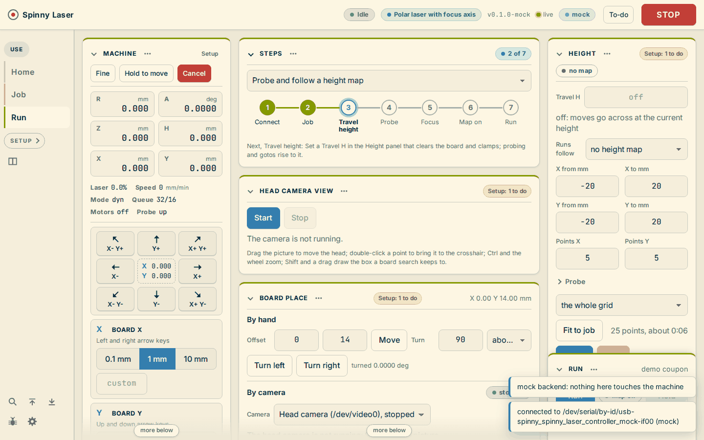

Run draws 99 boxes in its first view, nested four deep: panels, boxes in
panels, fields in boxes. Each panel has the same head (a chevron, a title
in capitals, a dots menu, a colored top edge) and the same weight. Text is
set in 11 sizes between 11.5 and 17.6 px and 11 colors. Six panels start
within the first screen and each of the three columns scrolls on for more
than two screens of its own, marked by three "more below" presses.
Nothing is larger, darker or more central than anything else, so the
screen is read item by item, every time.

### 2. The work is not on the screen

The share of the Run window showing the work is 0%. There is no preview of
the job in the area that runs it: the toolpath, the board and the head's
place on it are in the Job area. The camera's picture is a Start button and
two lines of instructions until started, and then opens below the fold.
On Job the preview has a quarter of the window, under two rows of ten view
buttons. A machine page should be mostly a picture of the machine's work
with a few controls beside it; this one is the reverse.

### 3. The next action is never where the eye is

- **Connect**, the first action of every session, is on the other side of
  the page (Setup, Machines). Home, the page meant to say where things
  stand, has no button that acts on the machine: seven cards that repeat
  the rail.
- **Run**, the reason for the Run area, is a narrow panel docked in the bottom
  right corner, its buttons under the toasts.
- The Steps panel says what comes next in a gray line ("Set a Travel H in
  the Height panel"), and the control it names is in another panel, in
  another column, below the fold.

From opening the page to a running job on the demo coupon takes six or
seven presses over two sides and three pages, with one scroll.

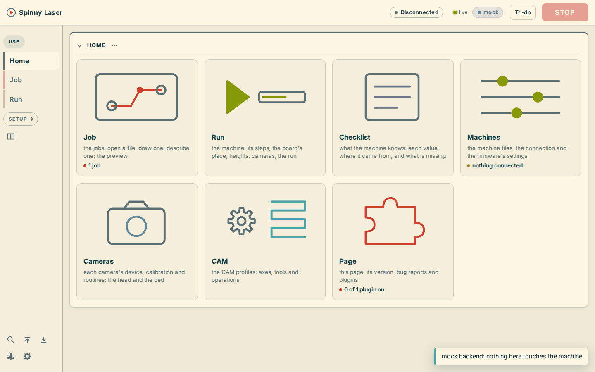

### 4. The screen does not change with the state

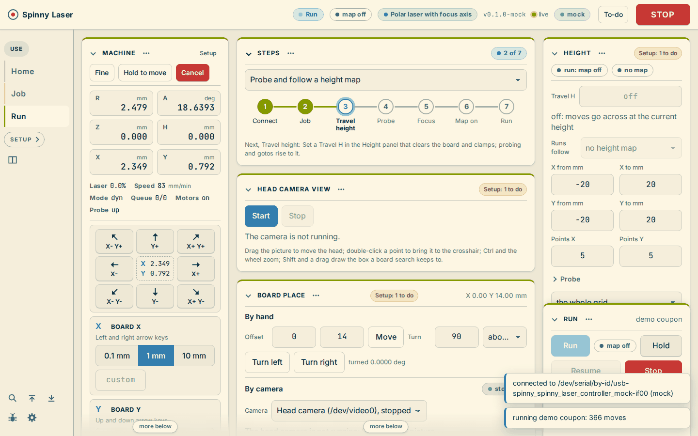

A running job looks like an idle machine: the same six panels, the jog pad
that cannot be used, the camera's Start. Progress is a thin bar in the
corner panel, behind a toast. With nothing connected Run still shows 221
controls, most of them locked or without meaning, and the one action that
would change that is elsewhere.

### 5. A panel shows its whole feature

- **Machine**: six step choosers (board X, board Y, radius, table, cross
  slide, focus), each a box with three steps, a custom field, two moves and
  a zero; then go to, set position, motors, the beam's test, the laser's
  mode and the markers. About 66 controls, two screens tall, on Run and
  again on Job.
- **Height**: travel height, how runs follow the map, six fields for the
  area and the points, a probe fold, Fit to job, Probe, Stop, the pads
  probe with its two fields and Plan, three ways to tie the map, focus
  offset, Focus here, Rayleigh, Save, Load, Clear, and five paragraphs.
- **Board place**: by hand, by camera, corners, features and marks all
  open; with no board job, a row of six locked buttons, an empty chart, a
  threshold slider and a method choice.
- **Preview**: ten view buttons in two rows before the picture.
- **Draw**: the operations for a mill's plot job, always beside the
  preview, also when the job is a board file for a laser.

### 6. The frame is heavy, and partly in code

- The rail shows one side at a time: SETUP folds the three Use areas away
  and USE folds the five Setup pages away, so half the navigation is
  always hidden. Below it sit a side-by-side icon and five more icons with
  no names (search, to the top, to the end, bug, gear).
- The top bar holds five chips (state, machine, version, live, mock), To-do
  and Stop. Three of the chips never change during a session.
- Every panel head carries the layout tools: fold, a 13-item menu (fold,
  hide, move four ways, stack two ways, stick, new folder, fit, reset,
  edit), a height handle. The page settings sheet holds 20 more controls
  for arranging the page. These exist because the screens show too much.
- On a phone the top bar and the tabs take 250 of 844 px before any
  content, and the two toasts another 130.

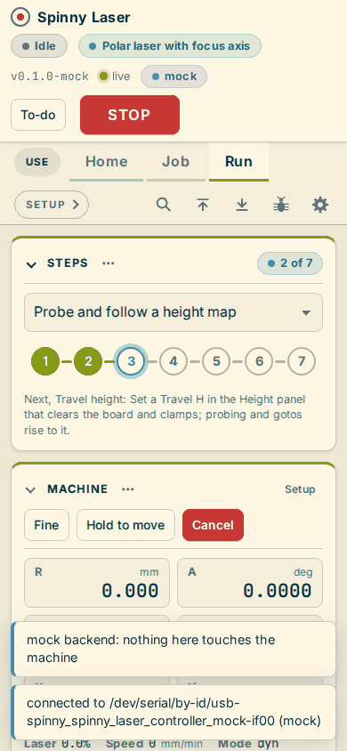

### 7. Color says nothing

- Each area has a color of its own on its tab and along the top edge of
  every one of its panels (orange, olive, gray, yellow, violet, cyan,
  red): decoration on every box.
- Blue means three things: the next action (Start, Probe, Run), a choice
  that is on (1 mm, Heights, dyn) and a link.
- Red fills Stop in the bar, Cancel in the jog, Test beam, the console's
  Reset, the probe's Stop and the run's Stop, at rest. The one button that
  must be found in a hurry has four look-alikes.
- Three yellow "Setup: 1 to do" chips sit on one screen.

### 8. Words and numbers at one weight

- Instructions are printed in the panels: how to drag the camera's
  picture, what Probe pads does, what tying the map is for. They are read
  once and seen forever.
- Every field is a 44 px box with its label above it, so six numbers take
  a quarter of a column; a value that changes every run and one set once
  look the same.
- The readout's status line is six terms in a code font ("Mode dyn Queue
  32/16 Motors off Probe up"), given the same room as the position.

### 9. Messages cover controls

Toasts stack in the bottom right corner, over the Run panel, and stay for
seconds. Two are there on every start (the mock's note, the connection's
path), and a long port path runs out of its box.

### 10. Details that mislead

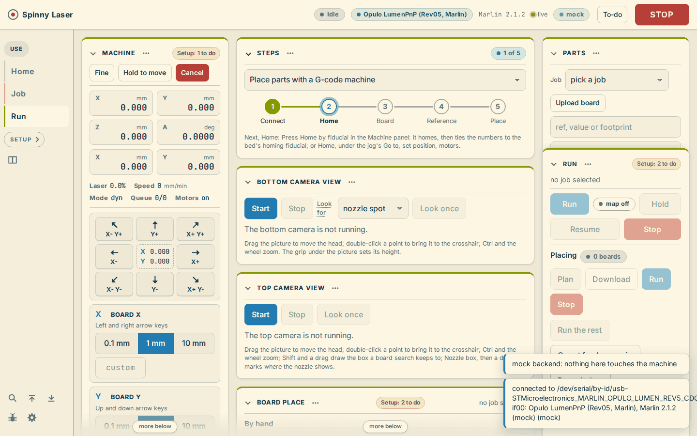

- With a pick and place machine the Run panel holds two Run and two Stop
  buttons (the job's and the placing's), next to the bar's Stop.
- The readout names X and Y twice (the machine's and the board's).
- The Job panel's table is cut off at its fourth column.
- In the Jobs panel's head the only button that is always live is Delete
  all.
- The search lists "more below" five times among its matches: the layout's
  scroll marks are found as features.
- At 820 px the jog pad's arrows stretch to 240 px wide each.
- The camera pages draw each camera's four panels as a pile of folder tabs
  two and three rows deep.

## Screen by screen

- **Home**: calm, and empty of meaning: nothing about the machine's state
  beyond one line in a card, no next action, no jobs.
- **Job**: the best of the screens (the preview leads), spoiled by the
  Draw panel, the view buttons, a job row that wraps into five lines and a
  Job panel too narrow for its table. Below the fold: Job JSON, the
  Machine panel again, the Assistant.
- **Run**: the worst. See 1 to 5.
- **Checklist**: readable; values in a code font at the same weight as
  their names; the two to do are not the first thing seen.
- **Machines**: the connection is clear; the machine file panel mixes the
  pick, New, Delete, Write, Read, a find and the editor; the settings
  column is 160 rows and 17 screens long with a paragraph on top.
- **Cameras**: piles of folder tabs, fields in three widths, Apply three
  times in one column.
- **CAM**: a table of fields; clear enough for a page used rarely.
- **Page**: fine.

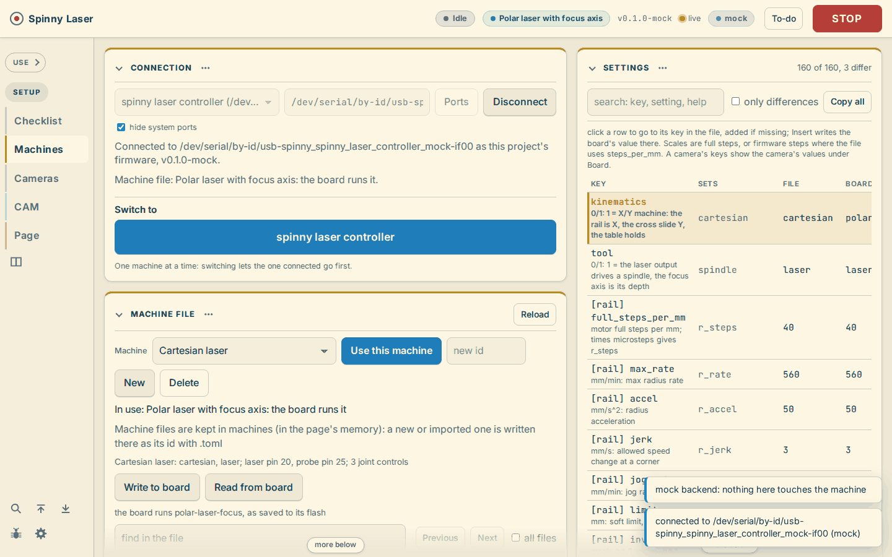

## The redo

The findings share one cause, so the redo changes one thing first: **a
screen shows one view of its area, not every panel the area owns.**

1. **Views.** Each area lists its views across its top and shows one at a
   time. A view is a few panels in fixed places: the work on the left, as
   large as the window allows, and what acts on it on the right. Run's
   views are the steps of a run for the machine connected (Connect, Job,
   Board, Height, Run for a laser; Connect, Home, Parts, Board, Feeders,
   Place for a pick and place machine), numbered, marked done, with Back
   and Next and one line saying what the step is for. Job's views are the
   ways to make a job (Jobs, Draw, Assistant, JSON). The last view of every
   area is All: every panel, arranged as before by the layout tools, for
   whoever wants the old screen. (Findings 1, 4, 5.)
2. **The work on the screen.** Run gets the job's preview, with the
   head's place and the run's trail, beside the camera's picture; it is
   the largest thing in every step. (Finding 2.)
3. **The next action in view.** Connect is in the top bar and on Home.
   Home says where things stand and offers the one next thing. Each step
   has one dark button. A press on Run in the Job area takes the job to
   the Run step. (Finding 3.)
4. **One dock.** The Machine panel becomes a dock at the foot of every
   step: the position always in view, the jog one press away, one step
   size (fine, normal, coarse) for every axis. (Findings 5, 10.)
5. **A quiet frame.** Both groups of the rail show, named Use and Setup;
   the rail's tools have names; the bar keeps the machine, the run and
   Stop. Panel heads lose the capitals and, outside the All view, the
   layout tools. Area colors are off. (Findings 6, 7.)
6. **Color for state only.** The next action is dark, a choice that is on
   is drawn pressed, blue is work under way, yellow needs you, red is Stop
   and danger; a hazard at rest is outlined, not filled. (Finding 7.)
7. **Layers inside panels.** What every run uses stays in view; the rest
   folds under More in the same panel; instructions become hover meanings.
   Fields are smaller on a screen with a mouse and stay large on a touch
   screen. (Findings 5, 8.)
8. **Messages out of the way.** Toasts move off the controls and wrap,
   and the mock's note, there on every start, goes. (Finding 9.)

The redo keeps what the page had right: Stop always in reach, the search
that finds any control, locked buttons that say why, Undo on camera
changes, the Setup side and its Checklist, and every panel's own logic,
which the views only arrange.

What was built, what the screens hold after it and what is left is under
[After](#after).

## After

Built on 2026-11-16 and 17: the frame (947e6f3), the layers inside the
panels (bc23953, aec321b), and every view under the budget with a check
that keeps it there (d4dee4e). The same screens, measured the same way:

| Screen | Controls in view (page) | Words in view (page) | Boxes (deep) | Type sizes | Text colors | Filled colors | Work % | Scroll |
|---|---:|---:|---:|---:|---:|---|---:|---:|
| Home, nothing connected | 21 (22) | 75 (75) | 25 (3) | 9 | 7 | red 1 | 0 | 1x |
| Job, a job picked | 39 (39) | 128 (128) | 38 (3) | 8 | 6 | red 1 | 24 | 1x |
| Run, polar laser | 33 (33) | 109 (110) | 42 (3) | 10 | 8 | red 1 | 30 | 1x |
| Run, a job running | 35 (35) | 126 (127) | 46 (3) | 10 | 8 | red 2 | 30 | 1x |
| Run, LumenPnP | 33 (37) | 103 (103) | 44 (3) | 8 | 7 | red 1 | 0 | 1x |
| Checklist | 34 (35) | 176 (181) | 34 (3) | 8 | 8 | red 1 | 0 | 1.1x |
| Machines | 35 (40) | 141 (497) | 34 (3) | 10 | 6 | red 1 | 0 | 1.7x |
| Cameras, LumenPnP | 39 (39) | 153 (153) | 32 (3) | 9 | 6 | red 1 | 0 | 1x |
| CAM | 38 (38) | 165 (429) | 35 (3) | 9 | 10 | red 1 | 0 | 1x |
| Page | 29 (30) | 141 (141) | 27 (3) | 9 | 7 | red 1 | 0 | 1x |
| Run on a phone (390 px) | 24 (33) | 72 (113) | 30 (3) | 9 | 7 | red 1 | 0 | 1x |

Run's first view went from 81 controls, 284 words and 99 boxes with no
picture of the work to 33 controls, 109 words and 42 boxes around the
job's preview, and what a step does not show is no longer on the page
behind a scroll: the page holds 33 controls where it held 169. Job went
from 79 controls to 39, a camera's page from 69 to 39. The one filled
color left on a screen at rest is Stop. From opening the page to a running
job takes four presses on one side and no scroll: Connect in the top bar,
the job, Run in the rail (or Run this job), Run. On a phone the Run step
opens on its Run button, with the preview under it, where it opened on a
preview with the button a screen further down.

`mise run test-budget` goes through 31 screens (docs/ui/budget.json: every
view of every area with the polar laser, the Run and Cameras views with
the LumenPnP, and Home, Job and Run at a phone's width) and fails when one
holds more than 40 controls or 200 words in its first view, saying which
panels hold them. On 2026-11-17 the most were 39 controls (Job, Draw, Run's
Board step, two camera pages) and 176 words (the Checklist).

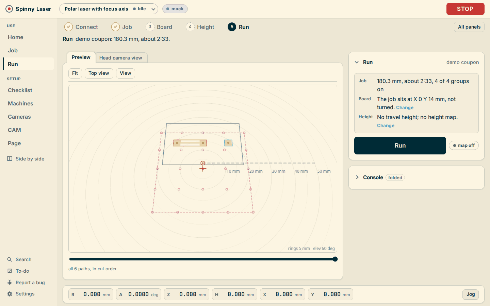

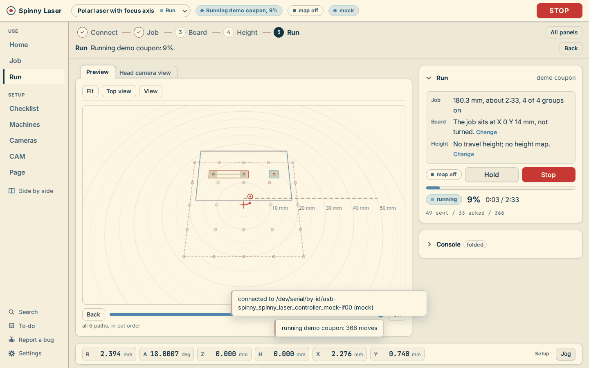

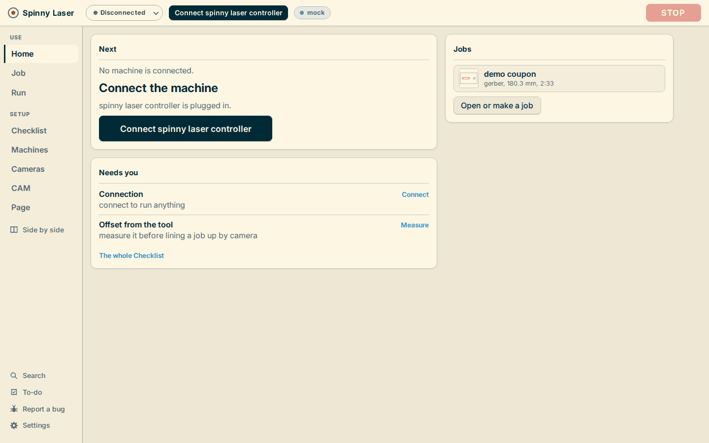

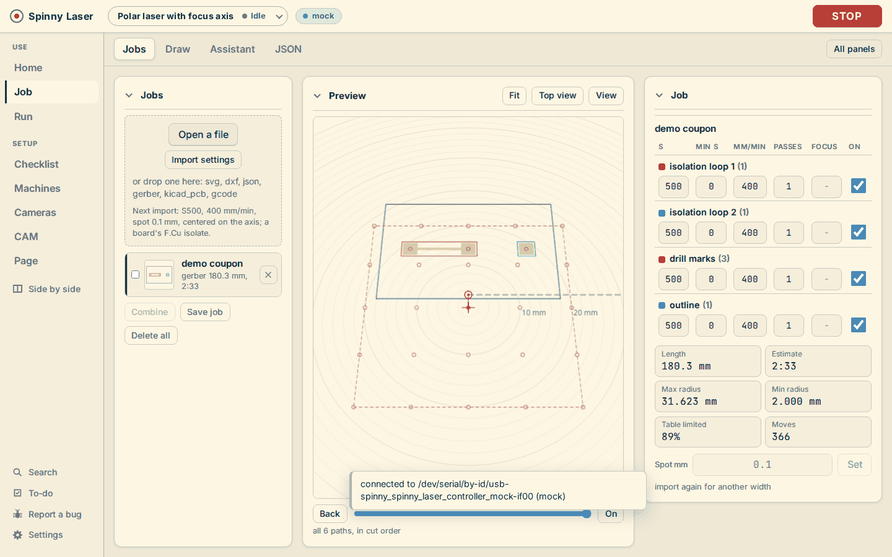

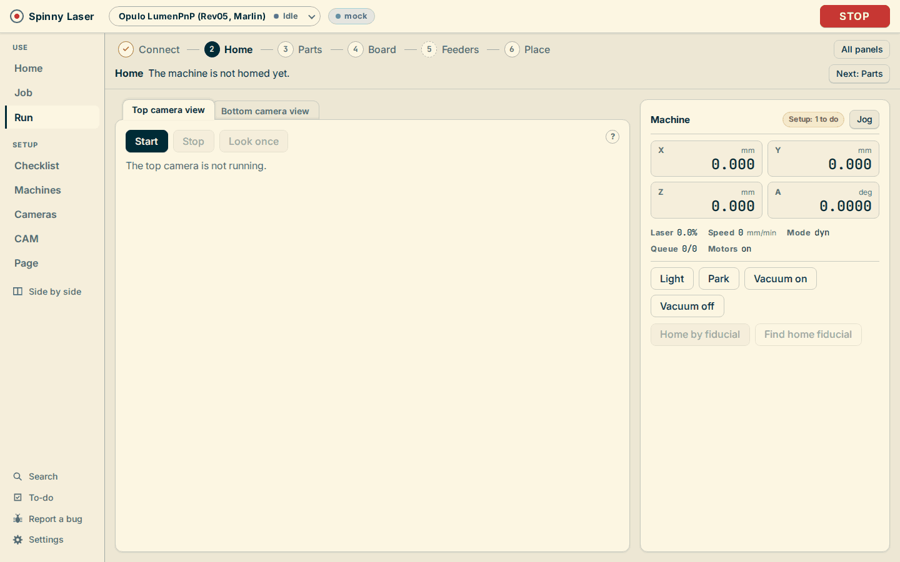

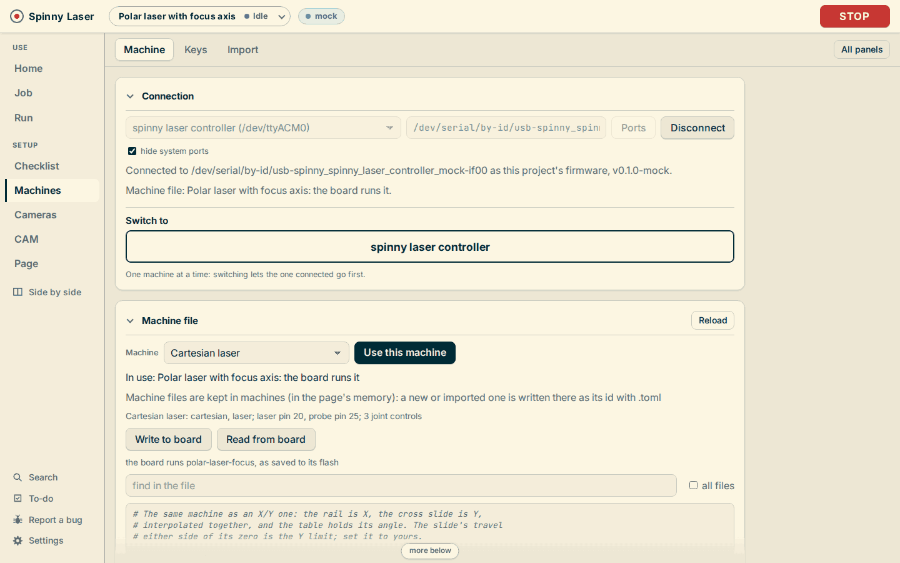

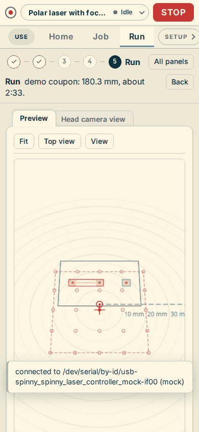

The head camera's page and CAM, before and after:

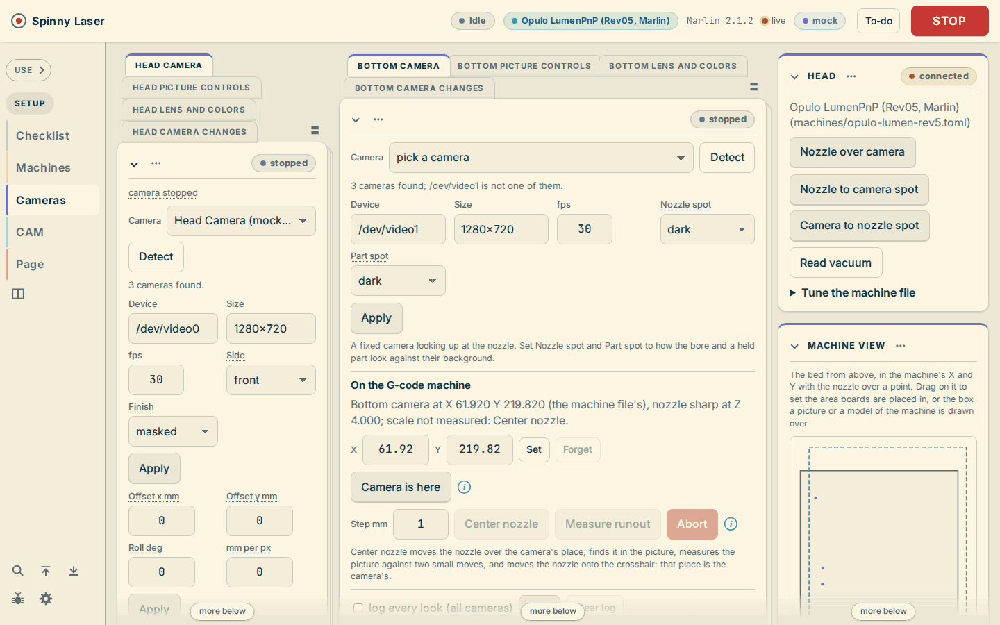

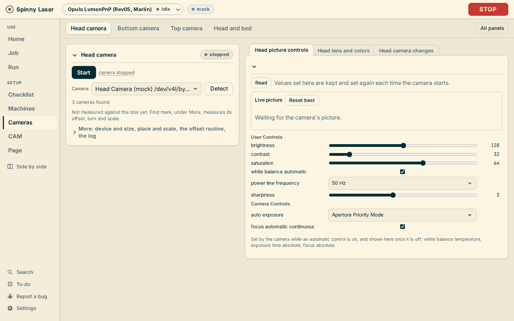

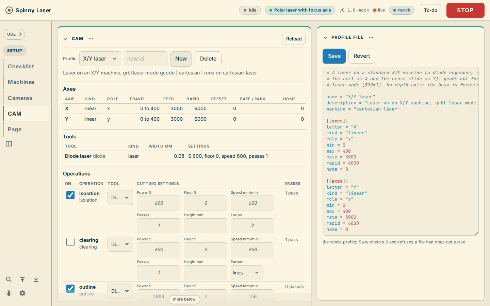

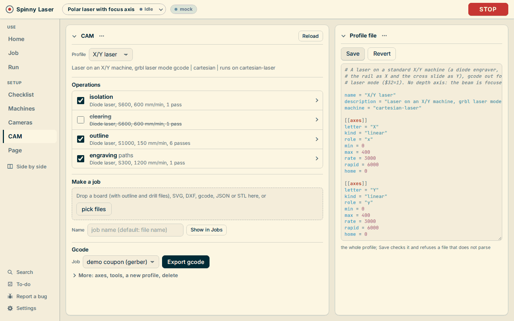

### What each finding became

| Finding | Now |
|---|---|
| 1. No first place to look | A view is the work with one panel beside it; the next action is the one dark button. |
| 2. The work is not on the screen | Run has the job's preview with the head on it, the camera's picture behind it on a tab. |
| 3. The next action is elsewhere | Connect is in the top bar, on Home and in Run's first step; Home names the next thing; each step has its action in its panel; the Job panel ends in Run this job; a camera starts on the page it is set up on. |
| 4. The screen does not change with the state | Run shows Run, or Hold and Stop, or Resume and Stop; the top bar carries a running job's share; a camera stopped offers Start and a running one Stop; Abort, Clear, Apply and a find's steps show while they can act. |
| 5. A panel shows its whole feature | Height, Board place, the jog, placing, the cameras, the machine file and the preview keep the usual in view and the rest under More, in place. A job's groups and a CAM profile's operations are rows that say their numbers and open their fields in place. The firmware's key list opens on the keys that differ. One step size serves every axis. |
| 6. The frame is heavy | Both sides' areas are listed under their names, which are headings; the rail's tools are named; the bar is the machine, the run and Stop; the layout tools show with All panels only, and a panel alone in its column has no fold. |
| 7. Color says nothing | The pages' colors are off; ink is the next action, a ticked box and a slider's fill; pressed is drawn, not colored; red fills only what stops the machine. |
| 8. Words and numbers at one weight | Paragraphs became tooltips, heading tooltips and a question mark; controls are a mouse's size, a finger's on a touch screen; the run's share is in large type. |
| 9. Messages cover controls | Toasts sit over the foot of the work and wrap; the mock's note is its chip's tooltip. |
| 10. Details that mislead | One Run and one Stop with a pick and place machine; X and Y named once; a job's numbers read as a line, not a table too wide for its panel; the key list's buttons no longer run off its panel; the search skips the layout's marks. |

### What is not done

- **All panels is outside the budget.** It is the operator's own layout
  of every panel of an area, kept for whoever wants the old screen, and
  it holds what the old screen held.
- **A mill's screens are not in the check.** The page's mock offers the
  polar laser and the LumenPnP; a mill shows other fields in the same
  panels (depth and plunge in a group, the spindle's numbers in Draw).
- **The steps are the page's own**, per kind of machine
  (web/frontend/src/views/areaviews.ts, since 2026-11-21 the stages of
  web/frontend/src/views/stages.ts), not yet read from the machine
  file as TODO.md asks.
- **Board and Height are steps a run can do without**: the page cannot
  tell whether the board was placed, so it never marks Board done.
- **No guide.** How-to went to tooltips and question marks; the guide of
  principle 8, opened at a section, is not written.
- **Nothing here was tried on the machines.** The page was driven over
  its mock; the layout check, the budget and the unit tests are what was
  run.
- The choices made on the way that are the user's to confirm are in
  [QUESTIONS.md](../QUESTIONS.md).
