# Web interface API

The backend (`web/backend`, Python) owns the serial link to the firmware and
serves the frontend (`web/frontend`, TypeScript) as static files. The
frontend only talks to the backend; it never sees the serial port.

Base URL: `http://<host>:8000`. Bodies and responses are JSON unless noted.

Every refusal is `{"detail": "<text>"}`; a body or field that does not
parse is 422 with `detail` as a list; a link fault (port gone, no answer)
is 502.

A `POST` from a page on another origin is refused with 403, and so is a
websocket opened by one (browsers name the origin on both, and CORS alone
would only stop the page reading the answer); only the server's own
origin and any `--cors-origin` pass, such as the frontend's dev server
(`--cors-origin http://localhost:3000`, repeatable). Requests without an
`Origin` header (scripts, curl) are not a page's and pass: the backend is
meant for a trusted network. `--allowed-host spinny.local` (repeatable)
also pins the `Host` header, against a page that points its own name at
this address; the loopback names `127.0.0.1` and `localhost` are always
allowed, since the backend's own tools come in under them.

## Connection

| Method and path | Body | Returns |
| --- | --- | --- |
| `GET /api/ports` | | `{"ports": [{"url": "/dev/serial/by-id/usb-spinny_...", "device": "/dev/ttyACM0", "description": "...", "product": "spinny laser controller", "manufacturer": "spinny", "serial": "...", "vid": 11914, "pid": 10, "kind": "usb", "spinny": true, "machine": null, "machine_name": null}]}`, the controller first (`spinny`: it announces itself on the bus), then the other USB devices, then the built-in ports (`kind` `system`, never the controller), plus the url last used when it is not listed (`kind` `last`); a USB device is named by its stable `/dev/serial/by-id` link where the system gives one, so the pick survives a replug. `machine` and `machine_name` name the G-code machine file that claims the port (its `[port] url` is the port's, or its `[port] match` words are in the port's USB names), and a G-code machine whose file names a url no port is listed under comes as an entry of its own (`kind` `machine`) |
| `POST /api/connect` | `{"url": "/dev/ttyACM0", "machine": null}` | state snapshot; `socket://host:port` reaches the virtual firmware; anything but a device path, a `COMn` port or a `socket://` url is refused with 400. The port opens as a G-code machine when `machine` names a G-code machine file (400 for a file of this project's firmware), or when a G-code machine file claims the port; else as this project's firmware. A G-code machine's file gives the baud, the wait for a board that resets as its port opens and the init lines; the backend then asks M115 (the firmware's name) and the file's position command, and reads the position about once a second while nothing else is in flight. Connecting either kind closes the other |
| `POST /api/disconnect` | | state snapshot; a turning spindle or a lit beam is stopped first (`laser off` on an idle machine; one that is moving or held, or does not take `laser off` at once, is held and then reset once at rest, as a run's stop does), since the firmware does not see a port close; the backend's shutdown does the same |
| `GET /api/state` | | state snapshot |

State snapshot:

```json
{
  "connected": true,
  "url": "/dev/ttyACM0",  // the last url used; kept after a disconnect, null before the first connect
  "firmware": {"version": "0.1.0", "lines": 16, "blocks": 32},
  "machine": {
    "state": "Idle", "alarm": null,
    "joint": {"r": 12.345, "a": 90.1234, "z": 0.0, "h": -1.25},
    "probe": false,
    "board": {"x": 0.0, "y": 12.345},
    "rate": 0.0, "laser": 0, "mode": "dyn", "enabled": true,
    "queue": {"planner": 32, "lines": 16}
  },
  "profile": {"kinematics": "polar", "tool": "laser", "h_axis": true, "r_max": 60.0, "z_max": 0.0},
  "run": null,
  "resume": null,
  "position": {"r": 12.345, "a": 90.1234, "z": 0.0, "h": -1.25, "state": "Idle", "at": "2026-10-14T03:00:00+00:00"}
}
```

`machine.age` is how old the report is, s: a machine that has gone quiet
shows there first, and after 3 s with status polls unanswered the link is
closed with that reason (`link closed: no answer from the machine for 3
s`), which ends a run as `error` with it; reconnect, and pick the job up
(below). The verdict waits while the backend's own reader is behind on
the port (the interpreter held for seconds by a board's geometry on a
slow host), since the answers are then waiting unread; a reader that has
not run for three stalls closes the link with that reason instead. `resume` is the resume record, the last run's progress with the
plan it was made from (see `GET /api/resume`), kept across sessions.
`position` is the last position the machine reported, with its state and
when, kept across sessions in `var/position.json` (written at most once
a second while it changes and when the link closes): what *Last known*
in the Jog panel declares after a power cycle, run or no run. A board
may start over between two links, or under an open one (a banner no
reset came before), and count from zero where the head stands, so the
position is held at every connect and at such a restart, `held` saying
since when: the reports are not taken until the new link's first report
reads the same joints, the board's `diag` uptime reaches back past the
kept report, a position declared names `r`, `a` or `z` (a focus height
alone does not), or a home finds a switch on one of those joints.

`board` is derived on the host from `joint`: `x = r cos a`, `y = r sin a`
on the polar machine; on a cartesian one it is `(r, z)` turned by `a`.
`profile` is what the machine is, from its settings as last read (a laser
on the polar machine before the first): `kinematics` is `polar` or
`cartesian` (`$cartesian`), `tool` is `laser`, `spindle` (`$spindle`) or
`dispenser` (`$dispenser` with `$cartesian`). It follows a setting
written from a machine file (Config tab) or a page control, or typed at
the console.
`joint.h` (the focus axis, mm, up positive) and `probe` (the probe input is
active) are `null` on a machine without a focus axis (`$h_axis=0`).

A G-code machine's snapshot has its head's place as the cartesian
machine's joints (`r` is X, `z` is Y, `h` is Z, `a` the rotation axis as
the controller counts it), `board` its X and Y, `state` `Idle`, `Jog`
while a goto's moves run to their end, `Home` while it homes and `Run`
during a placing run or a camera routine, `enabled` as its motors were
last switched, and `age` 0; `firmware` is `{"version": "Marlin 2.1.2",
"lines": 1, "blocks": 0, "name": "Marlin 2.1.2"}` (the M115 answer's
FIRMWARE_NAME, else the machine's name). `profile` is
`{"kinematics": "cartesian", "tool": "nozzle", "h_axis": true, "r_max":
0, "z_max": 0, "controller": "gcode", "machine": "opulo-lumen-rev5",
"name": "Opulo LumenPnP (Rev05, Marlin)"}`; a machine on this project's
firmware says `"controller": "spinny"`. `run`, `resume` and `position`
are null. A G-code machine's link lost on its own shows `connected`
false with its profile kept until the next connect.

## Moving

| Method and path | Body |
| --- | --- |
| `POST /api/jog` | `{"kind": "joint", "dr": 1.0, "da": 0.0, "dh": 0.0, "feed": null}` or `{"kind": "board", "dx": 0.0, "dy": -1.0, "feed": 500}` relative; `dh` is the focus axis, alone or with the joints (the firmware refuses it without one fitted); `{"kind": "joint", "dz": 0.5}` moves the cross slide, which on the polar machine cannot be combined with `dr`, `da` or `dh`, and on a cartesian one is a joint beside them |
| `POST /api/goto` | `{"kind": "joint", "r": 0, "a": 0, "h": 0}` or `{"kind": "board", "x": 3, "y": 4, "feed": 500}` absolute; with a travel height set, a goto that moves across (a board one, or a joint one with `r`, `a` or, on a cartesian machine, `z`, and no `h`) is sent behind a `jogto H` to it when the head is lower or still moving, and `lines` names it (the polar machine's cross slide moves only at rest, on its own, and is not risen for); an axis left out keeps the coordinate the head will have once the jog in progress ends, and is refused with 400 while that end is not known; `{"kind": "joint", "z": 0}` sends the cross slide there, again not with `r`, `a` or `h` on the polar machine. On a cartesian machine a board jog or goto is planned in the table's frame from a fresh status, and answers 409 while the table may still be turning under a move in progress |
| `POST /api/jog/cancel` | |
| `POST /api/position` | `{"r": 0}`, `{"a": 0}`, `{"h": 0}` and/or `{"z": 0}`: declare the current position |
| `POST /api/motors` | `{"enabled": false}`; turning them off answers 409 while a run or probing owns the machine: the drivers share one enable line, so `disable` (and `$idle_ms`) lets go of the focus axis too, and a head that is not self-locking sinks unseen |
| `POST /api/unlock` | |
| `POST /api/home` | `{"axes": "R A-"}`: the joints to home as letters R, A, H, Z, each with an optional `-` or `+` for the end to seek; `{"axes": ""}` or `{}` homes every axis with an endstop. Answers when the home ends, with the state; 409 while a run or probing owns the machine, 400 for an axis without a switch, a home the firmware refuses or one that failed (then the machine is in `Alarm`). Takes the height map's focus offset back, as a position declaration does. The machine's `homed` is the letters of the joints homed since the position was last lost, or null on a machine with no endstop |
| `POST /api/stop` | the page's big Stop: a run or probing stopped as their own stop does (a hold, then a reset); otherwise the head camera's and the bottom camera's routines ended, a jog or goto cancelled (0x85) and the beam or spindle turned off (a refusal of that line, as in an alarm, is passed over); on a G-code machine the file's stop, ending a placing run and the camera routines. Answers `{"stopped": [what was stopped, in words], "snapshot": ...}`; 409 with nothing connected |
| `POST /api/realtime` | `{"action": "hold" \| "resume" \| "reset" \| "cancel" \| "status"}`; while a job runs, `hold` and `resume` are the run's own, and `reset` ends the run before the byte goes out; while a run is still being prepared, `hold` and `reset` cancel its start (and still go out) |
| `POST /api/command` | `{"line": "cut R10 F300 S200"}` returns `{"lines": ["ok"]}`: what the command printed, then its answer; a line of `?`, `!` or `~` alone goes out as that realtime byte and returns `{"lines": []}`; status reports and `[MSG:...]` lines arrive as events, except that a bare `status` returns its report in `lines` (asked for with the `?` byte); a typed `laser off` or `spindle off` during a run stops the run (hold, then reset) and returns `{"lines": []}`, and while a run is still being prepared cancels its start and goes out as typed; `set`, `disable`, `$<name>=<value>`, `$load`, `$defaults` and `spindle S` answer 409 while a run or probing owns the machine (`spindle S` only while probing); an accepted `set`, or a `$` line that may rescale or turn the axes, takes the height map's focus offset back |

A jog, a goto or a position declaration answers 409 while a run owns the
machine, from the moment the run is being planned, and while the board is
being probed. A board move whose
lines would pass the firmware's `r_max` is refused whole with 400 before
any of them goes out; a move within the limit chains from the end of the
jog in progress. Move requests are served one at a time.

On a G-code machine the same requests drive its controller, `r`, `z`, `h`
and `a` being its X, Y, Z and rotation axis (`dx`, `dy`, `x` and `y` too
being X and Y). A jog reads the head's place with the file's position
command first (Marlin answers with where the queued moves end, so jogs
pressed quickly add up) and sends one move to the place plus the step,
answered once queued; `feed` goes with X and Y, Z moves at the file's Z
feed. A goto moves only the axes it names: across (X or Y changing) it
goes to the file's safe height first, from either side of it, the turn
with the move across, and the height last and only when it changes; it is
answered once its moves have run (the file's wait command) and the place
read again. A position declaration is `G92` with the axes named; a home is
the file's home line (`G28`), with the axes named when some are; `motors`
sends the file's `motors_on` or `motors_off` (400 when it gives none).
`realtime` `reset` and `cancel` send the file's stop (`M410`) ahead of
anything in flight and stop a placing run or a camera routine, `status`
reads the place, and `hold` and `resume` are refused with 400: a G-code
controller has no hold to resume from. `command` sends the line as typed
and returns the lines that came with its `ok`; `unlock`, the laser, the
spindle, `mode`, settings writes, probing, runs and the camera on the
head answer 409 naming the machine (`... is a G-code machine: this is
for a machine on this project's firmware`). A jog step is at most 1000
mm (3600 degrees), a goto's place within 10000 mm (3600 degrees).

Board jogs and gotos are turned into joint moves on the host with the chord
tolerance (`[host] tolerance`), so a board move through the axis becomes
a radial move in, a turn, and a radial move out. On a cartesian machine a
board move is one straight `jogto R Z`, with the board turned by the table
angle as reported, and `z_max` bounds it beside `r_max`. Joint jogs move one motor
at a time when only one delta is given: that is the independent axis
control.

## Laser

| Method and path | Body |
| --- | --- |
| `POST /api/laser` | `{"power": 50, "ms": 2000}` constant beam with a timeout; `ms` left out means the firmware's `laser_ms`, `ms` under 1 is 400, and over 60000 the firmware's refusal comes back as 400 |
| `POST /api/laser/off` | during a run this is the run's hold, since `laser off` on the wire would stall the cut and let it go on; `POST /api/mode` answers 409 while a run is active |
| `POST /api/mode` | `{"mode": "dyn" \| "const"}` |

On a spindle machine (`profile.tool` `spindle`) `POST /api/laser` answers
400, and the spindle has its own:

| Method and path | Body |
| --- | --- |
| `POST /api/spindle` | `{"power": 800}` starts it at that `S`, or changes its speed; 400 on a laser machine, 409 while a run is active (a run starts and stops it itself) and while the board is probed (the probe may be the tool) |
| `POST /api/spindle/off` | stops it; 409 while a run is active, where the stop is the run's stop |

## Settings

| Method and path | Body |
| --- | --- |
| `GET /api/settings` | returns `{"values": {"r_steps": 256, ...}, "schema": [{"name", "unit", "help"}], "host": {"tolerance": 0.005, "clearance": 2.0, "travel": null, "spinup": 2.0, "speed_control": true, "gap": 0.1, "retract": 0.2, "output": 100, "extrude_rate": 60, "dwell_ms": 200}, "machine": "polar-laser", "unsaved": [], "controls_from": "polar-laser", "controls": {...}}`; `machine` is the machine file the values are, every one of them, or `null`; `unsaved` names the settings written (from the page, a machine file or the console) since the controller's were last saved to flash or loaded from it, `$defaults` for that command, as far as this backend has seen: a connect and a restart of the board start it empty; `controls` is what the page draws for jogging and the readout, a machine file's `[controls]` picked as [MACHINES.md](MACHINES.md#the-controls) says; `controls_from` is the file the controls are, `null` for the defaults |
| `PUT /api/settings` | `{"values": {"r_rate": 800}, "host": {"tolerance": 0.005, "clearance": 2.0, "spinup": 2.0, "speed_control": true, "gap": 0.1, "retract": 0.2, "output": 100, "extrude_rate": 60, "dwell_ms": 200}}`; all or nothing: an unknown name, a value that is not a finite number, a tolerance outside `(0, 10]` mm, a clearance outside `(0, 100]` mm, a travel height that is neither `null` nor within `[-100, 100]` mm, a spin-up outside `[0, 600]` s, a gap outside `(0, 10]` mm, a retract outside `[0, 50]` mm, an output outside `(0, 100000]` mm^3/mm, an extrude rate outside `(0, 10000]` mm/min or a dwell outside `[0, 60000]` ms answers 400 with nothing applied, and a value past what any firmware setting holds (a whole number past 4294967295, any other past 1e7 in magnitude) or a line longer than the link takes is refused the same way; a value the firmware refuses has the ones sent before it put back, and one lost on the link unanswered is put back with them, since it may have been taken; the host settings are stored only once the values went through; `values` answers 409 while a run or probing owns the machine, and a run or probing asked for during the write waits for it |
| `POST /api/settings/save` | writes the firmware settings to flash |

`clearance` and `spinup` are for milling: the tool travels `clearance` mm
over the surface (H 0 without a height map, the map's highest point with
one), and a run dwells `spinup` seconds after starting the spindle or
changing its speed. `speed_control` false runs the spindle full on: every
`spindle S` a run or the page sends asks for `s_max`, whatever a group's
speed says, for a spindle with its own speed knob or one behind a switch.
`gap`, `retract`, `output`, `extrude_rate` and `dwell_ms` are for
dispensing, what every dot of a dispensing run is made of (see Jobs); the
travel height between dots is `clearance`. `travel` is the H the head
rises to before a goto across the board, probing (and *Probe nearest*)
and the camera routines move it, when it is lower; `null` (the default)
leaves the head at the height it has. Only the keys given change.

With a G-code machine connected, `GET /api/settings` answers `{"values":
{}, "schema": [], "host": {...}, "machine": "opulo-lumen-rev5", "unsaved":
[], "controls_from": "opulo-lumen-rev5", "controls": {...}, "controller":
"gcode"}`: none of the firmware's settings, its file's controls.
`PUT /api/settings` with `values` answers 409 then.

## Machines

The machine files in `machines/` ([MACHINES.md](MACHINES.md)), one TOML
file per axis arrangement, each a complete set of firmware settings plus
the host's own; or, with `controller = "gcode"`, a machine on a G-code
controller of its own, a pick and place machine's.

| Method and path | Body |
| --- | --- |
| `GET /api/machines` | returns `{"machines": [{"id": "polar-laser", "name", "description", "kinematics": "polar", "tool": "laser" (or `spindle`, `dispenser`; `nozzle` for a G-code machine), "focus": false, "controller": "spinny" (or `gcode`)}, ...], "current": "polar-laser", "problems": [{"id": "broken", "problem": "..."}]}`; `current` is the file the connected machine's settings are (a G-code machine's file when one is connected), `null` with no machine connected or settings of no file's; `problems` names each file that could not be read with what is wrong, the others are listed; such a file still opens below, to be mended |
| `GET /api/machines/{id}` | `{"document": {...}, "problems": [], "text": "..."}`: the entry above plus `settings` (every firmware setting's value), `host`, `camera` (the file's `[camera]`, filled in from the defaults: `device`, `size`, `fps`, `pcbv`, `side`, `finish`, `offset`, `roll`, `mm_per_px`) and `controls` (the file's `[controls]`, filled in from the defaults) as `document`, and the file as written; a G-code machine's document has `settings` and `host` empty and its own tables read as `gcode` (the placing state's `document` below); a file that does not read answers with `document` null and the problem named, its text with it; 404 for a file that is not there, 400 for an id that is not lower case letters, digits, `-` and `_` |
| `PATCH /api/machines/{id}` | `{"path": ["motion", "place_z"], "value": 12.5}`: one value changed in the file's text, comments and all, and saved once the whole file reads (a plain table not in the file yet, such as `[vacuum]`, is added at its end; `null` takes the key out); answers as `GET`; 400 for a value the file refuses, which leaves it as it was. The PNP tab tunes a G-code machine's heights, feeds and vacuum ranges with it |
| `PUT /api/machines/{id}` | `{"text": "..."}`: writes the text as the file once it reads as a machine, creating the file when it is new; answers as `GET`; 400 names what is wrong and leaves the file as it was |
| `POST /api/machines/{id}/check` | `{"text": "..."}`: `{"document": {...} or null, "problems": [...]}`, what the text would read as and what is wrong with it, without writing anything |
| `POST /api/machines/{id}/from-board` | `{"text": "..."}` (400 for a G-code machine's text): the text with every key whose value differs from the connected board's written to the board's (`spinny_laser.machine_keys`), comments and order kept, nothing saved: `{"text", "document", "problems", "changes": ["[rail] max_rate = 900 (was 560)", ...], "left": [settings no key could give the board's value]}`. A scale goes in the key the section already uses, else as `full_steps_per_mm` over the board's microsteps; a `[host]` key only where the text names it (one left out keeps the host's value); a missing section goes in before `[controls]`. 400 for a text that does not read, or a board and file of which one is a dispenser and the other not; 409 not connected |
| `DELETE /api/machines/{id}` | removes the file; `{"deleted": id}`, 404 when it is not there, 409 for the G-code machine connected |
| `POST /api/machines/{id}/apply` | `{"save": false}` (the body is optional); writes the file's settings and host values as `PUT /api/settings` does, all or nothing, and with `save` writes the flash afterwards; answers the settings response, `machine` naming the file; 404 for no such file, 409 while a run or probing owns the machine, 400 for a G-code machine's file (its controller keeps its own settings; it is connected, not written) |

## CAM

The CAM profiles in `cam/` ([CAM.md](CAM.md)), one TOML file per machine
and tool set: its axes, its tools with their cutting settings, the
operations a design goes through, and how the gcode is written.

| Method and path | Body |
| --- | --- |
| `GET /api/cam` | `{"profiles": [{"id": "mill-3axis", "name", "description", "machine": null, "kinematics": "cartesian", "tools": ["spindle"], "axes": "XYZ", "operations": 3, "material": null, "model": false}, ...], "problems": []}`; `machine` is the machine file the profile's jobs run on, or null; `tools` the kinds the enabled operations use; `operations` how many are enabled; `material` the stock's material by name; `model` whether it cuts a 3D model (has a rough, waterline or parallel operation); `problems` names each file that could not be read |
| `GET /api/cam/{id}` | `{"document": {...}, "text": "..."}`: the profile read (`axes`, `tools`, `operations` each with `settings`, its own keys, `cutting`, what it cuts with, and `feeds`, the line saying how a material set its rpm and feed, `post`, `placement`, and for a model `materials`, `stock`, `model_setup` and `spindle`) and the file as written; 404 for no such file, 400 for one that cannot be read, with the table and the key named |
| `PUT /api/cam/{id}` | `{"text": "..."}`: writes the text as the profile once it reads as one, creating the file when it is new; answers as `GET`; 400 names what is wrong and leaves the file as it was; the id is lower case letters, digits, `-` and `_` |
| `PATCH /api/cam/{id}` | `{"path": ["operations", 2, "depth"], "value": 1.6}`: changes one value in the file and keeps the rest, comments included; `path` is a top level key, a table and a key, or an array table's name, index and key; `null` takes the key out; a key not there is added at its table's end; answers as `GET`; 400 for a table that is not there or a value the profile refuses |
| `DELETE /api/cam/{id}` | removes the file; `{"deleted": id}`, 404 when it is not there |
| `POST /api/cam/{id}/jobs` | multipart: `files` (one or more) plus optional `name`; a `.kicad_pcb`, or a copper gerber with its `Edge.Cuts` gerber and `.drl` drill files beside it in the same upload (every `.drl` whose name starts as the board's, so a KiCad `-PTH.drl` and `-NPTH.drl` pair both; with none named so, every one), an `.svg`, a `.dxf` (its paths a set a layer, as the Jobs import reads it), a `.gcode`/`.nc`/`.ngc`, a job `.json`, or an `.stl` model, through every operation of the profile into a stored job; a model goes through the profile's rough, waterline and parallel operations by the 3D kernel, each group carrying `moves`; answers `{"job": job, "notes": [what was left out: no drill file, another board's drill file, holes narrower than the bit, an operation the design has nothing for; for a model its size and block, the feeds a material set, the material's note]}`; 400 for a design the profile makes nothing of, a model whose toolpaths would cut into it, or no kernel built, 404 for no such profile, 413 over 64 MB |
| `POST /api/cam/{id}/gcode` | `{"job": "a1b2"}`: the stored job as gcode for the profile's controller: `{"text": "...", "filename": "board.nc", "report": {"lines", "cuts", "length_mm", "seconds", "extents": {"X": [min, max], ...}, "warnings": [...]}}`; the extents are machine coordinates; a reach past an axis' travel, a feed over an axis' rate and every stop to change the bit (`M0`, between groups made with two bits) are warnings; 400 for a job with nothing enabled to cut, a spindle group with no depth axis in the profile, a joint-space group, or a spindle group on a polar profile; 404 for no such profile or job |

## Jobs

| Method and path | Body |
| --- | --- |
| `POST /api/jobs` | multipart: `file` plus optional fields `power`, `speed`, `spot`, `anchor` (`center`/`keep`), `offset_x`, `offset_y`, `passes` (1 to 50: isolation loops offset around the copper, or with `mode` `deposit` edge loops inside it, not the group passes below; only 1 with `mode` `stencil` or `lines`), `layer` (a KiCad layer name, `F.Cu` when left out: the layer a `.kicad_pcb` is read from, a copper layer or `F.Paste`, which `mode` `stencil` cuts a solder paste stencil for; a gerber is its own layer, and one named the way kicad-cli names them, `board-F_Paste.gtp`, is known for it; a name that is not a layer name answers 400, a layer the board does not have `has no layer`), `mode` (`isolate`, the default, `deposit`, `stencil`, `dispense` or `lines`: gerber and KiCad only, see below; with `stencil` or `dispense` a `layer` left out is `F.Paste`), `margin` (`stencil` only: mm every opening is shrunk by on every side before it is cut, 0 to 10, default 0), `thickness` (`dispense` only: mm of paste over every pad, 0.01 to 5, default 0.12), `clear` (`off`, `radial`, `rings` or `lines`: isolation only, gerber and KiCad only, a `copper clearing` group of everything the isolation leaves inside the board outline, placed before the outline group; outline pieces whose ends meet within 0.001 mm are joined into one loop first, and with no closed outline, or one that holds less than half the copper (a lone cutout), the X/Y box the isolation spans is cleared instead), `fill` (`contour`, the default, `radial`, `rings` or `lines`: a deposit only), `mirror` (`auto`, the default, `none`, `x` or `y`: gerber and KiCad only, how the layer is flipped before it is placed; `auto` flips a layer on the back, `B.Cu`, `B.Paste` and the like, in X for the board turned over left to right, and leaves the front as drawn); `clear` other than `off` with a deposit, `fill` with isolation, either with a stencil or the lines, or `margin` with anything but a stencil, answers 400; a file over 64 MB answers 413 |
| `POST /api/center` | the polar laser's only (400 on a cartesian or spindle machine); JSON, every field optional: `{"fine": false, "lines": 4, "reach": 6, "ring": 8, "angle": 3, "cross": 4, "arm": 2.5, "spiral": 5, "show_error": [0.02, 0.01], "power": 400, "speed": 200, "spot": 0.1}`, the options of `spinny-center` (a missing `reach` or `ring` takes the pattern's default, `lines` belongs to the coarse pattern, `angle`, `cross`, `arm`, `spiral` and `show_error` to the fine one); stores the pattern as a job with `source` `center` and answers `{"job": job, "summary": [lines], "notes": [how to read it]}`. The table rate paces the ring and spirals; a power over the last read `s_max` is refused |
| `POST /api/calibrate` | a calibration test as a job (`source` `calibrate`), every patch a group of its own; JSON, every field optional: `{"kind": "material", "powers": [100, 1000, 5], "speeds": [300, 1500, 5], "size": 5, "gap": 2, "fill": true, "spot": 0.1, "x": 0, "y": 0}` is a laser's grid of `size` mm squares `gap` apart, power rising to the right and speed upward from the lower left corner at `x`, `y`, each filled with lines a `spot` apart or with `fill` false outlined, a group `test S<power> F<speed>` each; `{"kind": "depth", "depths": [0.05, 0.3, 6], "length": 10, "gap": 2, "feed": 120, "plunge": 30, "spindle": 1000, "x": 0, "y": 0}` is a mill's row of slots `length` mm along X, `gap` apart upward, shallowest first whichever way the ladder runs, a group `test depth <d> mm` each at that depth. A ladder is `[first, last, steps]`, both ends included, 1 to 12 steps. `{"kind": "focus", "focuses": [-1, 1, 9], "power": 500, "speed": 600, "length": 10, "gap": 2, "x": 0, "y": 0}` is a laser's focus ladder: a line `length` mm along X per step, `gap` apart upward, lowest first, each a group `test focus <step> mm` (`+0.25`, `-0.5`, `0`) whose `focus` is that step, all at one power and speed. `{"kind": "dots", "columns": 21, "rows": 15, "pitch": 2, "diameter": 0.6, "power": 500, "speed": 600, "spot": 0.1, "depth": 0.1, "x": 0, "y": 0}` is the camera pattern on either: `columns` by `rows` dots `pitch` mm apart from the lower left at `x`, `y`, the top right one left out, one group `camera dots`; on a laser each dot `diameter` across, its outline then a spiral a `spot` apart, at `power` and `speed`; on a mill one plunge per dot `depth` deep at `feed`, `plunge` and `spindle`. Answers `{"job", "summary", "notes", "svg"}` like `/api/center`, `svg` the camera pattern's sheet to print at true size (null for the other tests); 400 for the material test or the ladder on a spindle machine, the depth test on a laser, the ladder on a laser whose settings say it has no focus axis, a material fill finer than 0.01 mm or of more than 200000 points in all, or dots outside 2 to 100 a side, a pitch outside 0.2 to 20 mm, a pattern over 200 mm across, or a laser's dot not wider than its spot and narrower than its pitch |
| `GET /api/update` | the installed release and its update from GitHub: `{"kind": "release" \| "checkout", "version", "platform", "root", "link", "latest": null or {"version", "tag", "page", "published", "archive", "size"}, "status": null or "newer" \| "same" \| "older" \| "other", "checked", "state": "idle" \| "downloading" \| "unpacking" \| "done" \| "error", "done", "total", "error", "installed", "previous"}`; `other` is the same version as released over another build ([RELEASE.md](RELEASE.md#updating-from-github)) |
| `POST /api/update/check` | asks GitHub for the latest release and answers the state above; 400 for a checkout (it updates with git), during an update, and for GitHub unreachable, refusing or listing no release |
| `POST /api/update/install` | starts the update to the release last checked (download, SHA256SUMS check, unpack beside, link switched) on its own thread and answers the state, `downloading`; ask `GET /api/update` until `done` or `error`. 400 for a checkout, before a check, for nothing newer, a release with no archive for this platform or no `SHA256SUMS`, during an update, and once one is installed until a restart |
| `GET /api/jobs` | `{"jobs": [summary]}`: the job without coordinates, each group's `paths` and `joints` being counts |
| `GET /api/jobs/{id}` | the job |
| `GET /api/jobs/{id}/thumb.svg` | the job drawn small for the job list (64 px on its longer side): every group's paths in the preview's four colors in turn, a group switched off faint, a one-point path a dot, a model's moves by X and Y, fitted with the board's Y up; points nearer than a 100th of the box to the last one kept are skipped and at most 6000 drawn. Any query is ignored: the page adds a key of what the drawing shows (`?v=`), and the reply may be kept a day under the same address; 404 for no such job |
| `POST /api/jobs/combine` | `{"ids": ["a1", "b2", ...], "name": null}` (2 to 50 jobs): a new job of them, stored and answered, cut in that order: every group of the first, then of the next, each label led by its job's name (`lid: cut`), with their outlines, copper, pads and holes, all where the jobs are now (the new job starts unmoved); `source` `combined`, no recipe and no design map, the first job's spot, the jobs' layer when they share one; named `a + b` (up to three) or `a and N more` without `name`. The jobs stay. 400 for jobs whose groups were made for different tools, 404 for a missing one, 422 for fewer than two |
| `PATCH /api/jobs/{id}` | `{"name": "coupon", "groups": [{"index": 0, "label": "outline", "power": 500, "min_power": 100, "speed": 400, "passes": 2, "enabled": true, "depth": 1.6, "plunge": 30, "thickness": 0.15, "focus": -0.5}], "offset": {"x": 0, "y": 14}, "turn": 90, "about": "center"}`; every field optional, a speed or plunge under 0.001 mm/min is refused like one of 0, a depth must be above 0 and at most 50 mm, a thickness 0.01 to 5 mm, a focus within 50 mm either way (`null` takes it away). `turn` turns the job counterclockwise by -360 to 360 degrees after the offset, everything on it with it (pads, holes, outline, the design map), `about` the middle of the box round what it cuts (the default, so it stays where it is) or the `origin`; `rotation` adds it up; refused for a joint-space group |
| `PUT /api/jobs/{id}` | a job as `GET /api/jobs/{id}` answers it, edited: the page's JSON panel, its moving of picked paths between groups, its taking them out and its arrays of picked paths (the last three sent with `recipe` null, since such paths are nothing the job's file or operations would make again) send the whole job back this way. Checked as a `.json` upload is (numbers, paths, a joint-space group's joints, a model's moves); `id` and `stats` are ignored, the id kept and the job priced again; `name` and `source` left out stay the old job's, anything else left out takes a new job's default. The `recipe` sent is kept only while the groups cut what the old job's did (their paths, joints, moves and pads' areas) under the same labels but for their numbers, and dropped otherwise: made again for another width or from the Plot page, the paths would come back as the file or operations make them and a renamed group would lose its settings. A joint-space group's `paths` are only its drawing: one whose joints changed (or that comes without paths) is drawn again from them, and one whose joints are as they were keeps the drawing sent. Answers the job as kept; 400 with the reason, 404 for no such job, 409 while it runs |
| `POST /api/jobs/{id}/width` | `{"width": 0.4}`, the bit's or the beam's width in mm (above 0, at most 1000): the job made again for it and answered. A board upload (gerber or KiCad, whose file is kept beside the job as `{id}.kicad_pcb` or `{id}.upload.gbr` with the options in the job's `recipe`) is imported again and put where the job is now through its `design` map, so the copper lands on the copper already cut; a Plot page job is built again from its operation, turned and moved as the job has been. The groups keep their settings, matched by label with the numbers taken out, in order. A drawing (SVG, DXF, gcode, a centering burn) takes the width with its paths as they are. 400 for a job whose paths follow its width with nothing kept to make them again (a CAM job, a board saved and loaded as JSON, an STL model): import it again; 409 while the job runs |
| `POST /api/jobs/{id}/margin` | `{"margin": 0.05}`, mm every opening of a stencil is shrunk by on every side (0 to 10): the stencil imported again from its kept file with that margin, put where the job is now as another width is, and answered; the groups keep their settings. 400 for a job not imported with `mode` `stencil`, one whose file is no longer kept, or a margin that closes every opening (the job stays as it was); 409 while the job runs |
| `DELETE /api/jobs/{id}` | also removes the file kept for it |
| `DELETE /api/jobs` | every job but the one running: `{"deleted": [ids], "kept": [id]}` |
| `POST /api/jobs/{id}/run` | starts streaming; optional body `{"compensate": "off" \| "auto" \| "focus" \| "power", "focus_here": false}` follows the height map (see below), `off` when left out (on a spindle machine `off` cuts from H 0 as the copper's height, and is 400 when a probe in this frame found the copper more than 1 mm from there); 409 while probing; without the map, 409 for a laser job with a group's own focus whose last run did not finish (anything but `done` in the resume record: stopped, failed, or left `running` by a host that died) when the head is not at the `start_h` that run began at, since the stop leaves it at the height of the group it was cutting (`go H` back there, then run), or when the focus axis frame has changed since (a connect, a restart, a position set or a home), unless `focus_here` gives the operator's word that the head is at focus where it stands, which the groups' focus then counts from; such a refusal ends `with focus here`; 400 for a joint-space group on a cartesian or spindle machine, for a spindle without the focus axis (`$h_axis=0`), which is its depth axis, for an enabled milling group with cuts at a spindle speed (`power`) of 0 or less, for an enabled group whose `tool` is not the machine's (`laser`, `spindle` or `dispenser`), on a spindle machine for enabled groups a CAM profile made with more than one bit (`tool_id`), naming the groups to switch off to cut with the first alone, and on a dispenser machine for an enabled group of paths rather than dots (a dispenser lays dots: import the board with `mode` `dispense`) and for a machine without the focus axis, which is the needle's height |
| `POST /api/jobs/{id}/resume` | picks the job up at a line: `{"line": 27213, "rewind": true, "compensate": "focus"}`. `line` is the count of lines done, as the progress reports it (`acked`); the lines before it count as done, and the head is brought from where it stands to where that line begins (a spindle: up to the travel height, over the point, the spindle started at the speed the job had there and given its spin-up, then down to the depth the cut starts at; a laser: a dark move to the cut's start, at the focus height when the map is followed), then the job goes on. `rewind` (default true) starts over at the first line of the path that line belongs to, so a count one line off cannot leave a gap. `compensate` left out takes the way the recorded run followed the board. The plan is made from where the recorded run began when the record is this job's, so its lines are the ones counted; otherwise from where the head is, which on a cartesian machine changes at most the first rapid. A laser group's own focus counts from the record's `start_h` when the record is this job's, which the focus axis means the same only in the frame it was read in: without the map, a pickup after the frame changed (a connect, a restart, a position set or a home) is 409, ending `with focus here`, unless `"focus_here": true` gives the operator's word that the head is at focus where it stands, which it then counts from. The count is of the recorded run's lines, so a plan that prints otherwise than its `fingerprint` (the job re-cut, regrouped, turned or moved, paths deleted or added, or the map followed otherwise; another power, speed, depth or focus height, or a map tied again, prints the same) is 409, ending `a line counted in the job as it is now`, unless `"changed": true` gives the operator's word that `line` is counted in the job as it is now. On the polar machine a `set A` first gives the table the plan's count of turns. Answers the progress, with `resumed_from`; the same refusals as a run, plus 400 for a line past the job |
| `POST /api/jobs/{id}/resume/plan` | the same body; what the resume would do without moving anything: `{"job", "line", "skip", "total", "compensate", "planned_from_record", "next", "group", "approach": [lines]}`, `skip` the line the run starts at, `next` that line, `approach` the lines that bring the head there |
| `GET /api/resume` | `{"resume": record or null}`: the last run's progress (see below) plus `start` (the joint its plan began from), `start_h` (the focus height a group's own focus counted from, null when no group had one), `frame` (the focus axis frame the run began in, a name only this backend gives meaning to), `fingerprint` (a short print of the plan's lines, what each is and where it goes, without their feed, power, floor, dwell or height; null in a record from before it), `compensate`, `cartesian`, `angle`, `spindle`, `started`, `updated` and `position` (the machine's last report, `{"r", "a", "z", "h"}`), written every second as a run goes and at its end, so a host that dies, or a controller powered down with the job half done, leaves behind what a later session needs |
| `DELETE /api/resume` | forgets the record; 409 while a job runs |
| `GET /api/log?lines=200&file=spinny` | `{"lines": [...]}`, the tail of one of the backend's logs: `spinny` (the default, `var/spinny.log`) holds the link's opening and closing with what it last sent and heard, every run's and probing's start and end with its counts, settings written, messages shown on the page and the machine's own messages (its boot reason and `diag` answer among them); `wire` (`var/wire.log`) holds every line sent and received with the time to the millisecond, the link's own status polls marked `tx-poll`/`rx-poll`; 400 for any other name |
| `POST /api/run/hold`, `/api/run/resume`, `/api/run/stop` | while a run is still being prepared (its checks and estimate), `hold` and `stop` cancel its start, and the pending `POST /api/jobs/{id}/run` answers 409 with the reason; `POST /api/laser/off` and a reset do the same, and a reset in that window is also seen by the preparation itself |
| `GET /api/run` | progress, or `null` before any job has run |

A job carries `recipe` (null, or `{"file", "options"}` for a board upload,
`{"mill": operation}` for a Plot page job), and its summary `remake`,
whether `POST /api/jobs/{id}/width` makes it again, and `holes`, the count
of its drill holes.

Accepted uploads: `.svg` (paths, lines, polylines, polygons, rects,
circles; curves flattened; mm from the viewBox; one group per stroke
color, and within a group whatever lies inside a closed shape is cut
before the shape, so a part's holes and marks go before the outline that
frees it, the deepest first, the drawing's order kept otherwise; a board's
outline group joins its pieces where their ends meet and cuts its cutouts
before its edge the same way, and on a machine with a spindle the bit, the
spot wide, runs half the spot outside the board's edge and inside each
cutout, a cutout narrower than it going, switched off and on its line,
into a group `board outline cutouts narrower than the bit, on their
line`), `.dxf` (an ASCII DXF drawing: `LINE`, `LWPOLYLINE` and
`POLYLINE` with their bulges, `ARC`, `CIRCLE`, `ELLIPSE`, `SPLINE`, and
`INSERT` of a block, scaled, turned, in rows and columns and nested,
a block's entities on layer 0 taking the insert's layer; curves within
the backend's chord tolerance; the unit from `$INSUNITS`, mm when it
gives none; lines whose ends meet within 0.001 mm joined into one path;
one group a layer, labeled `layer` and its name, in the order the layers
first draw, cut inside out as an SVG's; text, hatches, dimensions,
points, invisible entities, paper space and the entities of a layer
switched off or frozen left out; a binary DXF, a drawing with nothing to
cut, or one reaching past 1e6 mm (a wrong `$INSUNITS`) answers 400),
`.gcode`/`.nc`/`.ngc` (absolute
X/Y `G0`/`G1` with `S` and `F`), `.json` (a job), a gerber of one layer
(`.gbr`, or the Protel extensions kicad-cli gives its layers, `.gtl`,
`.gbl`, `.gts`, `.gbs`, `.gtp`, `.gbp`, `.gto`, `.gbo`, `.gm1`; isolation
loops through the sibling geometry engine), `.kicad_pcb` (its `layer`
plotted through kicad-cli). The job's `layer` says which layer a kicad or
gerber job came from, `null` otherwise, and the group labels below say
`paste`, `mask` or `silk` for `copper` when the layer is one of those. A
layer cut with the board turned over is flipped with its pads, holes and
outline, and the job's `design` map says so in its `mirror` (`none`, `x`
or `y`, applied to the gerber frame before the turn), so a camera fix,
another width and the parts of a kept `.kicad_pcb` land on the flipped
copper; a part's angle is flipped with it.

A board with `mode` `deposit` is for a process that lays copper down: the
beam burns the copper and nothing past its edge. Its groups, in order:

| Group | Paths |
| --- | --- |
| `copper edge loop N at X mm in` | one per `passes`, X = spot/2 + (N - 1) spot: the first loop's beam edge lies on the copper's edge |
| `copper fill, <fill>, <spot> mm pitch` | the rest of the copper: `contour` goes on with loops in to the middle, the others are the clearing fills clipped to the copper; a short stroke wherever loops a pitch apart leave copper (a corner, the middle of a pad no whole number of spots wide) |
| `copper narrower than the spot, along its middle` | traces the beam cannot fit inside, burnt along the line the gerber strokes them with, half a spot on into the copper the loops reach; they come out the spot's width |
| `board outline pass 1` | `enabled: false`: off until the copper is down, to cut the board free with a power of its own |

Copper narrower than the spot that is not a stroke (a thin neck of a
zone) is left, as are the corners of copper sharper than the beam. A
deposit is placed where isolation of the same board would be. A deposit
of `layer` `F.Paste` burns every paste opening out of a film whole; a
stencil, below, cuts round each one instead.

A board with `mode` `stencil` is a solder paste stencil cut out of a film
laid where the board would be: the beam runs once round the inside of
every opening of the layer (`F.Paste` unless `layer` says otherwise), so
the piece inside drops out and leaves the hole. Its groups, in order:

| Group | Paths |
| --- | --- |
| `paste openings, M mm margin` | a closed loop round each edge of every opening, the beam's middle `margin` M plus half a spot inside the paste's edge: the kerf's outer edge lies on the edge of the opening shrunk by M on every side, and only the corners sharper than the beam are left on the piece |
| `paste openings narrower than the spot, along their middle` | an opening the beam has no room inside once shrunk: a stroke along the long center line of the smallest rectangle round it, half a spot short of each end and at least a quarter spot long, so the hole is as long as the opening and as wide as the spot |
| `paste openings the margin closes, along their middle` | `enabled: false`: the same stroke along every opening the margin closes, which KiCad too leaves without paste when a pad's paste margin closes it; switch the group on for paste there after all |
| `board outline pass 1` | `enabled: false`: to cut the film to the board's shape |

A margin that closes every opening answers 400. A narrow part of an
opening whose other part holds a loop (a neck between two wide ends) is
left uncut. The job's `copper` is the paste as drawn, so the preview shows
the margin as the band between each pad's edge and its cut; `POST
/api/jobs/{id}/margin` cuts the stencil again for another margin, and the
job's `recipe` options carry the one it was cut with.

A board with `mode` `lines` is cut where its layer is drawn, for a drawing
rather than copper: Edge.Cuts to cut a part out on its outline, a silk
screen or a user layer to burn as drawn. Its groups, in order:

| Group | Paths |
| --- | --- |
| `lines of <layer>` | every stroke of the layer along its middle and every filled shape (a pad, a region, a TrueType glyph) round its edge, the beam's middle on the line; the pieces a plotter writes one by one are joined where their ends meet, taken in turn by the head's travel, and whatever lies inside a closed shape comes before the shape |
| `board outline pass 1` | `enabled: false`: the board's shape, there to be switched on; left out when the layer is `Edge.Cuts`, whose lines are the outline |

A layer whose lines have no width is cut all the same; a layer that draws
nothing answers 400 (`draws no lines`). kicad-cli names the gerber it
plots after the name a layer is shown by (`F.SilkS` as
`board-F_Silkscreen.gto`, `Dwgs.User` as `board-User_Drawings.gbr`, a
layer the board names itself by that name), and both a KiCad upload and a
gerber named that way are read as the layer the board file names.

A board with `mode` `dispense` is solder paste on a board that is already
made: a dot on every pad of the layer (`F.Paste` unless `layer` says
otherwise; a copper layer's pads are its flashes, and a pad poured into a
zone is lost in it). One group:

| Group | Paths |
| --- | --- |
| `paste dots` | one path of one point per pad, at the pad's centroid, in a short tour over the board; `areas` holds each pad's area in mm^2 in the same order, `thickness` the mm of paste over a pad, and `tool` is `dispenser` |

The dot's volume is the pad's area times `thickness`, pushed out over the
machine's `output` ([Settings](#settings)); no outline group is made, since
a dispenser cuts nothing, but the outline is kept for the preview.

Every kicad and gerber job also carries `pads`, the centroid and area of
every pad of its layer (every flash or region of the gerber, pads joined
by their copper counted once), and `holes`, the drill file's holes with
their diameters, both in the job's frame, for probing the pads and for
alignment ([Alignment](#alignment)); and `design`, how the file's
coordinates map to the job's (see [Camera](#camera)). A `.kicad_pcb`
upload is kept beside the job, so the camera can look for it.

Job:

```json
{
  "id": "a1b2", "name": "board", "source": "gerber", "layer": "F.Cu",
  "spot": 0.1, "offset": {"x": 0, "y": 14}, "rotation": 0,
  "pads": [[x, y, area], ...], "holes": [[x, y, diameter], ...],
  "design": {"shift": [sx, sy], "rotation": 0, "board": true, "mirror": "none"},
  "groups": [
    {"label": "isolation loop 1", "power": 500, "min_power": 0, "speed": 400, "passes": 1, "enabled": true,
     "depth": 0.1, "plunge": 60, "thickness": 0.12, "focus": null, "tool": null, "tool_id": null, "tool_name": null,
     "height": null, "paths": [[[x, y], ...], ...], "areas": []},
    {"label": "rail line through the axis", "power": 400, "min_power": 0, "speed": 200, "passes": 1, "enabled": true,
     "paths": [[[x, y], ...]], "joints": [[[r, a], ...]]},
    {"label": "rough: 3 mm end mill", "power": 12000, "speed": 288, "plunge": 86, "depth": 6.5, "tool": "spindle",
     "tool_id": "em3", "tool_name": "3 mm end mill", "paths": [], "moves": [[[x, y, z, kind], ...], ...]}
  ],
  "outline": [[[x, y], ...]], "copper": [[[x, y], ...]],
  "stats": {"length_mm": 0, "seconds": 0, "max_radius": 0, "min_radius": 0,
            "limited_fraction": 0, "moves": 0}
}
```

Path coordinates are board mm with the rotation axis at the origin; the
offset is already applied, and so is `rotation`, the degrees the job has
been turned counterclockwise about the origin by alignment and turns. `pads`,
`holes` and `design` are `[]` and `null` for a drawing, a gcode file or a
job file without them; `design` is the map from the design's gerber frame
(the KiCad file's X, and its Y negated, as kicad-cli plots it) to the
job's: `job = turn(rotation) * flip(mirror) * gerber + shift`, kept current through
every offset, turn and alignment, and `board` says whether the `.kicad_pcb` is
kept beside the job. `focus` (a laser's, mm, null for none) raises the head that far above
focus for the group, negative lowers it: on the height map's focus height
when the run follows the map by focus, otherwise on the height the head
stood at as the run began, which the resume record keeps as `start_h` with
the focus axis `frame` it was read in (a run or a pickup that cannot count
from a height nothing vouches for asks for `focus_here`, see the run and
resume routes). The
head goes to a group's height in the dark with the rapid to its first path
(or on its own before a cut that starts where the head is), the first
group's height is said even when it is the start's, and the head goes back
to the start's height after the last group. A run refuses a group with a
focus on a machine with no focus axis (409), following the map by power,
which holds the head still (400), and on a spindle or a dispenser machine
(400); the gcode a CAM profile writes leaves it out. `min_power` is the group's floor in the
firmware's `dyn` mode, sent as `M` on each of its cuts when above 0 (a
floor above `power` goes out as `power`); a job without it loads with 0.
`passes` (1 to 100) is how many times the group streams: all of its
paths once, then all of them again from where the head stopped, so an
open path is gone back to and a closed loop starts where it ended; a job
without it loads with 1, and the stats count every pass. A group may instead carry `joints`: polylines
in joint space, radius mm and angle degrees, each pair of points streamed
as one `cut` with no kinematics in between, and a negative radius meaning
the far side of the axis. Such a group is written about the axis, so a
job holding one cannot be given an offset; its `paths` are only what the
preview draws, and the importer fills them in from the joints when they
are left out. A 3D model's group carries `moves` instead, and no `paths`:
each path's moves as x, y, z (mm over the stock's top, which is H 0) and
how the tool gets there, 0 a rapid, 1 a feed at `speed` along the move,
2 a plunge at `plunge`. The first move of a path is where the tool comes
down to from the travel height. Only a cartesian spindle machine runs
them: it rises to the travel height between paths, adds the height map
under every move when the run follows one, and sends `F` as the board's
share of the feed along a move that also rises or falls. `depth` is the
deepest the moves go, and `passes` is 1; a machine that cannot run the
moves prices them by their feeds. Progress:

```json
{"job": "a1b2", "state": "running", "sent": 120, "acked": 118, "total": 900,
 "seconds": 12.5, "estimate": 95.0, "group": 0, "error": null, "resumed_from": null,
 "compensate": "focus"}
```

`resumed_from` is the line a run picked the job up at, null for a run from
the top; its `sent` and `acked` count from there. `compensate` is how the
run follows the height map, `off`, `focus` or `power`, an `auto` settled
the way the run settled it; the page shows it beside the run's choice, in
the Height map panel's head and in the status bar while the run lasts.

On a spindle machine a job is milled: `power` is the spindle's `S`,
`speed` the feed, `depth` how far under the surface the group's last pass
cuts (each pass a step deeper: pass k of n at `depth * k / n`) and
`plunge` the rate the tool goes down into it. The run lifts the tool to
the travel height, starts the spindle and dwells for the spin-up, then
for every path goes to its start at the travel height, plunges, cuts at
depth (H on every cut) and rises back; the spindle changes speed between
groups that ask for another and stops at the end. Without a height map
the surface is H 0, so zero H with the tool touching the copper first.
A job without `depth` or `plunge` loads with 0.1 mm and 60 mm/min. A
path of one point is a drill on a spindle machine: the bit goes down at
the point to the depth and up again; a laser skips it. `tool` is `laser`,
`spindle` or `dispenser` for a group a CAM profile or a dispense import
made ([CAM.md](CAM.md)), and a run refuses an enabled group made for
another tool than the machine has; null, or missing, runs on a laser or a
spindle. `tool_id` and `tool_name` are the CAM profile's tool a group was
made with, null for a group made otherwise, which cuts with whatever is
fitted: the gcode a profile exports stops to change the bit between two
(`M0`), and a run on a spindle machine, which cannot, refuses a job whose
enabled groups were made with more than one. `height` is a CAM laser
group's over the surface (its operation's, else its tool's; within 1000
mm), where the exported gcode holds a depth axis for focus, null for
none; a run does not read it (a laser's own focus is `focus`).

On a dispenser machine a job is dispensed: the head lifts to the travel
height (`clearance` over H 0, or over the map's highest point when the run
follows one), and for every dot goes over the pad, lowers the needle to
`gap` over the surface there (the map's height plus the focus offset, or H
0), pushes the plunger out by the dot's volume over `output` plus the last
`retract`, at `extrude_rate`, waits `dwell_ms`, pulls the plunger back by
`retract` at the plunger's rate (`a_rate`, a machine file's `[dispenser]
max_rate`) and lifts. The plunger's position `A` only ever grows by the
dots' volumes, so a run may be picked up at a line like any other.

`group` is `null` until the first line has gone out. `state` is `running`, `hold`, `done`, `stopped`, or `error`; `error` carries
the reason when it is `error`, why a run was stopped from outside (a reset
from the console), and what a stop cost when it was not clean: the machine
did not come to rest in time and was reset moving, or is in an alarm the
operator has to clear. A stop that could not reach the machine ends the run
as `error`, since the machine is still cutting what it had. `done` means
every line was answered and the machine came to rest; a machine still busy
an hour after the last answer, holds not counted, ends the run as `error`
with a stop. `acked` counts lines the firmware answered; lines a stop
flushed are not answered.

## Plot page

Simple operations made into a job, cut on a spindle: every group is made
for `spindle`, goes down in passes of `step_down` to `depth` under the
surface, and a path of one point is a drill. A job holds one operation or
several, cut in order, each its own groups.

| Method and path | Body |
| --- | --- |
| `POST /api/mill/plan` | `{"ops": [operation, ...], "name": null, "job": null, "like": null}` (1 to 100 operations, below), or one operation alone; answers `{"job": job, "notes": [...]}`, the job not stored (`id` empty), for the page to draw while an operation is typed; the notes are numbered `1: ...` by operation when there are several; with `job` the plan is placed where that job is (below); 400 with the reason for one that cannot be cut |
| `POST /api/mill` | the same, the job stored with `source` `mill` and the operations as its `recipe` (`{"ops": [...]}`, each holes operation with its `holes` filled in); with `job` naming a Plot page job, the operations replace that job's in place: same id, turned and moved as the job has been since it was made (its `rotation` and `offset` kept), the groups made again from the operations, each keeping the settings its operation's numbers do not change as the job's group had them (`enabled`, `focus`, `min_power`, a feed changed on the Jobs page), matched to the operation it was made from (an unchanged one wherever it moved, a changed one in its place) and then by label but for its numbers; 400 for a job not made on this page, 404 for none, 409 while it runs. Without `job`, `like` naming a job makes the new one turned and moved as that job has been since it was made (its `rotation` and `offset` taken), the operations typed in its frame from before the move, as the page does with a Plot page job selected; 404 for none |

Every operation of a job cuts with the same `cutter` and the same `tool`
(nothing changes the bit or the spot halfway through a run): 400 names the
first that does not. Without `name`, a job of one operation is named after
it and one of several `<the first's name> and N more`. A job made before
jobs held several operations keeps its one as `recipe.mill`, and is still
made again for another width.

The operation: `{"kind": "drill" \| "holes" \| "line" \| "face" \| "pocket"
\| "profile", "name": null, "tool": 1, "depth": 0.5, "step_down": 0.5,
"stepover": 0.4, "speed": 300, "plunge": 60, "spindle": 10000, "climb":
true}` plus what the kind takes, every field optional but `kind`:

| `kind` | Fields | Groups |
| --- | --- | --- |
| `drill` | `points` `[[x, y], ...]` | one: a one-point path a point, in the order given |
| `holes` | `job` (a stored job's id), `sizes` (diameters to take, all when null; a hole and a size are told apart to 0.01 mm, a half rounded up, so 3.175 is 3.18), `bore` (default true) | one a hole size, smallest first, each a short tour on from the last: drilled, or bored out in rings with the bit when wider than the bit by over 0.05 mm and `bore` is on; 404 for no such job |
| `line` | `points`, `closed` | one path through the points, back to the first when closed |
| `face` | `x0`, `y0`, `x1`, `y1` | rows along X back and forth at most `stepover` bits apart; the bit's center runs over the whole rectangle |
| `pocket` | `shape` `rect` with the corners and `corner` (the radius its corners are rounded to, default 0, at most half the shorter side), or `circle` with `cx`, `cy`, `diameter` | one path out from the middle, loops or rings at most `stepover` bits apart, the last on the walls; a rectangle's stepover is at most 0.85, past which its loops leave the corners between them; rounded loops share the wall's corner centers, so rounding only brings them closer |
| `profile` | the shape (a rectangle with `corner` as for a pocket), and `side` `outside` (square corners rounded by the bit so the part keeps them sharp; rounded ones the bit's radius farther out), `inside` (a corner tighter than the bit gets the bit's radius) or `on` | one closed path; no tabs |

`climb` runs counterclockwise inside a pocket or a hole and clockwise
around a part, with the spindle turning clockwise; false is conventional.
A holes operation may carry `holes` (`[[x, y, diameter], ...]`) in place
of looking them up in `job`; a made job keeps them there, so it is made
again without the job they came from. Holes looked up in `job` are where
that job is now; with `job` or `like` in the body naming a moved job they
are taken into its frame from before the move, as the operations are
typed, so they land on the board job's holes.

`"cutter": "laser"` (default `spindle`) burns the same paths with a beam
`tool` mm across: `power` (S, default 500) and `passes` (1 to 100, each
the whole path again, default 1) take the place of `depth`, `step_down`,
`plunge` and `spindle`, which are ignored, and the groups are `laser`
groups at that power. A beam drills nothing standing still, so a `drill`
point is marked with a ring the spot across (`mark N points`), a hole no
wider than the spot likewise (`mark ... holes`), and a wider hole is cut
along its inside edge (`cut ... holes`) or with `bore` cleared in rings
(`clear ... holes`). A pocket or an inside profile of a circle the spot
fills, which a bit would drill, is refused (400): mark its middle with a
drill point, or give a wider circle.

## Markers

Named positions on the board, kept in the backend's config for every page.

| Method and path | Body |
| --- | --- |
| `GET /api/markers` | `{"markers": [{"name": "corner", "x": 1.5, "y": -2}]}` |
| `PUT /api/markers` | the whole list, in place of the one kept: names 1 to 40 characters once each (trimmed), at most 200, coordinates within 1e6 mm; answers the list as kept, 400 with the reason |

## Height map

The touch probe on the focus axis measures the board over a grid, and a
run can follow the result. Heights are the focus axis position at
contact, mm, at grid points in board mm; `focus_offset` is focus height
minus contact height, which `focus` sets.

The heights are focus axis positions in the frame of the session that
probed them, and the focus axis has no home: it reads 0 wherever the head
was when the machine started. So `focus_set` is cleared, the heights kept,
whenever that frame may have changed: a `POST /api/position` (H renumbered,
or R, A or Z, which move the board under the map), a `PUT /api/settings`
that changes `r_steps`, `a_steps`, `z_steps`, `h_steps`, `dir_invert`,
`cartesian` or `h_axis`, a connect, a restart the link sees (a banner no
reset byte came before; a reset keeps the position), and a map put back
with `PUT /api/heightmap`. A `heightmap` event says so. A restart during
probing ends it with an error, and an offset set before a frame change is
never followed, even if a map written back over the change still says
`focus_set`.
`focus` with `{}` then ties the map to the new frame: the offset takes the
difference with it. An offset given as a number holds only for heights
probed in the frame in use, so it is refused (400) for any other map, and
probing again keeps the last offset only when that offset was not taken
across a frame change.

| Method and path | Body |
| --- | --- |
| `GET /api/heightmap` | returns `{"map": map or null, "probe": probing progress or null, "settings": probe settings}` |
| `POST /api/heightmap/probe` | `{"x0": -20, "y0": -15, "x1": 20, "y1": 15, "nx": 5, "ny": 4}`: probes that grid (2 to 50 points a side) and replaces the map; 409 without a focus axis, with the probe already touching, unless `Idle`, with a spindle turning, or while a run or another probing is under way (a run and probing asked for at once: one starts, the other is 409); a point the probe tip cannot reach, or one that would take the head past `r_max` (or `z_max` on a cartesian machine, where the rail and the cross slide put the tip over each point), is 409 before anything moves; the map is done once the head is back at the travel height and still. With `"job": id` and `"margin": 1.0` only the points a cut of that job comes within the margin (plus half the job's spot) of are probed: the corners of every grid cell a cut passes through, the rest left out of the map (`grid.mask[iy][ix]`, false where left out; `heights` stay null there), which on a sparse board is most of them. With `"resume": true` probing goes on with the stored map where it has no height yet, whatever grid the body carries (400 when there is none, when it is complete, or when the focus axis was renumbered since it was probed) |
| `POST /api/heightmap/estimate` | the same body; `{"seconds": 420.0, "points": 60, "grid": grid}` without touching the machine: about how long the probing takes (each point its moves, a touch down over half the probe depth, the slow touch, the rise and the answers), and the grid it would probe, mask included, for the page to draw |
| `POST /api/heightmap/touch` | `{"mode": "map" \| "zero", "at": "here" \| "nearest", "job": id}`: one probe down where the head is or, `at` nearest (map only), at the probed point of the map nearest the tip that no cut of the job (the one named, else the last run's) comes within 1 mm plus half the job's spot of, which the head goes to first (400 when no point is clear, 409 when it is past a soft limit); back up, and then: `map` ties the height map to the focus axis frame in use by the shift it finds, the surface's height there against the map's (the offset becomes the map's `focus_gap`, the focus or touch-off over the probe's contact, plus that shift, so tying again in the same frame changes nothing), so a map probed before a power cycle, a restart or a position set follows the board again without being probed anew (the tip must be over a probed cell, and a laser's map must have been focused by eye once; a spindle's touch-off is the probe itself, so its first touch sets the offset); `zero` makes the contact height H 0 (`set H`), for milling without a map, and takes the map's offset back as any position set does. Reported as a probing of one point; the same refusals as a probing |
| `POST /api/heightmap/touch/plan` | the same body; `{"point": [x, y], "index": [ix, iy] \| null, "distance": 8.1, "lines": ["go R5.000 A90.0000"]}` without moving anything: where the probe would go down, the map point picked, how far the tip is from it, and the lines that take the head there (none for a touch under the head) |
| `POST /api/heightmap/pads` | `{"job": "a1b2", "min_area": 0.5, "max_points": 100, "resume": false}`: probes the board at the job's pads instead of a grid, for a probe that must land on copper (a conductive probe, or the tool itself): every pad of at least `min_area` mm^2 (0.05 to 1000, default 0.5), and when there are more than `max_points` (2 to 2500, default 100) the most spread out of them, in a short tour over the board; replaces the map with a pad map (below); `resume` goes on with the pad map in the store where it has no height yet. 400 for a job without pads, or with none large enough; 409 as `/probe` |
| `POST /api/heightmap/pads/plan` | the same body; `{"points": [[x, y], ...], "pads": 240, "skipped": 12, "seconds": 310.0, "resume": 0}` without touching the machine: the points that would be probed, how many pads the job has, how many were under `min_area`, about how long, and how many points a `resume` would skip |
| `POST /api/heightmap/stop` | holds and resets like a run's stop; a probing still starting (checking the machine) ends before anything moves, and so it does on `POST /api/realtime` `reset`; 409 when nothing is being probed |
| `POST /api/heightmap/focus` | `{"offset": 1.2}` sets the focus offset, for a map probed in the focus axis frame in use (400 otherwise); `{}` takes it from where the head is: the operator has focused the beam by eye over the probed area, and the offset is the head's height (`h`, or 0 without a focus axis) less the map's height under the beam; 400 with the beam more than 1 mm outside the grid, where the map would only guess |
| `POST /api/heightmap/focus/keep` | no body; takes back the offset a connect, restart or other frame change dropped, unchanged, on the operator's word that the focus axis has not moved since; 400 for a map never focused (`focus_known` false), 409 while probing. The page offers it in a banner under the status bar |
| `PUT /api/heightmap/settings` | any of `{"depth": 5, "feed": 60, "slow": 15, "backoff": 0.3, "offset": [along, across], "rayleigh": 0.5}`, kept in the backend's config: the most the probe goes down from the travel height, the first and second touch speeds (mm/min, `slow` 0 for one touch), how far it backs off between them, the probe tip from the beam along the rail (outward positive) and across it (positive to the left of outward seen from above: board +Y at table angle 0, +Z on a cartesian machine), in mm, and the beam's Rayleigh length for power compensation (mm) |
| `PUT /api/heightmap` | a map, to put one back from a file; stored with `focus_set` false, whatever it says, until `focus` with `{}` |
| `DELETE /api/heightmap` | clears it |

Map:

```json
{"grid": {"x0": -20, "y0": -15, "x1": 20, "y1": 15, "nx": 5, "ny": 4},
 "heights": [[-1.512, -1.498, ...], ...],
 "focus_offset": 1.2, "focus_set": true,
 "probe_offset": [0, 0], "created": "2026-09-23T10:00:00+00:00"}
```

`heights[iy][ix]` is `null` where not yet probed. Probing progress:
`{"state": "running" | "done" | "stopped" | "error", "done": 3, "total":
20, "point": [ix, iy] or null, "pad": i or null, "seconds": 12.5, "error": null}`.

A pad map, from `POST /api/heightmap/pads`, carries `"points": [[x, y],
...]` and `"point_heights": [h or null, ...]`, the pads probed and their
heights in the same order (both `null` on a grid map), and `pad` in the
progress is the index of the point being probed. Its `grid` is the job's
extent and the pads' with a 1 mm margin, at about 2 mm spacing, and its
`heights` are filled in from the pads as they are probed: a plane through
the probed pads, plus the nearest pads' deviations from it weighted by
the inverse square of their distance, so the map reads exactly the probed
height at a pad and bends smoothly between them. A run follows a pad map
the same way as a grid map, and `touch` ties it the same way; it is
complete when every point has a height.

Probing starts from the head's height at the time, which is the travel
height between points: raise the head so the probe clears the board
first. At each point the tip goes over it, touches at `feed`, backs off
`backoff` and touches again at `slow`, and rises back. A tip off the rail
by `offset[1]` never comes nearer the axis than that; a grid point inside
that circle is probed from the nearest place on it when that is within
half a grid spacing, and refused otherwise. A miss leaves the firmware in
`Alarm:2` and the probing in `error`.

One point, as the lines go out (each answered before the next; the times
are for the default settings with the board 2 mm under the travel height).
A move is answered once it is queued, and a probe only once the motion
ahead of it has run as well, so each probe waits for the head to come to
rest first: its answer time is then its own descent at the lower of its
feed and `h_rate`, plus 10 s, however long the table takes to turn to the
point. A hold stretches every wait:

```mermaid
gantt
    title One probe point
    dateFormat X
    axisFormat %s s
    section Lines
    go R A (to the point, at travel height)   :0, 1
    probe H-5 F60 (first touch)               :1, 3
    go H (back off 0.3 mm)                    :3, 4
    probe H-0.6 F15 (second touch, recorded)  :4, 6
    go H (back to travel height)              :6, 7
```



With a spindle the probe may be the tool itself, touching grounded copper
(probe offset `[0, 0]`), and `focus` is the touch-off: jog the tool down
until it just touches the copper over the probed area, then `{}`. The map
plus the offset is then the surface under the tool, a cut goes to that
less its depth, and `power` compensation is refused. Probing is refused
while the spindle turns (the status's `L` is not the off duty), and the
spindle is not started while probing.

A compensated run is refused with 400 unless the map is complete, its
focus offset has been set, it spans at most 5 mm top to bottom, and it
covers every enabled group of the job to within 1 mm (a joint-space
group by points along its moves, which sweep arcs on the board, not by its
vertices alone). `focus` needs the
focus axis: each line carries the focus height (map plus offset) at its
end, and cuts are split to a quarter of the grid spacing, 0.25 to 2 mm.
A cut that starts where the head already is, as the job's first line or
in a group whose own focus differs from the line's before it, gets a dark
`go H` to its height first, so the beam never lights across a change.
`power` leaves the head where it is and raises each cut piece's `S` and
`M` by `sqrt(1 + (dz / rayleigh)^2)`, `dz` the defocus there, up to
`s_max`. `auto` is `focus` with a focus axis, else `power`.

## Camera

A camera on the head (`[camera]` in the machine file,
[MACHINES.md](MACHINES.md)) is read through `pcbv serve` from the sibling
pcb-vision repository, which the backend runs as a program on the device
named (a V4L2 device, or an MJPEG stream or JPEG snapshots at an
`http://` URL such as a bridge Pi's camera forwarded by relay-pi), or
reaches over TCP at a
`socket://host:port` device (a `pcbv serve --listen` elsewhere, which it
reopens with the settings' size and fps and leaves running when it
stops). The page shows its picture, and the
backend uses it to measure the camera's offset from the tool and to align
a job to the board. Poses are in the KiCad file's board frame (mm, x
right, y down); the picture's center in the job's frame comes with them
when a job's board is loaded, through the job's `design`.

| Method and path | Body |
| --- | --- |
| `GET /api/cameras` | the cameras attached, for the camera's or the bottom camera's `device` to be picked from: `{"cameras": [{"device": "/dev/v4l/by-id/usb-...-video-index0", "names": ["/dev/v4l/by-id/...", "/dev/v4l/by-path/...", "/dev/video0"], "name": "Integrated Camera", "kind": "v4l2", "modes": [{"size": "1280x720", "fps": 30.0}], "online": null}], "problems": []}`. `kind` `v4l2` is a camera on the backend's computer as `pcbv cameras --json` lists it (the nodes that capture MJPG or YUYV), named by its `/dev/v4l/by-id` link, or by `/dev/v4l/by-path` when a camera of the same name has no by-id link of its own (alike cameras without serial numbers share one); `stream` is a ustreamer answering `/state` on a loopback port (2325 and 2326, or the ports `SPINNY_CAMERA_PORTS` names, as relay-pi forwards them), its device `http://127.0.0.1:<port>/snapshot`, its one mode the stream's size and rate, `online` false while its camera gives no picture; `pcbv` is a pcbv serving on such a port (`socket://127.0.0.1:<port>`), one this backend's camera holds listed without being asked. `names` are every name that reaches the camera, so a device set by any of them is known as it; `modes` come largest first, each size once with the best rate of its formats. `problems` say why cameras could not be looked for (pcbv not built). A port is asked for 1.5 s at most |
| `GET /api/cameras/controls?camera=head` | a camera's V4L2 controls (`head`, `up`, or `top`, a G-code machine's) as `v4l2-ctl -d DEVICE --list-ctrls-menus` lists them now: `{"camera": "head", "device": "/dev/video0", "local": true, "note": null, "controls": [{"name": "brightness", "section": "User Controls", "kind": "int", "min": 0, "max": 255, "step": 1, "default": 128, "value": 140, "inactive": false, "kept": null}, {"name": "auto_exposure", "kind": "menu", ..., "items": [{"value": 1, "label": "Manual Mode"}, {"value": 3, "label": "Aperture Priority Mode"}]}], "kept": {"exposure_time_absolute": 300}}`. Only numbers (`int`), switches (`bool`) and menus (`menu`, `intmenu`) that can be set are listed; `inactive` ones do nothing while another (an automatic one) is on; `kept` is the value the camera keeps for it, set every time it starts. A device that is not a `/dev/` node (an HTTP camera, a bridge Pi's snapshots; a pcbv over TCP; a picture file) has none here: `local` false, `controls` empty, `note` says why. 502 when v4l2-ctl is not installed or fails |
| `POST /api/cameras/lens` | `{"camera": "head", "polarity": "dark", "pitch": 2.0}` (`dark` dots on a light ground or `bright` on a dark one; pitch 0.1 to 50 mm): the camera's pcbv measures its lens from the dot grid filling its picture now (`calibrate`: the calibration test's camera pattern), the terms are kept in that camera's settings (`lens`: `k1`, `k2`, `width`, `height`) and given to pcbv, which corrects every point of a picture of that size from then on; each start sends them again. Answers `{"camera", "measured": {"k1", "k2", "width", "height", "dots", "rms_px", "rms_before_px", "mm_per_px", "angle_deg", "worst_px", ...}, "state"}`; a message says the fit with and without. 400 with the camera stopped or the pitch out of range, 502 when pcbv finds no grid |
| `DELETE /api/cameras/lens?camera=head` | the lens correction forgotten (and taken off pcbv) |
| `POST /api/cameras/color` | `{"camera": "head", "item": "spots", "x": 640, "y": 360}`: the mean color about that point of the full size picture (pcbv's `color`, 3 px about it) kept in the camera's settings (`colors`) for `spots` (marks, fiducials, pads: spots of that color instead of a shade), `board` (pcbv looks for the board's pads by it; a board loaded is loaded again) or `edges` (a blank board's edges found on it); `{"camera", "item", "clear": true}` forgets it. Answers `{"camera", "item", "rgb", "state"}`. 400 without a point or with the camera stopped |
| `PUT /api/cameras/controls` | `{"camera": "head", "values": {"auto_exposure": 1, "exposure_time_absolute": 300, "gain": null}}`: each value set on the device now (automatic ones first, each on its own; the camera may be streaming) and kept in that camera's settings (`controls`), to be set again whenever it starts; `null` forgets a kept value. Answers the listing with `refused`, each control v4l2-ctl refused and why. 400 for a name that is not a control's or a value that is not whole |
| `GET /api/camera` | the camera state (below) |
| `PUT /api/camera/settings` | any of `{"device": "/dev/video0", "size": "1280x720", "fps": 30, "pcbv": "pcbv", "side": "front", "finish": "masked", "offset": [dx, dy], "roll": 0.4, "mm_per_px": 0.021, "look_threshold": 0.5, "corner_mm": 2.0}` (and `controls`, which the controls' route keeps), kept in the backend's config; `look_threshold` and `corner_mm` are the board look's (Board look, below). 400 for a size that is not `WIDTHxHEIGHT`, a side or finish that is not one of its two words, an offset past 1000 mm, a roll past 360 degrees, a negative scale, a threshold past 0 to 1 or a tolerance past 0.1 to 50 mm. A running camera given another `device`, `size`, `fps` or `pcbv` starts again on them and looks for the board it looked for (409 while the find routine runs; when the start fails, 502 with pcbv's reason, the camera stopped and the settings kept). Returns the state |
| `POST /api/camera/start` | starts pcbv on the device (`pcbv serve`, or a connection to the socket) with the size and fps; 502 when the program is not found or does not answer `hello` within 5 s, 409 when running. Returns the state; the first frame may take a moment, `frame` is null until then |
| `POST /api/camera/stop` | stops it; 409 while the find routine runs. The state |
| `GET /api/camera/frame.jpg?width=640&overlay=1` | the newest picture as JPEG, shrunk to at most `width` (160 to 4096; left out, 640), with the spots and the pose drawn on it when `overlay` is 1 and a crosshair at the center always; 404 when the camera is not running or has no frame yet, 502 when pcbv fails or another request has had it for over 1 s (`the camera is busy`). `Cache-Control: no-store`; the page asks again for every picture |
| `GET /api/camera/pose` | the newest pose: `{"state": "locked" \| "coasting" \| "lost" \| "none" \| null, "center": [x, y], "angle_deg": 1.3, "mm_per_px": 0.021, "inliers": 171, "expected": 190, "rms_mm": 0.04, "spots": 190, "fps": 14.0, "age_ms": 40, "job_center": [x, y] or null}`; `null` state with the camera stopped, `none` with no board loaded, and the pose fields only on `locked`; `job_center` is the picture's center in the loaded job's frame |
| `POST /api/camera/board` | `{"job": "a1b2"}`: pcbv looks for the job's board in the pictures (a `.kicad_pcb` upload only: 400 for a job without its board file; the camera's `side` and `finish` apply), and the backend reads its poses into the state's `board_look` until it is unloaded or the camera stops (Board look, below); `{"job": null}` unloads it. The state |
| `POST /api/camera/search` | `{"box": [x0, y0, x1, y1]}` (board frame mm, where the picture's center may go; left out, the box where the corners taken of the board put it, grown by `corner_mm` (and a tenth of the board's diagonal with one corner), else a square the board's diagonal on a side about where the picture's center is now): the head goes over the box in camera-sized steps until the board is found, on the camera's routine thread, owning the machine as the find routine does (`routine.kind` `search`, `done` the stop it is at of `total`). It ends `done` with the picture's center over the board's middle once a guess is found, `error` (`no board found: ...`) once every stop was looked at, or `stopped` by `POST /api/camera/abort`. 400 with no board loaded, no picture yet, or no scale (`mm_per_px` 0 and no lock), or a box over 400 stops; 409 unless Idle and free |
| `POST /api/camera/corner` | `{"job": "a1b2", "corner": "bottom left"}` (`bottom left`, `bottom right`, `top right` or `top left` of the job's outline's box, as the board drawing shows it): the picture's center is on that corner of the board; the tool's point plus the camera's offset is kept for it, in place of one of the same name (corners of another job's board are dropped). The state's `board_look.corners` (Board look, below). 400 for another corner name or a job with no outline, or with the machine not Idle |
| `DELETE /api/camera/corners` | the head camera's corners are forgotten; the camera state |
| `POST /api/camera/edge-corner` | `{"job": "a1b2", "corner": "bottom left"}`: the picture shows that corner of a blank board on the bed; pcbv's straight edges (on the camera's `edges` color when one is picked) give it: the strongest two that run within 15 degrees of square and meet within a quarter of the shorter one (or 1 mm) of both their ends. Where they cross is kept as the corner (`by: "edges"`) with the board's turn they show (`angle`, averaged over the two), so one such corner is a whole rough place. A message says where and how turned. 400 with no two such edges, no scale, the camera stopped, or the machine not Idle |
| `POST /api/camera/refine` | `{"job": "a1b2", "use": "auto", "count": 3}` (`use` `auto`, `fiducials`, `holes` or `pads`; `count` 2 to 6): with the board found (else its corners taken), the head camera centers `count` features far apart, each where the place puts it: fiducials (from the kept board) when two stand clear, else drilled holes, else pads, only those with no other feature within a millimeter beyond both their sizes. Each is looked for within half its size and half a millimeter of there, round ones (fiducials, holes) at least 0.7 round, within half to twice their area, filling 75% of their ellipse and under 90% of their rectangle (a square is no round mark), with the `spots` color for fiducials and pads when picked; the head moves by what is left until the center is within 0.02 mm. They become the job's camera marks in Align (`kind` `feature`; tool marks stay), on the camera's routine thread (`routine.kind` `refine`). 400 with no place, no scale, the camera stopped, or no two features; 409 unless Idle and free |
| `POST /api/camera/mark` | `{"depth": 0.1, "plunge": 30, "speed": 1000}`: makes a mark with the tool where it stands, to measure the camera against: a job of one drill named `camera mark` is stored and run from the tool's point (a spindle machine with the focus axis, 400 otherwise; `depth` 0.01 to 5 mm, `plunge` 1 to 1000 mm/min, `speed` the spindle's `S`, `s_max` when left out; 409 while a run or probing owns the machine), its progress coming as `progress` events, and the tool's board point is recorded as the mark. `{"here": true}` only records the tool's point, for a mark made by hand or a hole in the board. The state |
| `POST /api/camera/find` | `{"step": 2.0}`: finds the mark in the picture and puts the picture's center on it, which measures the offset. On its own thread, owning the machine as probing does: the head lifts to the travel height (`travel`, else `clearance` taken as an H) when the machine has a focus axis and is lower, goes where the camera should see the mark (the mark less the offset in force), and the dark spot nearest the picture's center is taken for the mark (400 with no mark or no running camera, 409 unless Idle and free); with `step` above 0 (0 to 20 mm, default 2), or with `mm_per_px` 0, the head is moved `step` along +X and back, and how the spot moved in the picture gives `mm_per_px` and `roll`; then the head is moved by the spot's distance from the center, up to three times, until the spot is within 0.02 mm of it, and `offset` is the mark less the tool's point, saved in the settings. The routine's progress comes as `camera` events; a spot lost on the way ends it as `error` with the head where it stopped. The state |
| `POST /api/camera/abort` | stops the find routine as a probing is stopped (hold, reset); 409 when none runs. The state |

Camera state:

```json
{"running": true, "device": "/dev/video0", "size": "1280x720", "fps": 30, "pcbv": "pcbv",
 "side": "front", "finish": "masked",
 "offset": [12.5, -3.2], "roll": 0.4, "mm_per_px": 0.021, "controls": {},
 "board": "a1b2", "mark": [10.0, 5.0],
 "frame": {"width": 1280, "height": 720, "age_ms": 40, "fps": 14.2} ,
 "pose": {"state": "locked", "center": [61.2, 43.9], "angle_deg": 1.3, "mm_per_px": 0.021, "inliers": 171, "expected": 190, "rms_mm": 0.04, "spots": 190, "fps": 14.0, "age_ms": 40, "job_center": [1.3, -2.0]},
 "routine": {"state": "running", "step": "centering", "done": 3, "total": 6, "error": null, "spot": {"dx": 12.4, "dy": -3.1, "mm": 0.27}}}
```

`frame` and `pose` are `null` with the camera stopped (and `frame` until
the first picture); `board` is the job whose board pcbv looks for, or
`null`; `mark` is the recorded mark's board point or `null`; `routine` is
the find routine's progress, `null` before any, with `step` one of
`lifting`, `moving`, `scale`, `centering`, `done`, `spot` the last spot
found, its distance from the center in picture pixels and in mm, and
`seconds` how long the routine has run.
The pose is read from pcbv when the state is asked for; the page polls
`GET /api/camera` while its camera panel shows. `routine.kind` is `find`
or `search`. `board_look` is the board look, below.

### Board look

With a board loaded (the head camera's `POST /api/camera/board`, a
G-code machine's top camera's `POST /api/pnp/top/board`), the backend
reads pcbv's pose about five times a second. Each locked pose, taken
with the head known to be at rest (the machine Idle at the place for
0.25 s; on a G-code machine, the place last read or moved to, after the
move's length at half the file's feed and 0.25 s), gives an estimate of
where the board lies on the machine: the turn and shift that take the
job's frame onto the machine's, fitted to the board points pcbv sees
under the picture's center and corners against the machine points the
camera's offset, roll, mirror and pcbv's scale put them at (a pose with
no corners: its center and angle), and how well pcbv matched it
(`match`: the features it paired of those it expected, an unsure one
counted half among those expected; 1 when pcbv does not say). The newest
40 estimates are sorted into guesses: those whose middles lie within
0.5 mm of one another and whose turns within 1 degree make one, its
place and turn their medians. A guess's `probability` is its share of
the evidence (its looks' matches summed, over every guess's). The board
is `found` once the most likely guess has 5 looks or more from 2
independent locks or more (`sessions`; pcbv numbers its locks by the
search that found them, its `acquisition`: poses tracked from one lock
are one look at the picture), at least the camera's `look_threshold` of
the evidence (its settings, 0 to 1, 0.5 unless set), and more than the
next guess. A guess with all of that but the second lock has pcbv clear
its pose and search the same picture again (`rechecking`; at most every
2 s, a `recheck` event in the record). Each look keeps how near pcbv's
rival came (the strongest other pose its search passed, as a share of
the lock's evidence); a guess whose rival reached 80% is `ambiguous`.
A search's look over the board's middle is a check: after a reset there,
3 looks must agree with the place found (or 3 disagree, and the search
goes on), at most 3 checks; it goes where the picture holds the most
pads and holes when the middle holds under half of the best place's.
Looks send the camera's scale a fifth either way, so pcbv's search keeps
to it. Corners taken by hand
(`POST /api/camera/corner`, `/api/pnp/top/corner`) rule out a guess that
puts one further than the camera's `corner_mm` (0.1 to 50, 2 unless set)
from where it was taken: its probability is 0 and the others share the
evidence. Both settings are set with the camera's settings
(`PUT /api/camera/settings`, `PUT /api/pnp/top`). A picture mirrored
against the board is refused (`problem`).

```json
{"job": "a1b2", "looks": 42, "locked": 30, "pose": "locked", "agree": 25, "need": 5, "found": true,
 "sessions": 3, "sessions_needed": 2, "rechecking": false, "rival": 0.12, "ambiguous": false, "view_rival": 0.0,
 "spread_mm": 0.08, "spread_deg": 0.12,
 "estimate": {"rotation": 1.02, "shift": [40.1, 29.9], "center": [59.8, 45.3], "rms": 0.01, "match": 0.91},
 "view": [[7.2, 22.3], [32.9, 22.1], [32.7, 7.7], [7.1, 7.9]], "seen": [20.0, 15.0], "problem": null,
 "threshold": 0.5, "corner_mm": 2.0,
 "guesses": [{"rotation": 1.02, "shift": [40.1, 29.9], "center": [59.8, 45.3], "rms": 0.01, "match": 0.91,
              "looks": 25, "probability": 0.86, "share": 0.86, "spread_mm": 0.08, "spread_deg": 0.12,
              "ruled_out": false, "corner_mm": null, "sessions": 3, "rival": 0.12,
              "view": [[7.2, 22.3], [32.9, 22.1], [32.7, 7.7], [7.1, 7.9]], "seen": [20.0, 15.0]},
             {"rotation": 1.0, "shift": [42.64, 29.9], "center": [62.34, 45.3], "rms": 0.02, "match": 0.62,
              "looks": 5, "probability": 0.14, "share": 0.14, "spread_mm": 0.03, "spread_deg": 0.05,
              "ruled_out": false, "corner_mm": null,
              "view": [[4.7, 22.3], [30.4, 22.1], [30.2, 7.7], [4.6, 7.9]], "seen": [17.5, 15.0]}],
 "more": 0,
 "corners": null,
 "record": "20261112-153012-000"}
```

`looks` counts the poses read, `locked` the ones that gave an estimate,
`pose` the newest pose's state, `agree` how many looks the most likely
guess has; `estimate` (machine frame: the board frame for the head
camera, X and Y for the top camera) is where it puts the board, null
with no guess (or every one ruled out), and `spread_mm`, `spread_deg`
how far its looks lie from it. `view` is the newest locked picture's
corners and `seen` its center in the job's frame (null while not
locked); `problem` why the newest locked pose was not used (the head
moving, the offset not known, a mirrored picture). `guesses` are the
most likely 8, each with `share`, its part of every guess's evidence
corners or not, `corner_mm` the furthest it puts a corner taken from
where it was taken, and `view`, `seen` where it says the newest picture
(locked or not) lies on the board; `more` counts those not sent.
`corners` holds the corners taken, of this board or another's:
`{"job", "points": [{"corner", "job": [x, y], "machine": [x, y]}],
"rough"}`, `rough` the place they give (two or more: the turn and shift
that fit them; one: not turned), or null with none. `record` is the id of
the newest search record of this look or its search (Search records,
below). With no board loaded, `{"job": null, "threshold", "corner_mm",
"corners"}`.
`POST /api/align/capture` takes a found estimate (the board's middle, its
place and turn) when the camera has one for that job, else a mark at each
corner taken of that board, else the newest pose as before.

## Camera log

With logging on, every look a camera routine takes keeps the picture the
finder looked at: the head camera finding its mark, the bottom camera centering
the nozzle, measuring its runout and looking at a part, the G-code
device's top camera measuring its offset and finding fiducials, a
feeder's marks and parts in their pockets, and a G-code machine's run
looking at each part it picked. A look that found nothing is kept as well. A photo can be
taken by hand at any time, logging on or not. Each entry keeps the picture
as it was (JPEG), the same picture with what the finder found drawn over it
(an SVG holding the JPEG: the picture's center, the circle searched, the
spot found with the box of its axes and the line to it, or "nothing
found"), and with a board loaded on the head camera pcbv's picture with the
board's pose. They sit in `var/camlog/` with an index of one JSON line an
entry; the oldest go past 300 entries.

| Method and path | Body |
| --- | --- |
| `GET /api/camlog?limit=100&camera=up` | `{"enabled": false, "count": n, "entries": [entry, ...]}`, the newest first, of one camera (`head`, `up` or `top`, a G-code machine's) when named; 400 for another name |
| `PUT /api/camlog` | `{"enabled": true}`: logging on or off, kept across restarts; answers as `GET` |
| `POST /api/camlog/photo` | `{"camera": "head", "find": true}`: a photo now, kept whatever the switch says; with `find` the camera's finder looks first (the head camera for a dark mark, the bottom camera for a part of its polarity, the top camera for its mark's shade) and what it found is drawn; answers the entry; 409 while the camera is not running |
| `GET /api/camlog/{name}` | a kept picture by its file name (`<id>.jpg`, `<id>.svg`, `<id>-pose.jpg`); 404 for any other name |
| `DELETE /api/camlog` | forgets every entry and its pictures: `{"deleted": n}` |

An entry: `{"id": "20261105-101500-003", "time", "camera": "up", "routine":
"centering the nozzle", "step": "scale", "note": "dark spot, look 2",
"width": 1280, "height": 720, "frame", "age_ms", "spot": {"found": true, "x",
"y", "dx", "dy", "area", "major", "minor", "contrast"} or null, "files":
{"photo", "overlay", "pose"}}`. A `camlog` event carries the state after
every change.

## Search records

Every look for a board (from *Look for board* until enough looks agree,
the board is unloaded, a search starts or 3000 lines were written) and
every search over a box is recorded, whatever the camera log's switch
says, by the head camera and a G-code machine's top camera alike. A
record is a folder in `var/searchlog/` named by its id: `record.json`
(what was looked for and how: the camera's offset, roll, mirror and
scale, the board file and the side and finish pcbv was told, the
board's outline box and middle in the job's frame and the map from KiCad
board points into it, a search's box and stops, the settings; and once
it ended, `outcome`), `events.jsonl` (one line each, `t` seconds from
the start: every pose read with pcbv's whole reply, where the picture lay
or why that was not known, the estimate or why none, the consensus
after it; each `stop`, `arrived` and `stop_end`; each `picture`), a JPEG
of the picture at each stop once its looks are done (`stop-NNN.jpg`; a
look keeps `look-NNN.jpg` at its first pose and when found) and
`board.kicad_pcb`, the board file as pcbv had it. The oldest go past 60
records or 200 MB together, never one still being written; a record
keeps at most 150 pictures. `mise run search-report` reads them on the
command line (`spinny_web.searchreport`).

| Method and path | Body |
| --- | --- |
| `GET /api/searchlog?limit=20&camera=top` | `{"count": n, "records": [line, ...]}`, the newest first, of one camera (`head` or `top`) when named; 400 for another name |
| `GET /api/searchlog/{id}` | `{"record": record.json, "summary": ...}`: what the report makes of it (each stop's move, look, poses used, refused and read, pcbv's medians, how much of the picture the board covered, the misses, the estimates against where the board was found, the outliers); 404 for an id not kept |
| `GET /api/searchlog/{id}/report` | the record as an HTML page: the stops on the machine, the poses along the time, the stops' table, the outliers, what other consensus settings would have called on the same poses, the pictures |
| `GET /api/searchlog/{id}/{name}` | a file of the record: `record.json`, `events.jsonl`, `board.kicad_pcb`, `stop-NNN.jpg`, `look-NNN.jpg`; 404 for any other name |
| `DELETE /api/searchlog` | removes every record not being written: `{"deleted": n}` |

A line: `{"id": "20261112-153012-000", "kind": "search" | "look",
"camera": "top", "started", "job", "job_name", "board", "result",
"message", "seconds", "stops", "visited", "poses", "pictures", "agree",
"estimate"}`. `result` is `found`, `not found`, `stopped` or `error` for a
search; `found`, `searched` (a search took over), `unloaded` or `cut
short` for a look; `running` while written and `unfinished` for one the
backend never ended. A `searchlog` event carries `GET /api/searchlog`'s
answer when a record begins or ends.

## Pick and place

A second camera, fixed to the machine and looking up at what the head
holds over it, is read through its own `pcbv serve` the same way; its
settings are kept in the backend's config. `position` is the rail and
cross slide joints that put the nozzle over its picture's center, and a
spot's pixels are a head displacement through `mm_per_px`, `roll` and
`mirror` (looking up turns the picture over). Its routines need an X/Y
machine (`$cartesian=1`): on the polar one only the rail crosses the
picture. They own the machine as the camera's find routine does: a run,
probing or a goto is 409 while one is under way.

| Route | Does |
| --- | --- |
| `GET /api/pnp` | the bottom camera state, below |
| `PUT /api/pnp/settings` | `{"device": "/dev/video1", "size": "1280x720", "fps": 30, "pcbv": "pcbv", "nozzle_spot": "dark", "part_spot": "dark", "position": [60.0, 20.0], "height": 2.0, "mm_per_px": 0.01, "roll": 2.5, "mirror": true, "clear": ["position", "height"]}`, any of them; the whole set is checked (400): the spots are `dark` or `bright`, the position within 2000 mm, the height within 100 mm, `mm_per_px` 0 to 1, the roll within 360 degrees; `clear` takes the position or the height back to `null`. A running bottom camera given another `device`, `size`, `fps` or `pcbv` starts again on them (409 while a routine runs; when the start fails, 502 with pcbv's reason, the camera stopped and the settings kept) |
| `POST /api/pnp/start`, `POST /api/pnp/stop` | starts or stops its pcbv (409 when already running, or stopping during a routine) |
| `GET /api/pnp/frame.jpg?width=640&overlay=1` | its newest picture, as `GET /api/camera/frame.jpg` |
| `POST /api/pnp/nozzle` | `{"step": 1.0}`: centers the nozzle over the bottom camera, on its own thread: the head rises to the travel height (else the milling clearance as an H) when lower, goes over the camera when its `position` is known (otherwise the nozzle must be in the picture already), goes to `height` when set; the spot nearest the picture's center of the `nozzle_spot` polarity is the nozzle; with `step` above 0 (to 10 mm), or with `mm_per_px` 0, the head moves `step` along +X and back and along +Y and back, and how the spot moved gives `mm_per_px`, `roll` and `mirror`; then the head is moved by the nozzle's distance from the center, up to four times, until it is within 0.02 mm, and `position` (and `height`, the H it is at) is saved. 400 with the camera stopped or on a polar machine, 409 unless Idle and free |
| `POST /api/pnp/part` | looks at the part on the nozzle: over the camera as above, the `part_spot` spot nearest the center is the part, and `part_offset` is its center from the nozzle's in the machine's frame, with its length and width from the spot's axes; 400 until the nozzle has been centered |
| `POST /api/pnp/look` | `{"spot": "nozzle"}` (or `part`): the spot of that setting's polarity nearest the picture's center, found once with no move, as the routines would take it: kept as the state's `look` for the page to draw; 409 with the camera stopped |
| `POST /api/pnp/abort` | stops a routine as the camera's is stopped; 409 when none runs |
| `GET /api/jobs/{id}/components` | `{"job", "components": [{"ref": "R1", "value": "10k", "footprint": "Resistor_SMD:R_0603_1608Metric", "side": "front", "x": 10.0, "y": -10.0, "rotation": 90.0, "pads": 2, "smd": true, "dnp": false}], "note": null}`: the footprints of the job's kept `.kicad_pcb` in the job's frame through its `design` (a move or a turn of the job moves them too), without those left out of position files, on the board only, or with no reference; for a job that keeps no board, none and the `note` says why |
| `POST /api/pnp/goto` | `{"job": "a1b2", "ref": "R1", "correct": false}`: the nozzle over the part's place as a board goto (risen to the travel height first); with `correct`, the part's center as last seen on the nozzle goes over the place instead (400 when no part has been looked at); 404 for a part the job does not have |

Bottom camera state:

```json
{"running": true, "device": "/dev/video1", "size": "1280x720", "fps": 30, "pcbv": "pcbv",
 "nozzle_spot": "dark", "part_spot": "dark", "position": [60.0, 20.0], "height": 2.0,
 "mm_per_px": 0.01, "roll": 2.5, "mirror": true,
 "frame": {"width": 1280, "height": 720, "age_ms": 40, "fps": 15.0},
 "routine": {"kind": "nozzle", "state": "done", "step": "done", "done": 5, "total": 5, "error": null, "spot": {"dx": 0.4, "dy": -0.2, "mm": 0.004}, "seconds": 6.2},
 "part_offset": {"dx": 0.12, "dy": -0.05, "mm": 0.13, "length": 1.6, "width": 0.8}}
```

`routine.kind` is `nozzle` or `part`, its `step` one of `lifting`,
`moving`, `lowering`, `scale`, `centering` (the nozzle) or `looking` (a
part), then `done`. `routine.spot` also carries the rest of pcbv's spot
reply as far as it was given: `x`, `y` (full size px), `area`, `major`,
`minor`, `angle` (its equivalent ellipse), `contrast`, `rect` (`length`,
`width`, `angle`), and `radius`, the px from the center it was looked for
within (null for pcbv's own, a third of the picture's height). `look` is
the last Look once: `{"found": true, "polarity": "dark", "radius": null,
"dx", "dy", "x", "y", "area", "major", "minor", "angle", "contrast",
"rect"}`, or `{"found": false, "polarity", "radius"}`, null before any. `controls`
(here, in the top camera's state and in the head camera's) is the V4L2
values the camera keeps, set at each start (`/api/cameras/controls`).

Every look a routine takes waits for a picture captured 0.25 s after it
began (pcbv's `age_ms` tells when the newest one was), so a picture read
at once after a move's wait cannot show the head still moving or where
it was; a camera whose pictures stop coming fails the look after 3 s.
The nozzle and the top camera's offset routines refuse a measure whose
X and Y steps did not show as equal moves at right angles (lengths a
quarter apart, or 15 degrees off square): a picture that lagged, or a
spot that is not the one the head moved.

## Placing with a G-code machine

A pick and place machine whose own controller takes the G-code OpenPnP's
GcodeDriver sends (Marlin, Smoothieware, RepRapFirmware, Grbl) is a
machine file with `controller = "gcode"` ([MACHINES.md](MACHINES.md#g-code-machines)
says what it holds), connected from the Connection tab like any machine
(`POST /api/connect` above): a line at a time, each answered `ok`, a
refusal `error...` or `!!` (an `ok` that follows a refusal is taken with
it), Marlin's `busy:` keeping a slow line alive; the jog, goto, home,
console and stop requests above drive it. The PNP tab places with the
G-code machine connected, or with none connected the one last connected
(else the only G-code machine file), and the backend keeps what it knows
of each one by its id in `var/config.json` under `placing`: the board's
turn and references per job, how many parts each feeder has given, the
boards finished, the bottom camera's place and runout on it, and its top
camera's settings. The board's place on the machine is fitted from
references, a part of the job paired with where it is on the machine: one
gives a shift, turned by the typed `angle`; two or more a turn and a
shift. Two or more fiducials the top camera found (`"by": "fiducial"`)
outdo references given by hand (`"nozzle"`, or `"camera"` for Camera
here) and taken from the top camera's board look (`"look"`). A fiducial is a footprint whose reference starts with FID or whose
name holds "fiducial", kept whatever its position-file flags; the
components list marks it (`fiducial`, with its largest pad as `diameter`)
and gives every part's `body` (its F.Fab extent, longer side first, or
null).

A run (placer.py) sends the init lines; with `fiducials` it finds the
board's fiducials where the references put them and fits the board on
them; then per part: the feeder's marks once, the pocket look, the pick,
the vacuum read, the bottom camera's look, the place and the vacuum read once
it let go. A pick that will not do (no part held, nothing on the nozzle,
too far off, turned too far, the wrong size) is let go at `discard` or in
its pocket and the next pocket tried, up to `pick_tries`; then the part
is left out and listed in `failed`. A part still on the nozzle after its
place, or after a failed pick was let go, stops the run, and so do two parts left out one after another. The
program from *plan* is the plan before the run; the run changes it where
a camera or the vacuum says otherwise.

Every request below that sends the machine lines answers 409 with no
G-code machine connected, and while a placing run, a bottom camera routine
or a top camera routine moves it; one that only keeps something (a typed
reference, the angle, a count) needs a G-code machine to keep it for.

| Route | Does |
| --- | --- |
| `GET /api/pnp/placing` | the placing state, below |
| `PUT /api/pnp/placing` | `{"angle": 90, "clear_angle": false}`: the board's typed turn on the machine, within 360 degrees, or taken back |
| `POST /api/pnp/references` | `{"job", "ref", "at": [x, y], "camera": false}`: the part's place on the machine; `at` left out reads the head's place, plus the top camera's offset with `camera` (the place is under the picture's center) |
| `DELETE /api/pnp/references?job=ID&ref=R1` | drops a reference, or every one of the job without `ref` |
| `POST /api/pnp/plan` | `{"job", "refs": ["R1"]}` (`refs` left out: every part that can be): `{"parts": [{"ref", "feeder", "index", "vision"}], "skipped": [{"ref", "reason"}], "fit": {...}, "lines": 42, "text": "..."}`; a part on the back, one not to be fitted, one no feeder holds and one whose feeder is empty are skipped, with why; 400 without a reference |
| `GET /api/pnp/program.gcode?job=ID&refs=R1,C2` | the program as a file |
| `POST /api/pnp/run` | `{"job", "refs", "fiducials": false}`: places the parts on its own thread as above; each pick counts against its feeder once answered; 409 while one is under way, 400 when a camera it looks with is not running |
| `POST /api/pnp/run/stop` | sends the file's `stop` at once and nothing after the line in flight |
| `POST /api/pnp/goto` | `{"job", "ref", "camera": false}`: on a G-code machine, up to `safe_z` and the nozzle over the part's place, or with `camera` the top camera's picture center (by the measured offset, else the file's); run to its end and the place read |
| `POST /api/pnp/park` | to `[motion] park` at the safe height, as a goto; 400 without one |
| `POST /api/pnp/over-camera` | the lights on, then as a goto: across at `safe_z` and the nozzle turned to 0 over the bottom camera's place (measured, else the file's `[up_camera] position`), the height last (`[up_camera] z`, else `safe_z`) |
| `POST /api/pnp/swap` | `{"to": "nozzle" \| "camera"}`: the head moved by the top camera's offset as a goto, so the nozzle goes over the point the camera looked at, or the camera over the nozzle's |
| `PUT /api/pnp/camera` | `{"position": [x, y]}`, `{"here": true}` (the head's place now, the nozzle over the camera by eye) or `{"clear": true}` (the file's again): the bottom camera's place on the machine; its scale, roll and runout stay |
| `POST /api/pnp/light` | `{"on": true}`: the file's `light_on` or `light_off` lines; 400 without them |
| `POST /api/pnp/vacuum` | `{"on": true, "read": true}`, either: the vacuum switched by the file's pick or place lines, then the sensor read by its `[vacuum] read` lines: `{"reply": [...], ...state}`, the reading in `vacuum.reading`; 502 when the pattern finds none |
| `POST /api/pnp/boards/reset` | the count of boards finished back to 0 |
| `POST /api/pnp/bus/scan` | every address from 1 to `max_address` asked for its feeder's id: `{"feeders": [{"address": 3, "id": "0102...", "feeder": "c-100n" or null, "slot": true}], ...state}`, `slot` saying the file has a `[[slot]]` for that address; 400 without `[bus]` |
| `POST /api/pnp/bus/feed` | `{"feeder": "c-100n"}`: one advance of a feeder on the bus (found by its id when its slot is not given, initialized, fed, waited for); 404 for a feeder the file lacks, 502 when the feeder does not answer or refuses |
| `POST /api/pnp/feeders/reset` | `{"feeder": "id"}`, or `{}` for every one: counted from the first part again |
| `POST /api/pnp/nozzle` | on a G-code machine, the bottom camera's nozzle routine (as above) with the nozzle turned to 0, its moves the file's move word and wait command, its place read with the position command; what it measures is kept as the placing state's `camera`. The routine shows in the bottom camera state with `"target": "gcode"` |
| `POST /api/pnp/runout` | over the bottom camera, the tip found at six turns of the nozzle: the circle they lie on gives `camera.runout` (the tip off the turning axis at 0, mm), which places and looks then make up for; a tip going round the wrong way for `rotation_cw` fails naming it. Kind `runout` in the bottom camera's routine |
| `POST /api/pnp/fiducials` | `{"job"}`: the top camera finds the board's fiducials where the references put them; two or more replace the hand references (`by: fiducial`); fails when one is not within `within`, or they disagree with their fit by over 0.25 mm. Kind `fiducials` in `top.routine` |
| `PUT /api/pnp/top` | the top camera's settings, any of `device`, `size`, `fps`, `pcbv`, `mark_spot`, `mark_at`, `offset`, `mm_per_px`, `roll`, `mirror`, the board look's `look_threshold` (0 to 1) and `corner_mm` (0.1 to 50), the board's `side` (`front`, `back`), `finish` (`masked`, `bare`) and `paste` (bool; another side or finish loads a board looked for again, paste is told to pcbv as its assembly), and `clear` (`mark_at`, `offset`); a running camera given another device, size, fps or program starts again. A placing run tells the top camera's pcbv, looking for that job's board, the parts on it: none as it begins (a run places on the next board), then each as it is placed |
| `POST /api/pnp/top/start`, `.../stop` | starts or stops its pcbv |
| `GET /api/pnp/top/frame.jpg?width=640&overlay=1` | its picture; 404 before the first |
| `POST /api/pnp/top/mark` | the nozzle's tip is over a mark: the head's place is kept as `mark_at` |
| `POST /api/pnp/top/home` | homes the machine (the file's home line), then looks for the bed's homing fiducial (`[top_camera] home_fiducial`, the nozzle's place over it) within `within` mm, centers it in the top camera's picture and declares the head's X Y (G92) so the controller's numbers put it where the file says. Kind `home`; 400 when the file has no `home_fiducial` or home line, or the top camera's offset is not measured |
| `POST /api/pnp/top/offset` | `{"step": 2.0}`: the head goes where the camera should see the mark (from `offset`, the file's guess, or where it stands), a step along X and along Y measure the picture, the mark is centered, and the offset is `mark_at` less the head's place. Kind `offset` |
| `POST /api/pnp/top/look` | the `mark_spot` spot nearest the picture's center found once, no move, kept as `top.look` (as the bottom camera's) |
| `POST /api/pnp/top/board` | `{"job": "a1b2"}`: pcbv looks for the job's board (front, masked) and the backend reads its poses into `top.board_look` (Board look, under Camera) until unloaded, the camera stopped or started again; `{"job": null}` unloads it. 400 with the camera stopped or a job without its board file |
| `POST /api/pnp/top/search` | `{"box": [x0, y0, x1, y1]}`, machine X and Y for the picture's center, or `{}` for a square the board's diagonal on a side about where it is now: the head rises to the safe height, goes to `[top_camera] z`, and visits the box in camera-sized steps nearest first; pcbv is told to `reset` at each stop, and a stop is left when no lock comes within 2.5 s or after 5 s; ends `done` once enough looks agree (the picture's center put over the board's middle), `error` once every stop was looked at. Kind `search`, steps `lifting`, `stop 1` ... `stop N`. 400 as for the head camera's search |
| `POST /api/pnp/top/place` | `{"job": "a1b2"}`: the place the look found (else the rough place the corners taken of the board give) becomes the job's references: the two parts furthest apart (fiducials when there are two) where it puts them, `by: "look"` (or `"corners"`), replacing earlier ones by look or by corners; 400 until the look has found this job's board or a corner of it is taken |
| `POST /api/pnp/top/corner` | `{"job": "a1b2", "corner": "top right"}`: as the head camera's corner, the head's place plus the top camera's offset kept for it; 400 without the offset measured, 409 while the machine is busy |
| `POST /api/pnp/top/edge-corner` | as `POST /api/camera/edge-corner`, with the top camera's picture (its roll and mirror) about the head's place plus its offset; the placing state |
| `DELETE /api/pnp/top/corners` | the top camera's corners are forgotten; the placing state |
| `POST /api/pnp/top/abort` | ends the top camera's routine and sends the stop command |

A feeder bus (`[bus]`) carries packets to smart feeders through the
controller, Opulo's Photon feeders on a LumenPnP's RS-485 through
Marlin's M485 being the one shipped. A packet goes out in the `send` line
(`{packet}` is its hex) and its answer is the group of the `reply`
pattern in the line's answer. Its `header` names its bytes in order, from
`to`, `from`, `id` (the packet's number, which the answer carries back),
`length` (the payload's) and `crc` (CRC-8, polynomial 0x07, over every
other byte, in order); then the payload, whose first byte is the command's
code, or in an answer how it went. `host` and `broadcast` are addresses,
`tries` the tries per exchange, `max_address` the last address a scan
asks, `poll_ms` the wait between status asks; the commands' codes are
`get_id`, `init`, `feed`, `status` and `find`, the answers' `ok`,
`wrong_id`, `unreachable`, `uninitialized` and `busy` (Photon's values are
the defaults). Before each pick from a feeder on the bus a run finds it
by its id (a `find` to the broadcast address, answered from its own),
initializes it once (`init` with its id; a feeder answering
`uninitialized` later is initialized again), sends `feed` with the tenths
of a mm, and asks `status` until it answers `ok` (`busy` while feeding,
`unreachable` for a jam), waiting at most three times the time the feed's
answer gave, two seconds at least. A feeder that does not advance leaves
its part out. `[[slot]]` tables give where the feeder at each `address`
presents its part (`at`, `rotation`). Without the machine connected a plan
leaves out the parts of a feeder whose slot is found at the run. The
placing state's `document` has `bus` (true with a `[bus]`), `slots`, and
each feeder's `bus_id`, `slot` and `advance`; a feeder whose slot is
found at the run has `at` null there.

Placing state:

```json
{"machine": "opulo-lumen-rev5", "name": "Opulo LumenPnP (Rev05, Marlin)", "document": {...}, "angle": null,
 "references": [{"job": "a1b2", "ref": "FID1", "at": [100.0, 50.0], "by": "fiducial"}],
 "taken": {"r-10k-0603": 2}, "boards": 3,
 "camera": {"position": [150.0, 30.0], "height": -15.0, "mm_per_px": 0.01, "roll": 2.5, "mirror": true, "runout": [0.04, -0.01], "measured": true},
 "top": {"running": true, "device": "/dev/video4", "size": "1280x720", "fps": 30, "pcbv": "pcbv", "mark_spot": "dark",
         "mark_at": [120.0, 80.0], "offset": [35.0, -10.0], "mm_per_px": 0.02, "roll": 1.5, "mirror": false,
         "frame": {"width": 1280, "height": 720, "age_ms": 40, "fps": 15.0}, "routine": null,
         "fiducials": {"job": "a1b2", "found": [{"ref": "FID1", "at": [100.0, 50.0]}], "fit": {"rotation": 0.6, "rms": 0.01}},
         "look": null, "board_look": {"job": null, "threshold": 0.5, "corner_mm": 2.0, "corners": null}},
 "connected": true, "url": "/dev/ttyACM1", "lost": null, "running": false, "homed": true,
 "position": {"x": 100.0, "y": 50.0, "z": 0.0},
 "progress": {"state": "done", "sent": 42, "total": 42, "part": null, "placed": ["R1", "R2"],
              "failed": [{"ref": "C3", "reason": "the vacuum read 20 with no part held (40 to 100 with one)"}],
              "doing": null, "job": "a1b2", "error": null, "seconds": 12.3,
              "steps": [{"t": 0.0, "ref": null, "text": "placing 2 parts on rig", "level": "info"},
                        {"t": 1.2, "ref": "R1", "text": "picking 10k from r-10k-0603 #3", "level": "info"}]},
 "light": true, "vacuum": {"on": false, "reading": 251.0},
 "log": [{"dir": "tx", "text": "M114"}, {"dir": "rx", "text": "ok"}]}
```

`machine` is the G-code machine placed with (null with none), `name` its
name and `document` its file's own tables read (as `GET
/api/machines/{id}` gives them under `gcode`): `safe_z`, `place_z`, the
feeds, `park`, `camera_position`, `camera_z`, `light`, `vacuum`, `top`,
`feeders` and the rest. `connected` is true while that machine is the one
connected; `url`, `lost`, `running`, `homed`, `position`, `light`,
`vacuum`, `progress` and `log` are its link's. `position` follows the
moves a camera routine makes as well. `top.board_look` is the top
camera's board look (under Camera), `top.look` its last look once, as the
bottom camera's.

## Alignment

Lining a job up with the board on the table. Marks pair a design point, a
pad or a hole of the job or any point typed in, with the board point the
machine finds it at: the tool put over it by hand, or the camera's
picture centered on it. One mark gives a shift; two or more give a turn
and a shift fitted by least squares (the scale is reported, never
applied), and a mark from the camera alone gives the turn from the pose's
angle and the camera's `roll`. Applying it turns the job counterclockwise
about the origin and shifts it: its paths, outline, copper, pads and holes
move, and its `rotation`, `offset` and `design` record it. Marks are kept
for one job at a time, in memory; a mark for another job replaces them.

| Method and path | Body |
| --- | --- |
| `GET /api/align` | `{"job": "a1b2" or null, "marks": [mark, ...], "fit": fit or null}`: the marks collected and what they fit |
| `POST /api/align/mark` | `{"job": "a1b2", "design": [x, y] or null, "nearest": "pad" \| "hole" \| null, "within": 5.0}`: a mark from the tool's point now (the head's board point, read from the machine; 409 while a run or probing owns it); paired with `design` when given, else with the pad or hole (`nearest`) of the job nearest that point within `within` mm (0.1 to 100, default 5; 400 when none is, or the job has none). Returns the alignment state; the mark's `source` is `tool` |
| `POST /api/align/capture` | `{"job": "a1b2"}`: a mark from the camera: needs a running camera with this job's board loaded and locked (409 otherwise); the design point is the picture's center in the job's frame, the machine point the tool's board point plus the camera offset, and the mark carries the board's `angle` (the turn the pose and the roll say the board has against the machine). `source` `camera` |
| `DELETE /api/align/marks/{i}` | removes one mark; 404 past the end |
| `DELETE /api/align` | clears the marks |
| `POST /api/align/fit` | `{"job": "a1b2"}`: the fit without moving anything: `{"rotation": -0.4, "shift": [0.31, -0.08], "scale": 1.0003, "rms": 0.02, "residuals": [0.01, 0.03], "marks": 2}`; `rotation` is the turn applied before the shift; 400 with no mark, or when the marks are another job's |
| `POST /api/align/apply` | `{"job": "a1b2"}`: fits, turns and shifts the job (400 as `fit`, and for a job with a joint-space group), clears the marks and answers `{"job": job, "fit": fit}` |

Mark: `{"design": [x, y], "machine": [x, y], "source": "tool" \| "camera",
"kind": "pad" \| "hole" \| "point" \| "center", "distance": 0.3, "angle":
-0.4 or null, "residual": 0.01 or null}`; `distance` is how far the tool
was from the pad or hole picked (0 for a point given), `angle` the
board's turn a camera mark saw, and `residual` the mark's distance from
where the last fit puts it.

## Auto

The Auto tab's conversation with a language model that works through the
backend's tools (`web/backend/src/spinny_web/tools.py`): it makes and
changes jobs, Plot jobs, markers, the pick and place device's references
and plans, and CAM jobs, and reads the state, the machine files and the
CAM profiles. No tool moves the machine; the list and the boundary are in
[OPERATING.md](OPERATING.md). One conversation per backend, kept in
memory, and one turn at a time, which streams as `auto` events and makes
at most 25 tool calls. A tool calls the backend's own routes in-process,
with no `Origin`, so it passes the guards a script does, and only routes
that move nothing.

| Method and path | Body |
| --- | --- |
| `GET /api/auto/settings` | `{"provider": "anthropic", "model": "", "base_url": "http://localhost:11434/v1", "models": {"anthropic": "", "openai": "qwen2.5:7b", "claude-code": ""}, "providers": [provider, ...], "max_tool_calls": 25}`: the provider the next turn uses, its model as typed (empty takes its `default_model`), the OpenAI-compatible base URL, every provider's model, and each provider's state |
| `PUT /api/auto/settings` | `{"provider": "openai", "model": "qwen2.5:7b", "base_url": "http://box:11434/v1"}`, any of them, kept in `config.json` under `auto`: `provider` is `anthropic`, `openai` or `claude-code`; `model` is the model of the provider given, or of the one in use (up to 200 letters, digits and `. _ : / @ + -`, empty for the default); `base_url` is http or https (empty for the default). 400 with the reason, and nothing kept; the next turn takes them |
| `GET /api/auto/conversation` | `{"entries": [entry, ...], "busy": false}` |
| `POST /api/auto/messages` | `{"text": "a 20 mm square, three passes at 300"}`: starts a turn and answers at once with the conversation, `busy` true; 409 while a turn is under way, 400 for an empty message or one over 20000 characters. A provider that cannot answer (no key, no `claude` command, a server that does not answer) ends the turn with an `error` entry, not an HTTP error |
| `POST /api/auto/stop` | stops the turn under way: an answer being written keeps what it had, and a `notice` entry says so. A tool call under way goes on in the backend whatever the stop does, so it is waited for up to 5 s and ends with what it did; one still running then is shown and answered as stopped while it ran, maybe in effect all the same, with its tool's `changed` (so the page lists the jobs again), and its line shows what came of it when it ends. Every call the model asked for is answered in its history, so the next message goes on from there. A second stop, or a new chat, while a stop is under way waits for it, so the Claude Code command is still ended (interrupt, then terminate, then kill). Answers the conversation |
| `DELETE /api/auto/conversation` | a new chat: the turn under way stopped, the entries and the provider's history forgotten |

Provider: `{"id": "anthropic", "label": "Anthropic API", "default_model":
"claude-opus-5-5", "key_name": "ANTHROPIC_API_KEY", "key_present": true,
"ready": true, "note": null}`. Keys are read from the backend's
environment, `ANTHROPIC_API_KEY` (the SDK also takes
`ANTHROPIC_AUTH_TOKEN`) and `OPENAI_API_KEY` (optional for a local
server), and never reach the page: `key_present` says only whether one is
set, `note` what is missing. `claude-code` has no key (`key_name` and
`key_present` null; the `claude` command's own login is used) and is not
`ready` when `claude` is not on the backend's PATH.

Entry: `{"id": 4, "role": "user" | "assistant" | "tool" | "notice" |
"error", "text": "...", "done": true}`; a tool entry adds `"name":
"make_job", "arguments": {...}, "result": "...", "error": false,
"changed": ["jobs"]`. `id` counts up for the backend's life, and an
update to an entry (an answer as it is written, a call that has run)
comes under its id; `done` is false while an answer is written or a call
runs. `result` is what the model read: the route's answer as JSON (a job
counted and boxed rather than listed), cut at 20000 characters, or the
refusal. `changed` names what the call changed that a page shows: `jobs`,
`markers` or `placement`.

## Events

`WS /ws` sends JSON events; the client sends nothing. The payload's fields
sit next to `type` in one flat object: `{"type": "console", "dir": "rx",
"text": "ok"}`. While the last `state` said connected, the page takes 5 s
with no event as a dead socket (a network gone quiet sends no close) and
reconnects; with no machine connected nothing is sent between changes, so
it does not watch then.

| `type` | Payload |
| --- | --- |
| `state` | the state snapshot, at 5 Hz idle and 10 Hz while moving |
| `console` | `{"dir": "rx" \| "tx", "text": "...", "poll": false}` every line either way; `poll` marks the status poll the backend sends several times a second and the report it brings back, which a console should hide by default or it buries everything else; a G-code machine's lines come the same way, its once-a-second position read marked `poll` |
| `progress` | the progress object |
| `heightmap` | what `GET /api/heightmap` returns, whenever the map, the probing or the probe settings change |
| `message` | `{"level": "info" \| "error", "text": "..."}` |
| `camera` | the camera state, whenever it changes: started or stopped, settings, a board loaded, a mark recorded, every step of the find routine; not for every picture, which the page asks for |
| `align` | the alignment state (`GET /api/align`), whenever a mark is added, removed or applied |
| `pnp` | the bottom camera state (`GET /api/pnp`), whenever it changes: started or stopped, settings, every step of a routine |
| `placing` | the placing state (`GET /api/pnp/placing`), whenever it changes: a G-code machine connected, every part of a placing run, a reference, a feeder count, its file tuned |
| `markers` | `{"markers": [...]}` whenever the list is put |
| `camlog` | the camera log state, as `GET /api/camlog` answers it with no query (the newest entries of every camera), after every change |
| `searchlog` | the search records, as `GET /api/searchlog` answers it with no query, when a record begins or ends |
| `auto` | `{"entry": entry or null, "busy": true, "cleared": false}`: an entry of the Auto conversation added or changed, or none when only `busy` changed (a turn ended); `cleared` when the conversation was cleared. An answer being written is sent at most ten times a second, its whole text so far each time, and once more when it is done |
