# Web interface API

The backend (`web/backend`, Python) owns the serial link to the firmware and
serves the frontend (`web/frontend`, TypeScript) as static files. The
frontend only talks to the backend; it never sees the serial port.

Base URL: `http://<host>:8000`. Bodies and responses are JSON unless noted.

## Connection

| Method and path | Body | Returns |
| --- | --- | --- |
| `GET /api/ports` | | `{"ports": [{"url": "/dev/serial/by-id/usb-spinny_...", "device": "/dev/ttyACM0", "description": "...", "product": "spinny laser controller", "manufacturer": "spinny", "serial": "...", "vid": 11914, "pid": 10, "kind": "usb", "spinny": true}]}`, the controller first (`spinny`: it announces itself on the bus), then the other USB devices, then the built-in ports (`kind` `system`, never the controller), plus the url last used when it is not listed (`kind` `last`); a USB device is named by its stable `/dev/serial/by-id` link where the system gives one, so the pick survives a replug |
| `POST /api/connect` | `{"url": "/dev/ttyACM0"}` | state snapshot; `socket://host:port` reaches the virtual firmware; anything but a device path, a `COMn` port or a `socket://` url is refused with 400 |
| `POST /api/disconnect` | | state snapshot; a turning spindle or a lit beam is stopped first (`laser off` on an idle machine; one that is moving or held, or does not take `laser off` at once, is held and then reset once at rest, as a run's stop does), since the firmware does not see a port close; the backend's shutdown does the same |
| `GET /api/state` | | state snapshot |

State snapshot:

```json
{
  "connected": true,
  "url": "/dev/ttyACM0",  // the last url used; kept after a disconnect, null before the first connect
  "firmware": {"version": "0.1.0", "lines": 16, "blocks": 32},
  "machine": {
    "state": "Idle", "alarm": null,
    "joint": {"r": 12.345, "a": 90.1234, "z": 0.0, "h": -1.25},
    "probe": false,
    "board": {"x": 0.0, "y": 12.345},
    "rate": 0.0, "laser": 0, "mode": "dyn", "enabled": true,
    "queue": {"planner": 32, "lines": 16}
  },
  "profile": {"kinematics": "polar", "tool": "laser", "h_axis": true, "r_max": 60.0, "z_max": 0.0},
  "run": null,
  "resume": null,
  "position": {"r": 12.345, "a": 90.1234, "z": 0.0, "h": -1.25, "state": "Idle", "at": "2026-10-14T03:00:00+00:00"}
}
```

`machine.age` is how old the report is, s: a machine that has gone quiet
shows there first, and after 3 s with status polls unanswered the link is
closed with that reason (`link closed: no answer from the machine for 3
s`), which ends a run as `error` with it; reconnect, and pick the job up
(below). The verdict waits while the backend's own reader is behind on
the port (the interpreter held for seconds by a board's geometry on a
slow host), since the answers are then waiting unread; a reader that has
not run for three stalls closes the link with that reason instead. `resume` is the resume record, the last run's progress with the
plan it was made from (see `GET /api/resume`), kept across sessions.
`position` is the last position the machine reported, with its state and
when, kept across sessions in `var/position.json` (written at most once
a second while it changes and when the link closes): what *Last known*
in the Jog panel declares after a power cycle, run or no run.

`board` is derived on the host from `joint`: `x = r cos a`, `y = r sin a`
on the polar machine; on a cartesian one it is `(r, z)` turned by `a`.
`profile` is what the machine is, from its settings as last read (a laser
on the polar machine before the first): `kinematics` is `polar` or
`cartesian` (`$cartesian`), `tool` is `laser` or `spindle` (`$spindle`).
It follows a setting changed from the settings page or typed at the
console.
`joint.h` (the focus axis, mm, up positive) and `probe` (the probe input is
active) are `null` on a machine without a focus axis (`$h_axis=0`).

## Moving

| Method and path | Body |
| --- | --- |
| `POST /api/jog` | `{"kind": "joint", "dr": 1.0, "da": 0.0, "dh": 0.0, "feed": null}` or `{"kind": "board", "dx": 0.0, "dy": -1.0, "feed": 500}` relative; `dh` is the focus axis, alone or with the joints (the firmware refuses it without one fitted); `{"kind": "joint", "dz": 0.5}` moves the cross slide, which on the polar machine cannot be combined with `dr`, `da` or `dh`, and on a cartesian one is a joint beside them |
| `POST /api/goto` | `{"kind": "joint", "r": 0, "a": 0, "h": 0}` or `{"kind": "board", "x": 3, "y": 4, "feed": 500}` absolute; an axis left out keeps the coordinate the head will have once the jog in progress ends, and is refused with 400 while that end is not known; `{"kind": "joint", "z": 0}` sends the cross slide there, again not with `r`, `a` or `h` on the polar machine. On a cartesian machine a board jog or goto is planned in the table's frame from a fresh status, and answers 409 while the table may still be turning under a move in progress |
| `POST /api/jog/cancel` | |
| `POST /api/position` | `{"r": 0}`, `{"a": 0}`, `{"h": 0}` and/or `{"z": 0}`: declare the current position |

A jog, a goto or a position declaration answers 409 while a run owns the
machine, from the moment the run is being planned, and while the board is
being probed. A board move whose
lines would pass the firmware's `r_max` is refused whole with 400 before
any of them goes out; a move within the limit chains from the end of the
jog in progress. Move requests are served one at a time.
| `POST /api/motors` | `{"enabled": false}`; turning them off answers 409 while a run or probing owns the machine: the drivers share one enable line, so `disable` (and `$idle_ms`) lets go of the focus axis too, and a head that is not self-locking sinks unseen |
| `POST /api/unlock` | |
| `POST /api/home` | `{"axes": "R A-"}`: the joints to home as letters R, A, H, Z, each with an optional `-` or `+` for the end to seek; `{"axes": ""}` or `{}` homes every axis with an endstop. Answers when the home ends, with the state; 409 while a run or probing owns the machine, 400 for an axis without a switch, a home the firmware refuses or one that failed (then the machine is in `Alarm`). Takes the height map's focus offset back, as a position declaration does. The machine's `homed` is the letters of the joints homed since the position was last lost, or null on a machine with no endstop |
| `POST /api/realtime` | `{"action": "hold" \| "resume" \| "reset" \| "cancel" \| "status"}`; while a job runs, `hold` and `resume` are the run's own, and `reset` ends the run before the byte goes out; while a run is still being prepared, `hold` and `reset` cancel its start (and still go out) |
| `POST /api/command` | `{"line": "cut R10 F300 S200"}` returns `{"lines": ["ok"]}`: what the command printed, then its answer; a line of `?`, `!` or `~` alone goes out as that realtime byte and returns `{"lines": []}`; status reports and `[MSG:...]` lines arrive as events, except that a bare `status` returns its report in `lines` (asked for with the `?` byte); a typed `laser off` or `spindle off` during a run stops the run (hold, then reset) and returns `{"lines": []}`, and while a run is still being prepared cancels its start and goes out as typed; `set`, `disable`, `$<name>=<value>`, `$load`, `$defaults` and `spindle S` answer 409 while a run or probing owns the machine (`spindle S` only while probing); an accepted `set`, or a `$` line that may rescale or turn the axes, takes the height map's focus offset back |

Board jogs and gotos are turned into joint moves on the host with the chord
tolerance from the settings page, so a board move through the axis becomes
a radial move in, a turn, and a radial move out. On a cartesian machine a
board move is one straight `jogto R Z`, with the board turned by the table
angle as reported, and `z_max` bounds it beside `r_max`. Joint jogs move one motor
at a time when only one delta is given: that is the independent axis
control.

## Laser

| Method and path | Body |
| --- | --- |
| `POST /api/laser` | `{"power": 50, "ms": 2000}` constant beam with a timeout; `ms` left out means the firmware's `laser_ms`, `ms` under 1 is 400, and over 60000 the firmware's refusal comes back as 400 |
| `POST /api/laser/off` | during a run this is the run's hold, since `laser off` on the wire would stall the cut and let it go on; `POST /api/mode` answers 409 while a run is active |
| `POST /api/mode` | `{"mode": "dyn" \| "const"}` |

On a spindle machine (`profile.tool` `spindle`) `POST /api/laser` answers
400, and the spindle has its own:

| Method and path | Body |
| --- | --- |
| `POST /api/spindle` | `{"power": 800}` starts it at that `S`, or changes its speed; 400 on a laser machine, 409 while a run is active (a run starts and stops it itself) and while the board is probed (the probe may be the tool) |
| `POST /api/spindle/off` | stops it; 409 while a run is active, where the stop is the run's stop |

## Settings

| Method and path | Body |
| --- | --- |
| `GET /api/settings` | returns `{"values": {"r_steps": 256, ...}, "schema": [{"name", "unit", "help"}], "host": {"tolerance": 0.005, "clearance": 2.0, "spinup": 2.0, "speed_control": true, "gap": 0.1, "retract": 0.2, "output": 100, "extrude_rate": 60, "dwell_ms": 200}, "machine": "polar-laser", "controls_from": "polar-laser", "controls": {...}}`; `machine` is the machine file the values are, every one of them, or `null`; `controls` is what the page draws for jogging and the readout ([MACHINES.md](MACHINES.md), `[controls]`): that file's, or, for values that are no file's, those of the file last loaded from this host when it is this kind of machine (kinematics, tool, focus axis), else of the one file that is, else the defaults for what the values say the machine is; `controls_from` is the file the controls are, `null` for the defaults |
| `PUT /api/settings` | `{"values": {"r_rate": 800}, "host": {"tolerance": 0.005, "clearance": 2.0, "spinup": 2.0, "speed_control": true, "gap": 0.1, "retract": 0.2, "output": 100, "extrude_rate": 60, "dwell_ms": 200}}`; all or nothing: an unknown name, a value that is not a finite number, a tolerance outside `(0, 10]` mm, a clearance outside `(0, 100]` mm, a spin-up outside `[0, 600]` s, a gap outside `(0, 10]` mm, a retract outside `[0, 50]` mm, an output outside `(0, 100000]` mm^3/mm, an extrude rate outside `(0, 10000]` mm/min or a dwell outside `[0, 60000]` ms answers 400 with nothing applied, and a value past what any firmware setting holds (a whole number past 4294967295, any other past 1e7 in magnitude) or a line longer than the link takes is refused the same way; a value the firmware refuses has the ones sent before it put back, and one lost on the link unanswered is put back with them, since it may have been taken; the host settings are stored only once the values went through; `values` answers 409 while a run or probing owns the machine, and a run or probing asked for during the write waits for it |

`clearance` and `spinup` are for milling: the tool travels `clearance` mm
over the surface (H 0 without a height map, the map's highest point with
one), and a run dwells `spinup` seconds after starting the spindle or
changing its speed. `speed_control` false runs the spindle full on: every
`spindle S` a run or the page sends asks for `s_max`, whatever a group's
speed says, for a spindle with its own speed knob or one behind a switch.
`gap`, `retract`, `output`, `extrude_rate` and `dwell_ms` are for
dispensing, what every dot of a dispensing run is made of (see Jobs); the
travel height between dots is `clearance`.
| `POST /api/settings/save` | writes the firmware settings to flash |

## Machines

The machine files in `machines/` ([MACHINES.md](MACHINES.md)), one TOML
file per axis arrangement, each a complete set of firmware settings plus
the host's own.

| Method and path | Body |
| --- | --- |
| `GET /api/machines` | returns `{"machines": [{"id": "polar-laser", "name", "description", "kinematics": "polar", "tool": "laser" (or `spindle`, `dispenser`), "focus": false}, ...], "current": "polar-laser", "problems": [{"id": "broken", "problem": "..."}]}`; `current` is the file the connected machine's settings are, `null` with no machine connected or settings of no file's; `problems` names each file that could not be read with what is wrong, the others are listed; such a file still opens below, to be mended |
| `GET /api/machines/{id}` | `{"document": {...}, "problems": [], "text": "..."}`: the entry above plus `settings` (all 75 values), `host`, `camera` (the file's `[camera]`, filled in from the defaults: `device`, `size`, `fps`, `pcbv`, `side`, `finish`, `offset`, `roll`, `mm_per_px`) and `controls` (the file's `[controls]`, filled in from the defaults) as `document`, and the file as written; a file that does not read answers with `document` null and the problem named, its text with it; 404 for a file that is not there, 400 for an id that is not lower case letters, digits, `-` and `_` |
| `PUT /api/machines/{id}` | `{"text": "..."}`: writes the text as the file once it reads as a machine, creating the file when it is new; answers as `GET`; 400 names what is wrong and leaves the file as it was |
| `POST /api/machines/{id}/check` | `{"text": "..."}`: `{"document": {...} or null, "problems": [...]}`, what the text would read as and what is wrong with it, without writing anything |
| `DELETE /api/machines/{id}` | removes the file; `{"deleted": id}`, 404 when it is not there |
| `POST /api/machines/{id}/apply` | `{"save": false}` (the body is optional); writes the file's settings and host values as `PUT /api/settings` does, all or nothing, and with `save` writes the flash afterwards; answers the settings response, `machine` naming the file; 404 for no such file, 409 while a run or probing owns the machine |

## CAM

The CAM profiles in `cam/` ([CAM.md](CAM.md)), one TOML file per machine
and tool set: its axes, its tools with their cutting settings, the
operations a design goes through, and how the gcode is written.

| Method and path | Body |
| --- | --- |
| `GET /api/cam` | `{"profiles": [{"id": "mill-3axis", "name", "description", "machine": null, "kinematics": "cartesian", "tools": ["spindle"], "axes": "XYZ", "operations": 3}, ...], "problems": []}`; `machine` is the machine file the profile's jobs run on, or null; `tools` the kinds the enabled operations use; `operations` how many are enabled; `problems` names each file that could not be read |
| `GET /api/cam/{id}` | `{"document": {...}, "text": "..."}`: the profile read (`axes`, `tools`, `operations` each with `settings`, its own keys, and `cutting`, what it cuts with, `post`, `placement`) and the file as written; 404 for no such file, 400 for one that cannot be read, with the table and the key named |
| `PUT /api/cam/{id}` | `{"text": "..."}`: writes the text as the profile once it reads as one, creating the file when it is new; answers as `GET`; 400 names what is wrong and leaves the file as it was; the id is lower case letters, digits, `-` and `_` |
| `PATCH /api/cam/{id}` | `{"path": ["operations", 2, "depth"], "value": 1.6}`: changes one value in the file and keeps the rest, comments included; `path` is a top level key, a table and a key, or an array table's name, index and key; `null` takes the key out; a key not there is added at its table's end; answers as `GET`; 400 for a table that is not there or a value the profile refuses |
| `DELETE /api/cam/{id}` | removes the file; `{"deleted": id}`, 404 when it is not there |
| `POST /api/cam/{id}/jobs` | multipart: `files` (one or more) plus optional `name`; a `.kicad_pcb`, or a copper gerber with its `Edge.Cuts` gerber and `.drl` drill file beside it in the same upload, an `.svg`, a `.gcode`/`.nc` or a job `.json`, through every operation of the profile into a stored job; answers `{"job": job, "notes": [what was left out: no drill file, holes narrower than the bit, an operation the design has nothing for]}`; 400 for a design the profile makes nothing of, 404 for no such profile, 413 over 64 MB |
| `POST /api/cam/{id}/gcode` | `{"job": "a1b2"}`: the stored job as gcode for the profile's controller: `{"text": "...", "filename": "board.nc", "report": {"lines", "cuts", "length_mm", "seconds", "extents": {"X": [min, max], ...}, "warnings": [...]}}`; the extents are machine coordinates; a reach past an axis' travel and a feed over an axis' rate are warnings; 400 for a spindle group with no depth axis in the profile, a joint-space group, or a spindle group on a polar profile; 404 for no such profile or job |

## Jobs

| Method and path | Body |
| --- | --- |
| `POST /api/jobs` | multipart: `file` plus optional fields `power`, `speed`, `spot`, `anchor` (`center`/`keep`), `offset_x`, `offset_y`, `passes` (1 to 50: isolation loops offset around the copper, or with `mode` `deposit` edge loops inside it, not the group passes below), `layer` (a KiCad layer name, `F.Cu` when left out: the layer a `.kicad_pcb` is read from, a copper layer or `F.Paste`, which with `mode` `deposit` is a solder paste stencil; a gerber is its own layer, and one named the way kicad-cli names them, `board-F_Paste.gtp`, is known for it; a name that is not a layer name answers 400, a layer the board does not have `has no layer`), `mode` (`isolate`, the default, `deposit` or `dispense`: gerber and KiCad only, see below; with `dispense` a `layer` left out is `F.Paste`), `thickness` (`dispense` only: mm of paste over every pad, 0.01 to 5, default 0.12), `clear` (`off`, `radial`, `rings` or `lines`: isolation only, gerber and KiCad only, a `copper clearing` group of everything the isolation leaves inside the board outline, placed before the outline group; outline pieces whose ends meet within 0.001 mm are joined into one loop first, and with no closed outline, or one that holds less than half the copper (a lone cutout), the X/Y box the isolation spans is cleared instead), `fill` (`contour`, the default, `radial`, `rings` or `lines`: a deposit only); `clear` other than `off` with a deposit, or `fill` with isolation, answers 400; a file over 64 MB answers 413 |
| `POST /api/center` | the polar laser's only (400 on a cartesian or spindle machine); JSON, every field optional: `{"fine": false, "lines": 4, "reach": 6, "ring": 8, "angle": 3, "cross": 4, "arm": 2.5, "spiral": 5, "show_error": [0.02, 0.01], "power": 400, "speed": 200, "spot": 0.1}`, the options of `spinny-center` (a missing `reach` or `ring` takes the pattern's default, `lines` belongs to the coarse pattern, `angle`, `cross`, `arm`, `spiral` and `show_error` to the fine one); stores the pattern as a job with `source` `center` and answers `{"job": job, "summary": [lines], "notes": [how to read it]}`. The table rate paces the ring and spirals; a power over the last read `s_max` is refused |
| `GET /api/jobs` | `{"jobs": [summary]}`: the job without coordinates, each group's `paths` and `joints` being counts |
| `GET /api/jobs/{id}` | the job |
| `PATCH /api/jobs/{id}` | `{"name": "coupon", "groups": [{"index": 0, "label": "outline", "power": 500, "min_power": 100, "speed": 400, "passes": 2, "enabled": true, "depth": 1.6, "plunge": 30, "thickness": 0.15}], "offset": {"x": 0, "y": 14}}`; every field optional, a speed or plunge under 0.001 mm/min is refused like one of 0, a depth must be above 0 and at most 50 mm, a thickness 0.01 to 5 mm |
| `DELETE /api/jobs/{id}` | |
| `DELETE /api/jobs` | every job but the one running: `{"deleted": [ids], "kept": [id]}` |
| `POST /api/jobs/{id}/run` | starts streaming; optional body `{"compensate": "off" \| "auto" \| "focus" \| "power"}` follows the height map (see below), `off` when left out (on a spindle machine `off` cuts from H 0 as the copper's height, and is 400 when a probe in this frame found the copper more than 1 mm from there); 409 while probing; 400 for a joint-space group on a cartesian or spindle machine, for a spindle without the focus axis (`$h_axis=0`), which is its depth axis, for an enabled milling group with cuts at a spindle speed (`power`) of 0 or less, for an enabled group whose `tool` is not the machine's (`laser`, `spindle` or `dispenser`), and on a dispenser machine for an enabled group of paths rather than dots (a dispenser lays dots: import the board with `mode` `dispense`) and for a machine without the focus axis, which is the needle's height |
| `POST /api/jobs/{id}/resume` | picks the job up at a line: `{"line": 27213, "rewind": true, "compensate": "focus"}`. `line` is the count of lines done, as the progress reports it (`acked`); the lines before it count as done, and the head is brought from where it stands to where that line begins (a spindle: up to the travel height, over the point, the spindle started at the speed the job had there and given its spin-up, then down to the depth the cut starts at; a laser: a dark move to the cut's start, at the focus height when the map is followed), then the job goes on. `rewind` (default true) starts over at the first line of the path that line belongs to, so a count one line off cannot leave a gap. `compensate` left out takes the way the recorded run followed the board. The plan is made from where the recorded run began when the record is this job's, so its lines are the ones counted; otherwise from where the head is, which on a cartesian machine changes at most the first rapid. On the polar machine a `set A` first gives the table the plan's count of turns. Answers the progress, with `resumed_from`; the same refusals as a run, plus 400 for a line past the job |
| `POST /api/jobs/{id}/resume/plan` | the same body; what the resume would do without moving anything: `{"job", "line", "skip", "total", "compensate", "planned_from_record", "next", "group", "approach": [lines]}`, `skip` the line the run starts at, `next` that line, `approach` the lines that bring the head there |
| `GET /api/resume` | `{"resume": record or null}`: the last run's progress (see below) plus `start` (the joint its plan began from), `compensate`, `cartesian`, `angle`, `spindle`, `started`, `updated` and `position` (the machine's last report, `{"r", "a", "z", "h"}`), written every second as a run goes and at its end, so a host that dies, or a controller powered down with the job half done, leaves behind what a later session needs |
| `DELETE /api/resume` | forgets the record; 409 while a job runs |
| `GET /api/log?lines=200&file=spinny` | `{"lines": [...]}`, the tail of one of the backend's logs: `spinny` (the default, `var/spinny.log`) holds the link's opening and closing with what it last sent and heard, every run's and probing's start and end with its counts, settings written, messages shown on the page and the machine's own messages (its boot reason and `diag` answer among them); `wire` (`var/wire.log`) holds every line sent and received with the time to the millisecond, the link's own status polls marked `tx-poll`/`rx-poll`; 400 for any other name |
| `POST /api/run/hold`, `/api/run/resume`, `/api/run/stop` | while a run is still being prepared (its checks and estimate), `hold` and `stop` cancel its start, and the pending `POST /api/jobs/{id}/run` answers 409 with the reason; `POST /api/laser/off` and a reset do the same, and a reset in that window is also seen by the preparation itself |
| `GET /api/run` | progress, or `null` before any job has run |

Every refusal is `{"detail": "<text>"}`; a body or field that does not
parse is 422 with `detail` as a list; a link fault (port gone, no answer)
is 502.

Accepted uploads: `.svg` (paths, lines, polylines, polygons, rects,
circles; curves flattened; mm from the viewBox), `.gcode`/`.nc` (absolute
X/Y `G0`/`G1` with `S` and `F`), `.json` (a job), a gerber of one layer
(`.gbr`, or the Protel extensions kicad-cli gives its layers, `.gtl`,
`.gbl`, `.gts`, `.gbs`, `.gtp`, `.gbp`, `.gto`, `.gbo`, `.gm1`; isolation
loops through the sibling geometry engine), `.kicad_pcb` (its `layer`
plotted through kicad-cli). The job's `layer` says which layer a kicad or
gerber job came from, `null` otherwise, and the group labels below say
`paste`, `mask` or `silk` for `copper` when the layer is one of those.

A board with `mode` `deposit` is for a process that lays copper down: the
beam burns the copper and nothing past its edge. Its groups, in order:

| Group | Paths |
| --- | --- |
| `copper edge loop N at X mm in` | one per `passes`, X = spot/2 + (N - 1) spot: the first loop's beam edge lies on the copper's edge |
| `copper fill, <fill>, <spot> mm pitch` | the rest of the copper: `contour` goes on with loops in to the middle, the others are the clearing fills clipped to the copper; a short stroke wherever loops a pitch apart leave copper (a corner, the middle of a pad no whole number of spots wide) |
| `copper narrower than the spot, along its middle` | traces the beam cannot fit inside, burnt along the line the gerber strokes them with, half a spot on into the copper the loops reach; they come out the spot's width |
| `board outline pass 1` | `enabled: false`: off until the copper is down, to cut the board free with a power of its own |

Copper narrower than the spot that is not a stroke (a thin neck of a
zone) is left, as are the corners of copper sharper than the beam. A
deposit is placed where isolation of the same board would be. A deposit
of `layer` `F.Paste` is a solder paste stencil: the paste openings burnt
out of a film laid where the board would be, the outline group there to
cut the film to the board's shape.

A board with `mode` `dispense` is solder paste on a board that is already
made: a dot on every pad of the layer (`F.Paste` unless `layer` says
otherwise; a copper layer's pads are its flashes, and a pad poured into a
zone is lost in it). One group:

| Group | Paths |
| --- | --- |
| `paste dots` | one path of one point per pad, at the pad's centroid, in a short tour over the board; `areas` holds each pad's area in mm^2 in the same order, `thickness` the mm of paste over a pad, and `tool` is `dispenser` |

The dot's volume is the pad's area times `thickness`, pushed out over the
machine's `output` ([Settings](#settings)); no outline group is made, since
a dispenser cuts nothing, but the outline is kept for the preview.

Every kicad and gerber job also carries `pads`, the centroid and area of
every pad of its layer (every flash or region of the gerber, pads joined
by their copper counted once), and `holes`, the drill file's holes with
their diameters, both in the job's frame, for probing the pads and for
alignment ([Alignment](#alignment)); and `design`, how the file's
coordinates map to the job's (see [Camera](#camera)). A `.kicad_pcb`
upload is kept beside the job, so the camera can look for it.

Job:

```json
{
  "id": "a1b2", "name": "board", "source": "gerber", "layer": "F.Cu",
  "spot": 0.1, "offset": {"x": 0, "y": 14}, "rotation": 0,
  "pads": [[x, y, area], ...], "holes": [[x, y, diameter], ...],
  "design": {"shift": [sx, sy], "rotation": 0, "board": true},
  "groups": [
    {"label": "isolation loop 1", "power": 500, "min_power": 0, "speed": 400, "passes": 1, "enabled": true,
     "depth": 0.1, "plunge": 60, "thickness": 0.12, "tool": null, "paths": [[[x, y], ...], ...], "areas": []},
    {"label": "rail line through the axis", "power": 400, "min_power": 0, "speed": 200, "passes": 1, "enabled": true,
     "paths": [[[x, y], ...]], "joints": [[[r, a], ...]]}
  ],
  "outline": [[[x, y], ...]], "copper": [[[x, y], ...]],
  "stats": {"length_mm": 0, "seconds": 0, "max_radius": 0, "min_radius": 0,
            "limited_fraction": 0, "moves": 0}
}
```

Path coordinates are board mm with the rotation axis at the origin; the
offset is already applied, and so is `rotation`, the degrees the job has
been turned counterclockwise about the origin by alignment. `pads`,
`holes` and `design` are `[]` and `null` for a drawing, a gcode file or a
job file without them; `design` is the map from the design's gerber frame
(the KiCad file's X, and its Y negated, as kicad-cli plots it) to the
job's: `job = turn(rotation) * gerber + shift`, kept current through
every offset and alignment, and `board` says whether the `.kicad_pcb` is
kept beside the job. `min_power` is the group's floor in the
firmware's `dyn` mode, sent as `M` on each of its cuts when above 0 (a
floor above `power` goes out as `power`); a job without it loads with 0.
`passes` (1 to 100) is how many times the group streams: all of its
paths once, then all of them again from where the head stopped, so an
open path is gone back to and a closed loop starts where it ended; a job
without it loads with 1, and the stats count every pass. A group may instead carry `joints`: polylines
in joint space, radius mm and angle degrees, each pair of points streamed
as one `cut` with no kinematics in between, and a negative radius meaning
the far side of the axis. Such a group is written about the axis, so a
job holding one cannot be given an offset; its `paths` are only what the
preview draws, and the importer fills them in from the joints when they
are left out. Progress:

```json
{"job": "a1b2", "state": "running", "sent": 120, "acked": 118, "total": 900,
 "seconds": 12.5, "estimate": 95.0, "group": 0, "error": null, "resumed_from": null}
```

`resumed_from` is the line a run picked the job up at, null for a run from
the top; its `sent` and `acked` count from there.

On a spindle machine a job is milled: `power` is the spindle's `S`,
`speed` the feed, `depth` how far under the surface the group's last pass
cuts (each pass a step deeper: pass k of n at `depth * k / n`) and
`plunge` the rate the tool goes down into it. The run lifts the tool to
the travel height, starts the spindle and dwells for the spin-up, then
for every path goes to its start at the travel height, plunges, cuts at
depth (H on every cut) and rises back; the spindle changes speed between
groups that ask for another and stops at the end. Without a height map
the surface is H 0, so zero H with the tool touching the copper first.
A job without `depth` or `plunge` loads with 0.1 mm and 60 mm/min. A
path of one point is a drill on a spindle machine: the bit goes down at
the point to the depth and up again; a laser skips it. `tool` is `laser`,
`spindle` or `dispenser` for a group a CAM profile or a dispense import
made ([CAM.md](CAM.md)), and a run refuses an enabled group made for
another tool than the machine has; null, or missing, runs on a laser or a
spindle.

On a dispenser machine a job is dispensed: the head lifts to the travel
height (`clearance` over H 0, or over the map's highest point when the
run follows one), and for every dot goes over the pad, lowers the needle
to `gap` over the surface there (the map's height plus the focus offset,
or H 0), pushes the plunger out by the dot's volume over `output` plus the
last `retract`, at `extrude_rate`, waits `dwell_ms`, pulls the plunger
back by `retract` and lifts. The plunger's position `A` only ever grows by
the dots' volumes, so a run may be picked up at a line like any other.

`group` is `null` until the first line has gone out. `state` is `running`, `hold`, `done`, `stopped`, or `error`; `error` carries
the reason when it is `error`, why a run was stopped from outside (a reset
from the console), and what a stop cost when it was not clean: the machine
did not come to rest in time and was reset moving, or is in an alarm the
operator has to clear. A stop that could not reach the machine ends the run
as `error`, since the machine is still cutting what it had. `done` means
every line was answered and the machine came to rest; a machine still busy
an hour after the last answer, holds not counted, ends the run as `error`
with a stop. `acked` counts lines the firmware answered; lines a stop
flushed are not answered.

## Height map

The touch probe on the focus axis measures the board over a grid, and a
run can follow the result. Heights are the focus axis position at
contact, mm, at grid points in board mm; `focus_offset` is focus height
minus contact height, which `focus` sets.

The heights are focus axis positions in the frame of the session that
probed them, and the focus axis has no home: it reads 0 wherever the head
was when the machine started. So `focus_set` is cleared, the heights kept,
whenever that frame may have changed: a `POST /api/position` (H renumbered,
or R, A or Z, which move the board under the map), a `PUT /api/settings`
that changes `r_steps`, `a_steps`, `z_steps`, `h_steps`, `dir_invert`,
`cartesian` or `h_axis`, a connect, a restart the link sees (a banner no
reset byte came before; a reset keeps the position), and a map put back
with `PUT /api/heightmap`. A `heightmap` event says so. A restart during
probing ends it with an error, and an offset set before a frame change is
never followed, even if a map written back over the change still says
`focus_set`.
`focus` with `{}` then ties the map to the new frame: the offset takes the
difference with it. An offset given as a number holds only for heights
probed in the frame in use, so it is refused (400) for any other map, and
probing again keeps the last offset only when that offset was not taken
across a frame change.

| Method and path | Body |
| --- | --- |
| `GET /api/heightmap` | returns `{"map": map or null, "probe": probing progress or null, "settings": probe settings}` |
| `POST /api/heightmap/probe` | `{"x0": -20, "y0": -15, "x1": 20, "y1": 15, "nx": 5, "ny": 4}`: probes that grid (2 to 50 points a side) and replaces the map; 409 without a focus axis, with the probe already touching, unless `Idle`, with a spindle turning, or while a run or another probing is under way (a run and probing asked for at once: one starts, the other is 409); a point the probe tip cannot reach, or one that would take the head past `r_max` (or `z_max` on a cartesian machine, where the rail and the cross slide put the tip over each point), is 409 before anything moves; the map is done once the head is back at the travel height and still. With `"job": id` and `"margin": 1.0` only the points a cut of that job comes within the margin (plus half the job's spot) of are probed: the corners of every grid cell a cut passes through, the rest left out of the map (`grid.mask[iy][ix]`, false where left out; `heights` stay null there), which on a sparse board is most of them. With `"resume": true` probing goes on with the stored map where it has no height yet, whatever grid the body carries (400 when there is none, when it is complete, or when the focus axis was renumbered since it was probed) |
| `POST /api/heightmap/estimate` | the same body; `{"seconds": 420.0, "points": 60, "grid": grid}` without touching the machine: about how long the probing takes (each point its moves, a touch down over half the probe depth, the slow touch, the rise and the answers), and the grid it would probe, mask included, for the page to draw |
| `POST /api/heightmap/touch` | `{"mode": "map" \| "zero", "at": "here" \| "nearest", "job": id}`: one probe down where the head is or, `at` nearest (map only), at the probed point of the map nearest the tip that no cut of the job (the one named, else the last run's) comes within 1 mm plus half the job's spot of, which the head goes to first (400 when no point is clear, 409 when it is past a soft limit); back up, and then: `map` ties the height map to the focus axis frame in use by the shift it finds, the surface's height there against the map's (the offset becomes the map's `focus_gap`, the focus or touch-off over the probe's contact, plus that shift, so tying again in the same frame changes nothing), so a map probed before a power cycle, a restart or a position set follows the board again without being probed anew (the tip must be over a probed cell, and a laser's map must have been focused by eye once; a spindle's touch-off is the probe itself, so its first touch sets the offset); `zero` makes the contact height H 0 (`set H`), for milling without a map, and takes the map's offset back as any position set does. Reported as a probing of one point; the same refusals as a probing |
| `POST /api/heightmap/touch/plan` | the same body; `{"point": [x, y], "index": [ix, iy] \| null, "distance": 8.1, "lines": ["go R5.000 A90.0000"]}` without moving anything: where the probe would go down, the map point picked, how far the tip is from it, and the lines that take the head there (none for a touch under the head) |
| `POST /api/heightmap/pads` | `{"job": "a1b2", "min_area": 0.5, "max_points": 100, "resume": false}`: probes the board at the job's pads instead of a grid, for a probe that must land on copper (a conductive probe, or the tool itself): every pad of at least `min_area` mm^2 (0.05 to 1000, default 0.5), and when there are more than `max_points` (2 to 2500, default 100) the most spread out of them, in a short tour over the board; replaces the map with a pad map (below); `resume` goes on with the pad map in the store where it has no height yet. 400 for a job without pads, or with none large enough; 409 as `/probe` |
| `POST /api/heightmap/pads/plan` | the same body; `{"points": [[x, y], ...], "pads": 240, "skipped": 12, "seconds": 310.0, "resume": 0}` without touching the machine: the points that would be probed, how many pads the job has, how many were under `min_area`, about how long, and how many points a `resume` would skip |
| `POST /api/heightmap/stop` | holds and resets like a run's stop; a probing still starting (checking the machine) ends before anything moves, and so it does on `POST /api/realtime` `reset`; 409 when nothing is being probed |
| `POST /api/heightmap/focus` | `{"offset": 1.2}` sets the focus offset, for a map probed in the focus axis frame in use (400 otherwise); `{}` takes it from where the head is: the operator has focused the beam by eye over the probed area, and the offset is the head's height (`h`, or 0 without a focus axis) less the map's height under the beam; 400 with the beam more than 1 mm outside the grid, where the map would only guess |
| `PUT /api/heightmap/settings` | any of `{"depth": 5, "feed": 60, "slow": 15, "backoff": 0.3, "offset": [along, across], "rayleigh": 0.5}`, kept in the backend's config: the most the probe goes down from the travel height, the first and second touch speeds (mm/min, `slow` 0 for one touch), how far it backs off between them, the probe tip from the beam along the rail (outward positive) and across it (positive to the left of outward seen from above: board +Y at table angle 0, +Z on a cartesian machine), in mm, and the beam's Rayleigh length for power compensation (mm) |
| `PUT /api/heightmap` | a map, to put one back from a file; stored with `focus_set` false, whatever it says, until `focus` with `{}` |
| `DELETE /api/heightmap` | clears it |

Map:

```json
{"grid": {"x0": -20, "y0": -15, "x1": 20, "y1": 15, "nx": 5, "ny": 4},
 "heights": [[-1.512, -1.498, ...], ...],
 "focus_offset": 1.2, "focus_set": true,
 "probe_offset": [0, 0], "created": "2026-09-23T10:00:00+00:00"}
```

`heights[iy][ix]` is `null` where not yet probed. Probing progress:
`{"state": "running" | "done" | "stopped" | "error", "done": 3, "total":
20, "point": [ix, iy] or null, "pad": i or null, "seconds": 12.5, "error": null}`.

A pad map, from `POST /api/heightmap/pads`, carries `"points": [[x, y],
...]` and `"point_heights": [h or null, ...]`, the pads probed and their
heights in the same order (both `null` on a grid map), and `pad` in the
progress is the index of the point being probed. Its `grid` is the job's
extent and the pads' with a 1 mm margin, at about 2 mm spacing, and its
`heights` are filled in from the pads as they are probed: a plane through
the probed pads, plus the nearest pads' deviations from it weighted by
the inverse square of their distance, so the map reads exactly the probed
height at a pad and bends smoothly between them. A run follows a pad map
the same way as a grid map, and `touch` ties it the same way; it is
complete when every point has a height.

Probing starts from the head's height at the time, which is the travel
height between points: raise the head so the probe clears the board
first. At each point the tip goes over it, touches at `feed`, backs off
`backoff` and touches again at `slow`, and rises back. A tip off the rail
by `offset[1]` never comes nearer the axis than that; a grid point inside
that circle is probed from the nearest place on it when that is within
half a grid spacing, and refused otherwise. A miss leaves the firmware in
`Alarm:2` and the probing in `error`.

One point, as the lines go out (each answered before the next; the times
are for the default settings with the board 2 mm under the travel height).
A move is answered once it is queued, and a probe only once the motion
ahead of it has run as well, so each probe waits for the head to come to
rest first: its answer time is then its own descent at the lower of its
feed and `h_rate`, plus 10 s, however long the table takes to turn to the
point. A hold stretches every wait:

```mermaid
gantt
    title One probe point
    dateFormat X
    axisFormat %s s
    section Lines
    go R A (to the point, at travel height)   :0, 1
    probe H-5 F60 (first touch)               :1, 3
    go H (back off 0.3 mm)                    :3, 4
    probe H-0.6 F15 (second touch, recorded)  :4, 6
    go H (back to travel height)              :6, 7
```



With a spindle the probe may be the tool itself, touching grounded copper
(probe offset `[0, 0]`), and `focus` is the touch-off: jog the tool down
until it just touches the copper over the probed area, then `{}`. The map
plus the offset is then the surface under the tool, a cut goes to that
less its depth, and `power` compensation is refused. Probing is refused
while the spindle turns (the status's `L` is not the off duty), and the
spindle is not started while probing.

A compensated run is refused with 400 unless the map is complete, its
focus offset has been set, it spans at most 5 mm top to bottom, and it
covers every enabled group of the job to within 1 mm (a joint-space
group by points along its moves, which sweep arcs on the board, not by its
vertices alone). `focus` needs the
focus axis: each line carries the focus height (map plus offset) at its
end, and cuts are split to a quarter of the grid spacing, 0.25 to 2 mm.
`power` leaves the head where it is and raises each cut piece's `S` and
`M` by `sqrt(1 + (dz / rayleigh)^2)`, `dz` the defocus there, up to
`s_max`. `auto` is `focus` with a focus axis, else `power`.

A `POST` from a page on another origin is refused with 403, and so is a
websocket opened by one; only the server's own origin and any
`--cors-origin` pass. Requests without an `Origin` header (scripts, curl)
are not a page's and pass. `--allowed-host` restricts the `Host` header as
well.

## Camera

A camera on the head (`[camera]` in the machine file,
[MACHINES.md](MACHINES.md)) is read through `pcbv serve` from the sibling
pcb-vision repository, which the backend runs as a program on the device
named, or reaches over TCP at a `socket://host:port` device (a `pcbv
serve --listen` on the Pi, say). The page shows its picture, and the
backend uses it to measure the camera's offset from the tool and to align
a job to the board. Poses are in the KiCad file's board frame (mm, x
right, y down); the picture's center in the job's frame comes with them
when a job's board is loaded, through the job's `design`.

| Method and path | Body |
| --- | --- |
| `GET /api/camera` | the camera state (below) |
| `PUT /api/camera/settings` | any of `{"device": "/dev/video0", "size": "1280x720", "fps": 30, "pcbv": "pcbv", "side": "front", "finish": "masked", "offset": [dx, dy], "roll": 0.4, "mm_per_px": 0.021}`, kept in the backend's config; 400 for a size that is not `WIDTHxHEIGHT`, a side or finish that is not one of its two words, an offset past 1000 mm, a roll past 360 degrees or a negative scale. A running camera goes on with the old device until stopped and started again. Returns the state |
| `POST /api/camera/start` | starts pcbv on the device (`pcbv serve`, or a connection to the socket) with the size and fps; 502 when the program is not found or does not answer `hello` within 5 s, 409 when running. Returns the state; the first frame may take a moment, `frame` is null until then |
| `POST /api/camera/stop` | stops it; 409 while the find routine runs. The state |
| `GET /api/camera/frame.jpg?width=640&overlay=1` | the newest picture as JPEG, shrunk to at most `width` (160 to 4096; left out, 640), with the spots and the pose drawn on it when `overlay` is 1 and a crosshair at the center always; 404 when the camera is not running or has no frame yet, 502 when pcbv fails. `Cache-Control: no-store`; the page asks again for every picture |
| `GET /api/camera/pose` | the newest pose: `{"state": "locked" \| "coasting" \| "lost" \| "none" \| null, "center": [x, y], "angle_deg": 1.3, "mm_per_px": 0.021, "inliers": 171, "expected": 190, "rms_mm": 0.04, "spots": 190, "fps": 14.0, "age_ms": 40, "job_center": [x, y] or null}`; `null` state with the camera stopped, `none` with no board loaded, and the pose fields only on `locked`; `job_center` is the picture's center in the loaded job's frame |
| `POST /api/camera/board` | `{"job": "a1b2"}`: pcbv looks for the job's board in the pictures (a `.kicad_pcb` upload only: 400 for a job without its board file; the camera's `side` and `finish` apply); `{"job": null}` unloads it. The state |
| `POST /api/camera/mark` | `{"depth": 0.1, "plunge": 30, "speed": 1000}`: makes a mark with the tool where it stands, to measure the camera against: a job of one drill named `camera mark` is stored and run from the tool's point (a spindle machine with the focus axis, 400 otherwise; `depth` 0.01 to 5 mm, `plunge` 1 to 1000 mm/min, `speed` the spindle's `S`, `s_max` when left out; 409 while a run or probing owns the machine), its progress coming as `progress` events, and the tool's board point is recorded as the mark. `{"here": true}` only records the tool's point, for a mark made by hand or a hole in the board. The state |
| `POST /api/camera/find` | `{"step": 2.0}`: finds the mark in the picture and puts the picture's center on it, which measures the offset. On its own thread, owning the machine as probing does: the head lifts to the travel height (`clearance`) when the machine has a focus axis, goes where the camera should see the mark (the mark less the offset in force), and the dark spot nearest the picture's center is taken for the mark (400 with no mark or no running camera, 409 unless Idle and free); with `step` above 0 (0 to 20 mm, default 2), or with `mm_per_px` 0, the head is moved `step` along +X and back, and how the spot moved in the picture gives `mm_per_px` and `roll`; then the head is moved by the spot's distance from the center, up to three times, until the spot is within 0.02 mm of it, and `offset` is the mark less the tool's point, saved in the settings. The routine's progress comes as `camera` events; a spot lost on the way ends it as `error` with the head where it stopped. The state |
| `POST /api/camera/abort` | stops the find routine as a probing is stopped (hold, reset); 409 when none runs. The state |

Camera state:

```json
{"running": true, "device": "/dev/video0", "size": "1280x720", "fps": 30, "pcbv": "pcbv",
 "side": "front", "finish": "masked",
 "offset": [12.5, -3.2], "roll": 0.4, "mm_per_px": 0.021,
 "board": "a1b2", "mark": [10.0, 5.0],
 "frame": {"width": 1280, "height": 720, "age_ms": 40, "fps": 14.2} ,
 "pose": {"state": "locked", "center": [61.2, 43.9], "angle_deg": 1.3, "mm_per_px": 0.021, "inliers": 171, "expected": 190, "rms_mm": 0.04, "spots": 190, "fps": 14.0, "age_ms": 40, "job_center": [1.3, -2.0]},
 "routine": {"state": "running", "step": "centering", "done": 3, "total": 6, "error": null, "spot": {"dx": 12.4, "dy": -3.1, "mm": 0.27}}}
```

`frame` and `pose` are `null` with the camera stopped (and `frame` until
the first picture); `board` is the job whose board pcbv looks for, or
`null`; `mark` is the recorded mark's board point or `null`; `routine` is
the find routine's progress, `null` before any, with `step` one of
`lifting`, `moving`, `scale`, `centering`, `done`, `spot` the last spot
found, its distance from the center in picture pixels and in mm, and
`seconds` how long the routine has run.
The pose is read from pcbv when the state is asked for; the page polls
`GET /api/camera` while its camera panel shows.

## Alignment

Lining a job up with the board on the table. Marks pair a design point, a
pad or a hole of the job or any point typed in, with the board point the
machine finds it at: the tool put over it by hand, or the camera's
picture centered on it. One mark gives a shift; two or more give a turn
and a shift fitted by least squares (the scale is reported, never
applied), and a mark from the camera alone gives the turn from the pose's
angle and the camera's `roll`. Applying it turns the job counterclockwise
about the origin and shifts it: its paths, outline, copper, pads and holes
move, and its `rotation`, `offset` and `design` record it. Marks are kept
for one job at a time, in memory; a mark for another job replaces them.

| Method and path | Body |
| --- | --- |
| `GET /api/align` | `{"job": "a1b2" or null, "marks": [mark, ...], "fit": fit or null}`: the marks collected and what they fit |
| `POST /api/align/mark` | `{"job": "a1b2", "design": [x, y] or null, "nearest": "pad" \| "hole" \| null, "within": 5.0}`: a mark from the tool's point now (the head's board point, read from the machine; 409 while a run or probing owns it); paired with `design` when given, else with the pad or hole (`nearest`) of the job nearest that point within `within` mm (0.1 to 100, default 5; 400 when none is, or the job has none). Returns the alignment state; the mark's `source` is `tool` |
| `POST /api/align/capture` | `{"job": "a1b2"}`: a mark from the camera: needs a running camera with this job's board loaded and locked (409 otherwise); the design point is the picture's center in the job's frame, the machine point the tool's board point plus the camera offset, and the mark carries the board's `angle` (the turn the pose and the roll say the board has against the machine). `source` `camera` |
| `DELETE /api/align/marks/{i}` | removes one mark; 404 past the end |
| `DELETE /api/align` | clears the marks |
| `POST /api/align/fit` | `{"job": "a1b2"}`: the fit without moving anything: `{"rotation": -0.4, "shift": [0.31, -0.08], "scale": 1.0003, "rms": 0.02, "residuals": [0.01, 0.03], "marks": 2}`; `rotation` is the turn applied before the shift; 400 with no mark, or when the marks are another job's |
| `POST /api/align/apply` | `{"job": "a1b2"}`: fits, turns and shifts the job (400 as `fit`, and for a job with a joint-space group), clears the marks and answers `{"job": job, "fit": fit}` |

Mark: `{"design": [x, y], "machine": [x, y], "source": "tool" \| "camera",
"kind": "pad" \| "hole" \| "point" \| "center", "distance": 0.3, "angle":
-0.4 or null, "residual": 0.01 or null}`; `distance` is how far the tool
was from the pad or hole picked (0 for a point given), `angle` the
board's turn a camera mark saw, and `residual` the mark's distance from
where the last fit puts it.

## Events

`WS /ws` sends JSON events; the client sends nothing. The payload's fields
sit next to `type` in one flat object: `{"type": "console", "dir": "rx",
"text": "ok"}`. While the last `state` said connected, the page takes 5 s
with no event as a dead socket (a network gone quiet sends no close) and
reconnects; with no machine connected nothing is sent between changes, so
it does not watch then.

| `type` | Payload |
| --- | --- |
| `state` | the state snapshot, at 5 Hz idle and 10 Hz while moving |
| `console` | `{"dir": "rx" \| "tx", "text": "...", "poll": false}` every line either way; `poll` marks the status poll the backend sends several times a second and the report it brings back, which a console should hide by default or it buries everything else |
| `progress` | the progress object |
| `heightmap` | what `GET /api/heightmap` returns, whenever the map, the probing or the probe settings change |
| `message` | `{"level": "info" \| "error", "text": "..."}` |
| `camera` | the camera state, whenever it changes: started or stopped, settings, a board loaded, a mark recorded, every step of the find routine; not for every picture, which the page asks for |
| `align` | the alignment state (`GET /api/align`), whenever a mark is added, removed or applied |
