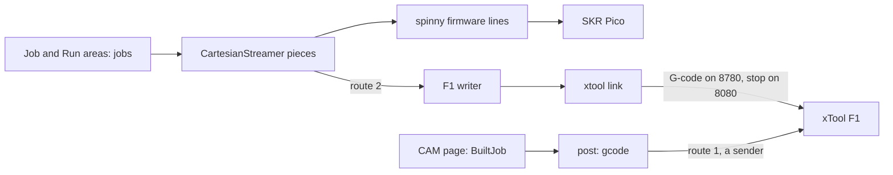

# xTool F1 (galvo) support: what it would take

An assessment, not a feature: nothing here is implemented (2026-11-21).
Machine facts are from [BeamInk](https://github.com/sfn-tools/BeamInk)
(commit 9b8b67e, MIT), which draws on an F1 live from a Wacom tablet, and
from the sources at the end. What neither settles is listed as a check on
the machine.

## The machine

The xTool F1 is a galvo laser with two sources behind one pair of mirrors:
a blue diode (455 nm) and an infrared one (1064 nm). The head does not
move; the mirrors put the spot anywhere in a field of about 120 x 120 mm
(BeamInk reads the size from the machine and defaults to 119.98). The host
sends X and Y only: no focus axis, no probe, no camera this repo can read.

Its USB port is a network adapter; the F1 answers at 201.234.3.1.

Two firmware generations talk differently:

| Firmware | Ports | Used by |
| --- | --- | --- |
| REST V1, before 40.51.020.04 | G-code on TCP 8780, JSON over HTTP on 8080 | BeamInk, LightBurn's GRBL device |
| WS-V2, 40.51.020.04 and later | 8780 refused, 8080 closed; TLS WebSocket on 28900 | xTool Studio |

The version boundary is the Cambridge Hackspace driver's documented range,
not tested here. One LightBurn user on WS-V2 got 8780 back by downgrading
in xTool Studio (Device, Firmware Management, Downgrade Firmware).

On REST V1, BeamInk (`beamink/transport/base.py` and `xtool.py`) sends:

- at the start: `$L`, `G0 F180000`, `M3 S0` (constant power; `M4 S0` for
  dynamic), `G1 F180000`, `M114 S1` (blue; `M114 S2` infrared), `G21`,
  `G90`
- a travel: `G0X..Y..` then `G0 S0`; a cut: `G1X..Y..S..F..`, S from 0 to
  1000 (percent times 10), F in mm/min
- at the end: `G90`, `G0 S0`, `G0 F180000`, `G1 F180000`, `M6 P1`, `$P`
- to stop: `G0 S0` on the socket, then POST `/processing/stop` on 8080
  (GET when POST fails), then it closes the socket
- `GET /device/machineInfo` for the field size (`data.workSize.x`, `.y`)

BeamInk writes and moves on: it never waits for an answer, only logs what
comes back. Nothing found says what `$L`, `$P` and `M6 P1` do. xTool's own
LightBurn device file for the F1 (`xTool-F1-V2.2.lbdev`) holds the start
and end lines xTool uses, and is the better source for them.

BeamInk draws live, so lines on 8780 run as they arrive: no button on the
machine gates them, and the host's Start is the only gate. BeamInk adds an
arm switch of its own and stops after 30 s without pen motion.

### M114 picks the source

On the F1 `M114` switches the laser source. On Marlin it asks where the
head is, and this repo's G-code machine (`controller = "gcode"`) sends it
at connect, before each jog, after each goto and once a second (its
`position` line, M114 unless the file says otherwise). That machine also
sends M115 at connect, M400 after a goto, M410 to stop and G28 to home,
none of which an F1 is known to take. So an F1 is not a
`controller = "gcode"` file with other lines: it needs its own controller.

## What carries over

A board job is paths in mm with a speed (mm/min), a power (an S value) and
passes. For a cartesian machine `CartesianStreamer`
(`web/backend/src/spinny_web/kinematics.py`) already turns it into travel
and cuts as pieces that carry the target, feed and power beside the line
text. Rendering those pieces as F1 lines is the seam. Isolation, clearing,
deposit, engraving and DXF drawings carry over; stencil mode only if the
blue cuts the stencil film.

These do not: the focus axis, the height map, probing, focus and power
compensation (no Z); homing and endstops (a galvo has none); the jog (the
mirrors move unseen); the head camera's board search and alignment; the
firmware settings; hold and resume (unknown on 8780); and the dynamic
power floor (`M` on a cut has no F1 word).

The blue ablates paint and etch resist as this repo's diode does. Neither
source is expected to remove the copper itself: 2 W of infrared marks
metal.

## Routes

| | Route | Code | Result |
| --- | --- | --- | --- |
| 1 | A CAM profile and a sender | about 200 lines with tests | CAM page jobs on the F1; answers most checks below on scrap |
| 2 | The F1 as a machine file (`controller = "xtool"`) | about 2500 to 3200 lines with tests and docs | connect, frame, run with progress and stop, all from the shared page |
| 3 | Route 2 over WS-V2 instead of a downgrade | route 2 plus a client for xTool's TLS WebSocket protocol | keeps current firmware; undocumented, breaks when xTool changes it |

1. `cam/xtool-f1.toml`: X and Y from 0 to 119.98, power out of 1000, the
   start and end lines as header and footer, galvo speeds (found on scrap;
   BeamInk's 9600 mm/min is for drawing by hand). `post.py` needs two
   options: a power word on every travel (`G0 X.. Y.. S0`, as the
   Cambridge driver writes them) and the line that switches the laser off
   (it writes `M5`, which BeamInk never sends). Comments go too, unless
   the F1 takes `;`. The sender writes the file down 8780 and stops by
   HTTP; BeamInk's transport is the template.
2. In pieces:
   - The file: a third controller in `spinny_laser.machines` beside spinny
     and gcode, with tables for the address and ports, the sources and
     their select lines, the field and the park place, the start and end
     lines; documented in MACHINES.md; the Rust twin refuses it as it
     refuses G-code files.
   - `xtool_link.py`: the socket and an HTTP client. machineInfo at
     connect (field size and firmware; WS-V2 refused with the downgrade
     hint), runningStatus for the state, `/processing/stop` behind Stop
     and the big Stop. Sent out of band, a stop does not wait behind lines
     the socket still holds.
   - The F1 writer: the pieces as `G0` and `G1` lines and the source line
     per group. Refused: focus moves, dots, a power floor, spindle and
     dispenser groups, a point outside the field.
   - The run: progress as the Run area shows it (sent, answered, total,
     estimate). Uploading the file (`/processing/upload`) would let the
     machine pace itself, but gives no progress, and the sources found do
     not name the V1 start call.
   - Frame: trace the job's outline so the board can be lined up. How
     xTool frames on an F1 is a check; BeamInk's preview is the blue at
     2 %, which can mark.
   - The page: a machine without jog, home, height or probe; Frame and the
     source in the Machine panel; the field as the bed; the readout from
     the last point sent; the mock's twin; a virtual F1 (TCP and HTTP
     fakes, as `virtual_pnp.py` fakes Marlin) for tests and a mise task.
     The G-code pick and place machine came to about 4700 lines; this one
     has no placing, cameras or feeders.
3. xTool Studio's protocol: JSON in a CRC-16/ARC envelope after a
   handshake, a ping every 3 s. LightBurn 2.2 runs the F1 family over the
   network as a Labs feature.

## Checks on the machine

In this order, each with the stop button in reach. The first two fire
nothing.

1. The firmware: does 8780 take a connection, and what does
   `GET /device/machineInfo` say (BeamInk's `--machine-info`).
2. The answers: what the F1 says to a line that moves nothing, to M115 and
   to `?`, and whether each line gets an `ok` (LightBurn drives it as
   GRBL, which suggests so). Never a bare `M114`.
3. Which way is up: an asymmetric mark (an F) on scrap at low power. One
   F1 Ultra's X came out mirrored.
4. Travel: does `G0` keep the beam off with an S set before it. BeamInk's
   order (move, then `G0 S0`) says it does.
5. A stream that runs dry in the middle of a cut: does the beam go off or
   burn a spot.
6. The field: the calibration card across the 120 mm field measures what
   the F1's own lens correction leaves.
7. The process: blue power and speed for the resist on a coupon, and what
   the infrared does to it.

## Recommendation

Check the firmware first: on WS-V2, routes 1 and 2 need a downgrade, and
route 3 is the only way to keep it. Then route 1: one profile and two post
options answer most of the checks on scrap. Route 2 after that, backend
first: the link, the writer and the run touch no page code, while the
page's panels and modes are being reworked.

## Sources

- [BeamInk](https://github.com/sfn-tools/BeamInk/tree/9b8b67e2cb95542ec1a670c664e41963e5bfface):
  the lines, the HTTP calls, the field and the stop.
- [Cambridge Hackspace boring-asset-manager PR 311](https://github.com/Cambridge-Hackspace/boring-asset-manager/pull/311):
  the firmware generations and their ports and endpoints, `S0` on every
  travel, the axis notes. Its author says nothing has run on a laser.
- [LightBurn forum: F1 port 8780 refused](https://forum.lightburnsoftware.com/t/xtool-f1-usb-connection-waiting-for-connection-port-8780-refused-detailed-diagnostics-included/189713):
  8780 refused on 40.51.020.2020.01.ht4, 28900 open, the downgrade.
- LightBurn forum,
  [the F1 as a G-code device](https://forum.lightburnsoftware.com/t/galvo-add-on-license-needed-for-xtool-f1/101805)
  and [M114 S2 for the infrared](https://forum.lightburnsoftware.com/t/run-macro-through-udp-to-select-laser-source/162660).
- [LightBurn 2.2 release notes](https://lightburnsoftware.com/blogs/news/lightburn-2-2-true-nest-center-line-trace-camera-print-and-cut-and-more):
  the F1 family over the network.
