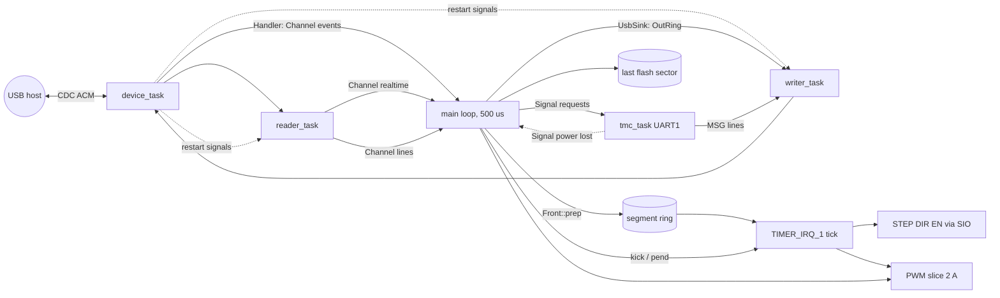

# The RP2040 board crate (firmware/rp2040)

## Layout: hardware glue here, logic next door

`.cargo/config.toml` pins this crate to `thumbv6m-none-eabi`, and a cargo
config applies to every crate below it with no way to cancel it from a
child. Everything that can run on the host therefore lives in
`../rp2040-logic` (a member of the `firmware` workspace) and this crate only
holds the hardware glue: `board.rs` (pins, `StepPort`, `LaserPort`),
`step_timer.rs` (alarm 1 interrupt), `usb.rs` (CDC tasks and channels),
`tmc.rs` (driver UART task), `flash.rs` (settings sector, serial number).
Each glue module has a logic module with the same concerns and its tests.

## Ports are zero-sized

`StepPins` and `LaserPwm` carry no state; they write the SIO set and clear
registers and the PWM slice registers directly. The interrupt and the main
loop each make their own instance, so nothing is shared but atomics: the
pulse width in cycles, the PWM wrap value, the last duty and the laser's
slice and channel. The duty write is a plain `cc` register write, not a
read-modify-write, so the two contexts cannot clobber each other; that is
safe because the slice's other channel is a pin the firmware never puts
in its PWM function (GP21, the bed heater output, beside the default
GP20).

Cortex-M0+ has no atomic read-modify-write, so the dropped-output counter
is updated inside the critical section that already guards the ring.

## Laser PWM

The laser defaults to GP20, the FAN3 output; `laser_pin` (read at boot)
moves it. The RP2040 wires GPIO `n` to slice `(n / 2) % 8`, channel A for
an even pin and B for an odd one, so GP20 is slice 2 channel A; `board.rs`
works the slice and channel out from the pin rather than naming them,
because the first version drove slice 6 channel B for GP29 and nothing but
the silent laser said otherwise.

Integer divider `ceil(sysclk / (hz * 65535))`, wrap `sysclk / (div * hz) - 1`.
The wrap is capped at 65534 rather than 65535 so that full duty, which is a
compare of `top + 1`, still fits the 16-bit compare field. Frequencies
below about 7.5 Hz or above half the system clock are clamped. The pad's
reset pull-down holds GP20 low until the slice claims it, which also holds
the fan MOSFET off. The settings sector is read first, because the stored
`laser_invert` decides the off level, and the slice then claims the pin
at that level: compare 0 (always low) normally, `top + 1` (always high)
when inverted. The kept duty is seeded with the same off level, because
the stored frequency goes in next and `set_frequency` recomputes the
compare from it; left at 0 it wrote the lit compare for an inverted
module until the first duty replaced it, and a wrap in between latched
it for a whole period.

## Step interrupt

TIMER alarm 1 on TIMER_IRQ_1 at priority P0; the time driver keeps alarm 0
and TIMER_IRQ_0 (moved to P1), USB and UART interrupts sit at P2. Critical
sections still mask everything, so the tick jitter is bounded by the
longest critical section in the system (the USB driver's, a few
microseconds) and the flash erase, which only happens while idle.

The handler disarms alarm 1 before doing anything, so a kick that lands
while the alarm is armed cannot produce a second tick from the stale
target. Arming checks whether the target is already behind the counter
(signed 32-bit compare) and the alarm has not fired; if so it is moved
`RETRY_US` ahead. The only failure mode of that check is one tick a couple
of microseconds early; ticks are counted, not timed, so the position is
unaffected.

`cortex_m::asm::delay(n)` loops `n + 1` times at about three cycles per
iteration on the M0+, and `pulse_loops` hands it half the cycles the width
asks for, so a 2 us request comes out near 3 us. The pulse is at least
`step_us` wide, which is what the port promises. It is busy-waited inside
the tick, so the core's tick floor rises with it (`min_tick_us`): a
`step_us` above 4 lowers the planner's rate ceiling rather than letting
the interrupt overrun its period, which would have run the move slower
than the segment and its laser duty were planned for.

## USB

Three tasks: the device, a reader turning packets into realtime actions
(channel of 8, duplicates dropped) and lines (channel of 24, more than the
16 credits the host is given; a host that ignores the credit makes the
endpoint NAK), and a writer draining a 4 KB ring in 64-byte packets. The
ring drops its oldest bytes when full and counts them, so the core never
blocks on output. A packet of exactly 64 bytes with nothing behind it is
followed by a zero-length packet, or Linux would keep the data until more
arrives.

"Connected" is the device being configured, not DTR, so the banner sits
in the ring until a program opens the port. The endpoint reads and writes
of this driver never fail, so a host going away is only seen through the
device state: a bus reset, a suspend (which is all an unplug shows, the
board having no VBUS sense) or the configuration being dropped. A
`Handler` on the device reports those as the disconnect event and signals
the reader and the writer, which abandon the packet they are on and wait
for the next configuration; the reader clears the line channel so lines
the old host left behind cannot run for the next one, and the main loop
clears the output ring and resets the machine.

Bytes that cannot be part of a command (controls, non-ASCII) are replaced
by `?` so a damaged line fails to parse instead of changing meaning; tab
becomes a space.

## TMC2209

Building CHOPCONF from an all-zero register, as an earlier firmware for
this board did, sets TOFF=0 and switches the driver off. Here CHOPCONF
carries the chopper values (the `tmc_toff`, `tmc_tbl`, `tmc_hstrt` and
`tmc_hend` settings, by default the datasheet's TOFF 3, HSTRT 5, HEND 0 and
TBL 2; see firmware.md, "Driver tuning settings"), the microstep
resolution, interpolation and the sense range. The hold current is scaled
in the run current's sense range; picking a range per current would put
the hold value on the wrong scale. GCONF also sets `multistep_filt`.

A configuration request is a latest-value slot, not a queue: the settings
page sends a burst of `tmc_*` lines, each of which asks for the drivers to
be written, and with a queue the newest snapshot, the one the settings
now hold, was the one dropped once it filled. The retry after a refused
configuration keeps the configuration only while it has not landed; the
first version kept it the other way round, so a board brought up on USB
before motor power never retried at all and announced the drivers
configured right after saying they had refused.

All datagrams echo back on RX (one wire through a resistor). Writes drain
their echo; reads take echo plus reply in one buffer and let the crate's
`Reader` find the reply behind the echo. Leftovers from a timed-out
exchange are drained before the next one. IFCNT counts accepted writes, so
`$tmc` right after a configuration should show 6 per driver (the GSTAT
clear and the five registers): a cheap check that the UART wiring and
addresses are right. The exchanges run in their own task, configuration,
polls and `$tmc` alike, so they never interleave on the wire; the main
loop only raises signals.

## Flash

Settings occupy the last 4 KB sector of the 2 MB flash. Erase and program
run from RAM with interrupts off (tens of milliseconds); the core saves
only while idle, and the watchdog window is 1.5 s.

## Boot

Pads reset with pull-downs, so from power-on until `board::init` the laser
line is low and the EN lines are low too, which enables the drivers at
their default current for a few milliseconds, the settings read below
included. The settings sector is read first, for the laser's pin and
polarity; `init` then claims the laser slice at its off level,
drives EN high, then STEP and DIR low. The stored laser frequency and the
off level are applied next, and USB and the driver task start after
that. The GPIO and PWM drivers are forgotten on purpose so their `Drop`
never returns a pin to an input.

## The drivers are asked, not told

A configuration write that a driver never took leaves it on its MS1 and
MS2 straps, which on this board is 8 microsteps on the radius socket and
64 on the table: every distance then comes out a fraction or a multiple of
what was asked for, and the first sign of it is a board the wrong size.
So each axis is written and then read back: IFCNT counts the write
datagrams the driver accepted, and if it has not moved by the six
written, or GSTAT does not read back clear, the axis is tried once more
and then said out loud on the console. A driver picks its baud rate from
the first datagram it sees, which can cost that datagram, so the retry
earns its place.

The drivers run from the motor supply, so none of this answers with motor
power off. That is the ordinary bring-up order, USB first and the supply
afterwards, so a configuration that found nobody home is kept and
retried, driver by driver, every quarter second until it lands rather
than left for the next reboot. `$tmc` reads the microstep count back from
the driver instead of reporting what was asked for, because the gap
between the two is the whole failure: the radius socket straps to 8
microsteps and the table to 64, so an unconfigured radius is asked for
thirty-two times its speed and stalls, while an unconfigured table turns
four times too far and looks like it is working. The count comes from
CHOPCONF only while GCONF selects the register; otherwise it is the MS1
and MS2 pins read from IOIN, because MRES reads 256 at power-up and a
driver on its straps would otherwise report exactly what was asked for.

The same supply arrangement means the supply can also go away after the
configuration has landed, and come back: an e-stop that cuts it, or the
operator switching it off to move the head by hand. Every driver then
comes back at its reset values, on its straps (16 on the focus axis,
which approaches the board), while the core goes on stepping for 256,
and its motor held nothing while it was off. A driver that took its
configuration is therefore polled every quarter second for GSTAT: no
reply after three tries (the supply is off), the `reset` flag (it came
back between two polls) or `uv_cp` (its charge pump is down, which
disables it) counts as lost. The first poll that finds it says so once,
signals the main loop, which resets the machine as the reset byte does
(`ALARM:1` when it was moving, beam and spindle off before the supply
returns, and the queued lines dropped), and the driver is written again
at every poll until it answers and takes it. `reset` is set at every
power-up, the first included, and only a write of ones clears it, so the
configuration clears it first of all, and a write counts as landed only
once GSTAT reads back clear. That write would also wipe the flag of a
supply cycle the last poll has not seen yet, so a new configuration (a
`tmc_*` or `h_axis` change, `$load`, `$defaults`) does not go straight
to the drivers that held the old one: they are superseded, polled once
more, and written only after. Three tries, because a missed reply read as
a lost supply stops a running job. `drv_err` is not counted: it is a
shutdown for heat or a short that `$tmc`'s DRV_STATUS shows, not a lost
configuration. What this cannot do on its own is hold motion back until
the operator has acknowledged the loss; the core has no alarm for it, so
an idle machine stays `Idle`, and a move sent in the fraction of a second
between the supply returning and the next poll runs at strap resolution.

`GCONF::default()` and `CHOPCONF::default()` in the driver crate start
from zero and set a few fields, so everything this firmware does not set
reads as off. Two of those would be silent and expensive if they ever
changed: `dedge` would make both edges of a step pulse count, doubling
every move, and `internal_rsense` would ignore the board's sense
resistors and pick the current off the internal reference. Both are
asserted in the tests rather than trusted.

## What 256 microsteps costs

The step generator emits at most one event per 10 us tick, so 100000
steps a second across both axes. At 256 microsteps that is 586 mm/min on
the radius and 422 deg/min on the table, well under what either motor can
turn. The planner caps each axis by the lower of its `max_rate` and that
ceiling, so a faster move simply runs at the rate the axis can be stepped
at and, under `mode dyn`, the laser power follows the speed down. Without
that cap the segment would still be planned at the commanded speed while
the interrupt fell behind it, and the beam would burn at a power meant
for a speed the machine never reached.

## Servos (2026-11-13)

- A servo on the board runs its pin's own PWM slice at 50 Hz (div 39, top
  64101 at 125 MHz, 0.312 us a count). Never the laser's slice: the laser
  writes the whole CC register and runs at its own rate. Two servos may
  share a slice on channels A and B, so servo compares are a `modify`;
  GPIO n and n + 16 drive the same channel. CC is double buffered, so a
  new pulse lands at the next wrap, never cut short.
- `spinny_fw_logic::servo::plan` decides at boot which servo pins and
  which bus are claimed, after the laser, tool output and probe; endstop
  inputs skip them. Refusals are printed at boot into the USB ring (they
  arrive before the banner). The pulse goes out only while the settings
  still name the boot output (`BOOT_WIRING`).
- The PCA9685 has its own task on async I2C at 100 kHz. embassy-rp's
  `I2c` takes its pins as types, so `open` matches the allowed pairs (a
  macro arm per SDA pin). Setup: MODE1 SLEEP, PRE_SCALE 121, MODE2
  OUTDRV, ALL_LED off, MODE1 AI, 500 us; a channel is one 5 byte write
  latched at the STOP. MODE1 is read each quiet second: SLEEP set or AI
  clear means it lost its supply, so it is set up again. Not answering is
  said once and retried every 500 ms. No SWRST: it is a general call that
  would reset other chips on the bus.
