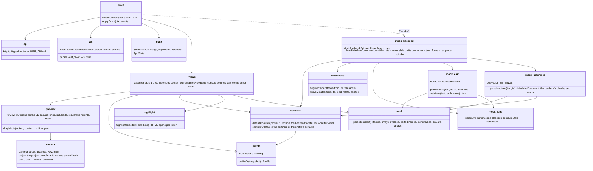

# spinny-web frontend

Browser interface for the rotary table laser, built with Bun and plain
TypeScript: no framework, one store, views that draw from it.

```sh
cd web/frontend
bun install
bun run check && bun test && bun run build
bun run dev            # serves index.html with the sources
```

`bun run build` writes `dist/`, which the backend serves at `/`. Open
`?mock=1` for an in-page machine that needs no backend (`src/mock/`);
`?api=http://host:8000`
points the page at a backend elsewhere, which must have been started with
that page's origin allowed: `spinny-web --cors-origin http://localhost:3000`
for the dev server. Without it the browser refuses every call.

Board coordinates are mm with the rotation axis at the origin: `x = r cos a`,
`y = r sin a`. The preview is a 3D view of the working area drawn on a
plain canvas (`camera.ts` projects, no WebGL): the rings and the rail
floating at the head's height, the soft limits, copper, outline and the
job's paths on the board, the probe grid with its heights raised and
stretched to be seen, and the head over its board point with the beam.
Drag orbits, or pans with *Lock rotation* pressed (kept between visits);
shift or right drag pans, the wheel zooms about the cursor, *Reset view*
and a double click return to the overview, tilted with the axis in the
middle and everything in view. The DRO and the jog panel draw the
machine's controls (`controls` in the settings the backend sends: the
`[controls]` of the machine file the settings are, or of the file last
loaded or the one file for this kind of machine when they are no file's,
else the defaults for what the machine is;
`src/controls.ts` holds the page's copy of those defaults for the moment
before the settings arrive and for the mock): one readout cell and one
bar per joint the file names, with its letter, label, step choices and a
field for any other step, its two buttons, keys and zero button, the
board's X and Y bars on the arrow keys when the file has a pad, a feed
field, goto fields and Center. *Cancel* sits in the jog panel's head,
away from every move; Escape does the same. The polar laser's defaults
are the joint (`R` mm, `A` deg), the cross slide (`Z` mm) as a setup
axis moved in the small steps a centering burn is measured into, and the
focus axis (`H` mm) with the probe on a machine with one. Both panels
are drawn again when the controls change.

The page follows what the machine is (`profile` in the backend's state,
from `$cartesian` and `$spindle`), with a badge in the status bar when it
is not the polar laser. The Config tab's machine file panel lists the
files in `machines/`, names the one the live settings are (or says they
are no file's, and whose controls the jog panel draws), edits the picked
one, and loads it after a confirmation,
every firmware setting from the file; *Save to flash* keeps it over a
restart. On a cartesian machine the cross slide is the Y
axis: it steps like the rail, at the feed given, and the joint goto takes
`r` and `z`. With a spindle the laser panel starts and stops the spindle,
the groups table has depth and plunge in place of the power floor, the
focus axis is the depth axis, "Focus here" is "Touch off here", and the
firmware settings panel on the Config tab has the travel clearance and
spin-up. The in-page mock
takes those settings too: with `$cartesian=1` the cross slide is a joint
and a board move is one line in the table's frame, and with `$spindle=1`
it mills a job the way the backend streams one (lift, spindle start,
spin-up dwell, plunge, cuts at depth, lift, spindle off). The preview draws
a cartesian machine's soft limits as a box turned with the table.

The Height map panel probes a grid (drawn on the preview before and while it
is probed), or only the points around the selected job's cuts with a
margin, with the point count and about how long beside the fields (the
backend's estimate, and the time left while it probes); shows the heights
as a map of the board seen from above, blue below the mean and red above
it, the points left out hatched; goes on with a map probed in part
(*Continue*); and sets the focus offset, by a typed value that holds until
*Set*, by Focus here, or by one probe under the head (*Probe here: tie
map*, which moves the map's offset by the shift the surface shows there,
or *set H 0*). The run button
sends the chosen compensation, which turns to `auto` while a map is usable
and back to off when it is not. The backend drops the focus offset whenever
the focus axis may have moved to other numbers (Set H=0, a connect, the
firmware restarting, a loaded map); the page then asks for Focus here (Touch
off here) again before a run follows the map. Probing is locked while the
spindle turns, and the spindle start while probing. The status reports the
output's duty as driven on the pin; the DRO and the probe lock turn it
around on an active-low output (`laser_invert`), as the backend does.

The Jobs panel has *Save job* (the selected job's JSON) and *Delete all*
beside its title, and under a run that stopped short a *Resume from line*
row: the count of lines done, *from the start of its path*, *Plan* (what
would go out first) and the button. The Jog panel's *Here is* row declares
the joints without moving them, *Last known* filling in the position the
backend recorded during the last run. The status bar lists the controller
first and polls the ports every 10 s while nothing is connected, with a
toggle that hides the built-in system ports; it marks a machine whose
last report is old, as the Position panel does, before the backend gives
the link up. The console's *Log* shows the backend's log.

The page has three tabs under the status bar, remembered per browser and
set by `?page=cam` or `?page=config` in the address: *Machine*, the
panels above, *CAM* and *Config*. The CAM page shows a profile from
`cam/` (`docs/CAM.md`): its axes,
its tools and its operations, every cutting setting of an operation in a
field that writes the one value back into the file (a field left empty is
the tool's value again), the file's text in an editor that saves it whole
and shows what is wrong with a text that does not read, a drop zone that
takes a design (a board with its outline and drill file in one drop, an
SVG, gcode or a job) through the profile into a job, and *Export gcode*,
which downloads the picked job as a program for the profile's controller
with a report of what each axis reaches. The CAM page has a preview of
its own. The mock reads the shipped profiles itself (`src/mock/toml.ts`,
`src/mock/cam.ts`): copper geometry is the demo coupon's, and its gcode
follows the backend's post for a cartesian profile.

The Config page is where a machine is described: the machine file panel
picks a file from `machines/` (`docs/MACHINES.md`), shows it in the TOML
editor, makes a new file from the text shown, deletes one, checks the
text against the backend (*Check*), saves it whole (*Save*, which keeps
nothing of a text that does not read), and loads it onto the board
(*Load to board*, then *Save to flash*). The pins, the laser output, the
probe and an optional tool output, are keys of the file; they are read at
boot, so the page says to save and restart after a load that changes one.
Beside it the firmware settings panel shows the live values with inline
edits, the host's chord tolerance and the milling values. Both TOML
editors (`src/views/editor.ts`) color the text (`src/highlight.ts`) and
read it with the page's own TOML reader (`src/toml.ts`) on every edit,
naming the line that does not read before any save; the backend's check
is the one that counts.

Arrow keys jog when no field that uses them has focus and the machine's
page is up; Escape cancels a jog
or goto from anywhere but a dialog while a machine is connected. The event feed is opened again when it
goes silent for 5 s while a machine is connected, since a backend host that
loses power sends no close. The page reads the settings again when the
machine, or the profile in its state frames, changes, and after a setting
typed at the console.

## Architecture


