# spinny-web frontend

Browser interface for the rotary table laser, built with Bun and plain
TypeScript: no framework, one store, views that draw from it.

```sh
cd web/frontend
bun install
bun run check && bun test && bun run build
bun run dev            # serves index.html with the sources
```

`bun run build` writes `dist/`, which the backend serves at `/`. Open
`?mock=1` for an in-page machine that needs no backend (`src/mock/`,
which only `src/main.ts` imports: the page's own code takes nothing from
it, the mock takes what it shares with the page from `src/`, and its DXF
reader `src/mock/dxf.ts` is checked against the backend's on the same
fixtures);
`?api=http://host:8000`
points the page at a backend elsewhere, which must have been started with
that page's origin allowed: `spinny-web --cors-origin http://localhost:3000`
for the dev server. Without it the browser refuses every call.

Board coordinates are mm with the rotation axis at the origin: `x = r cos a`,
`y = r sin a`. The preview is a 3D view of the working area drawn on a
plain canvas (`camera.ts` projects, no WebGL): the rings and the rail
floating at the head's height, the soft limits, copper, outline and the
job's paths on the board, the probe grid with its heights raised and
stretched to be seen, and the head over its board point with the beam.
Drag orbits, or pans with *Lock rotation* pressed (kept between visits);
shift or right drag pans, the wheel zooms about the cursor, *Reset view*
and a double click return to the overview, tilted with the axis in the
middle and everything in view. The DRO and the jog panel draw the
machine's controls (`controls` in the settings the backend sends, picked
as [MACHINES.md](../../docs/MACHINES.md#the-controls) says;
`src/controls.ts` holds the page's copy of the defaults for the moment
before the settings arrive and for the mock): one readout cell and one
bar per joint the file names, with its letter, label, step choices and a
field for any other step, its two buttons, keys and zero button, the
board's X and Y bars on the arrow keys when the file has a pad, a feed
field, goto fields and Center. *Cancel* sits in the jog panel's head,
away from every move; Escape does the same. On a machine with an endstop
the panel's *Home* homes every axis that has a switch, and the readout's
*Homed* names the joints homed since the position was last lost. The
polar laser's defaults
are the joint (`R` mm, `A` deg), the cross slide (`Z` mm) as a setup
axis moved in the small steps a centering burn is measured into, and the
focus axis (`H` mm) with the probe on a machine with one. Both panels
are drawn again when the controls change.

The page follows what the machine is (`profile` in the backend's state,
from `$cartesian`, `$spindle` and `$dispenser`), with a badge in the
status bar when it is not the polar laser. The Config tab's machine file
panel lists the files in `machines/`, names the one the live settings are
(or says they are no file's, and whose controls the jog panel draws),
edits the picked one, and writes it to the board after a confirmation,
every firmware setting from the file, saved to the board's flash in the
same step. On a cartesian machine the cross slide is the Y
axis: it steps like the rail, at the feed given, and the joint goto takes
`r` and `z`. With a spindle the laser panel starts and stops the spindle,
the groups table has depth and plunge in place of the power floor, the
focus axis is the depth axis, and "Focus here" is "Touch off here"; the
travel clearance and the spin-up are the machine file's `[host]
clearance` and `spinup`. The in-page mock
takes those settings too: with `$cartesian=1` the cross slide is a joint
and a board move is one line in the table's frame, and with `$spindle=1`
it mills a job the way the backend streams one (lift, spindle start,
spin-up dwell, plunge, cuts at depth, lift, spindle off). The preview draws
a cartesian machine's soft limits as a box turned with the table.

The Height map panel (`src/views/heightmap.ts`) draws
`AppState.heightMap` (the map, the probing under way and the probe
settings, kept current by `heightmap` events) as cells colored about the
mean height (`cellColor`), and puts the grid its fields describe in
`AppState.probeDraft` for the preview to draw before it is probed; the
preview draws a pad map's points as the pads. `mapUse` says what a run
would do with the map under the Run panel's choice (`AppState.mapChoice`),
in the panel's head and on the Run panel's chip. Their use is in
[OPERATING.md](../../docs/OPERATING.md#probing-and-the-height-map), with
[probing less](../../docs/OPERATING.md#probing-less-around-the-cuts-and-one-point) and
[the pads](../../docs/OPERATING.md#probing-the-pads). The status reports the output's duty
as driven on the pin; the DRO and the probe lock turn it around on an
active-low output (`laser_invert`, `outputDuty` in `src/profile.ts`), as
the backend does.

The preview draws a one-point path as a dot, a dispense import's the size
of its pad (`dotRadius` in `src/preview.ts`), and on a dispenser machine
(`isDispensing` in `src/profile.ts`) the Run panel names a group of paths
it refuses (`dispenseRefusal` in `src/views/run.ts`, the Run panel the
Jobs and Plot pages both mount); dispensing is in
[OPERATING.md](../../docs/OPERATING.md#dispensing-solder-paste).

The Jobs page's *Camera* panel (`src/views/vision.ts`; `camera.ts` is
the preview's camera) draws `AppState.camera`, asked for again with its
picture while the panel shows, the cameras attached from `AppState.cameras`
(`src/views/camerapick.ts`) and the camera log from `AppState.camlog`
(`src/views/camlog.ts`). The *Align* panel (`src/views/align.ts`) draws
`AppState.align`, the marks and the fit `src/align.ts` gives them. Their
use is in [the camera and its offset](../../docs/OPERATING.md#the-camera-and-its-offset) and
[lining a job up](../../docs/OPERATING.md#lining-a-job-up-with-the-board). The mock has a
camera of its own: an SVG picture of the loaded board, lying a little off
the job so alignment has something to find, the mark as a dark dot that
follows the head, and the find routine stepped on the mock's clock.

The *PNP* page (`src/views/pnp.ts`) draws the selected board job's parts
(`AppState.components`, read by the backend from its `.kicad_pcb`), the
one picked (`AppState.pnpPart`) and the up camera (`AppState.pnp`); with
*Place with* (`AppState.pnpTarget`) set to a G-code device, the *G-code
device* panel (`src/views/device.ts`, `AppState.device`) takes the up
camera and nozzle panels' place. Their use is in
[pick and place](../../docs/OPERATING.md#pick-and-place) and
[placing with a G-code machine](../../docs/OPERATING.md#placing-with-a-g-code-machine-openpnp-compatible).
The mock's up camera (`src/mock/pnp.ts`) draws the nozzle where the head
is against where the camera really sits, and makes a board job's pads its
parts; the mock's twin of the backend's profile reader and planner is
`src/mock/openpnp.ts`. The *Setup* panels (`src/views/steps.ts`, on the
Jobs and PNP pages) fill their steps in from the page's state
([setup steps](../../docs/OPERATING.md#setup-steps)). A panel's edits not applied yet are
counted per panel in `AppState.pending` and on its page's tab
(`PENDING_PAGES` in `src/views/tabs.ts`).

The Jobs panel has *Save job* (the selected job's JSON) and *Delete all*
beside its title. A `.kicad_pcb` picked or dropped opens a layer chooser
first (`src/kicad.ts` reads the board's layer table and counts what is
drawn on each layer), and Board *on the lines* cuts a drawing where it
lies. Paths picked in the preview (`AppState.selection`) are moved between
groups by `src/regroup.ts` and the job sent back whole with `PUT
/api/jobs/{id}`; the *Job JSON* panel (`src/views/jobjson.ts`, text and
caret places in `src/jsontext.ts`) draws its edit as `AppState.jobDraft`
and the caret's place as `AppState.highlight`. Under a run that stopped short a *Resume from line*
row: the count of lines done, *from the start of its path*, *Plan* (what
would go out first) and the button. The Jog panel's *Here is* row declares
the joints without moving them, *Last known* filling in the position the
backend recorded during the last run. The status bar lists the controller
first and polls the ports every 10 s while nothing is connected, with a
toggle that hides the built-in system ports; it marks a machine whose
last report is old, as the Position panel does, before the backend gives
the link up. The console's *Log* shows the backend's log, *Wire* the last lines over the wire with their times, polls included.

The page has six tabs under the status bar (`PAGES` in
`src/views/tabs.ts`), remembered per browser and set by `?page=plot`,
`?page=cam`, `?page=pnp`, `?page=auto` or `?page=config` in the address
(the old names `machine` and `mill` still open them): *Jobs*, the panels
above, *Plot*, *CAM*, *PNP*, *Auto* and *Config*. The CAM page shows a profile from
`cam/` (`docs/CAM.md`): its axes,
its tools and its operations, every cutting setting of an operation in a
field that writes the one value back into the file (a field left empty is
the tool's value again), the file's text in an editor that saves it whole
and shows what is wrong with a text that does not read, a drop zone that
takes a design (a board with its outline and drill file in one drop, an
SVG, a DXF, gcode, a job or an STL model) through the profile into a job, and
*Export gcode*, which downloads the picked job as a program for the
profile's controller with a report of what each axis reaches. The CAM
page has a preview of its own. The mock reads the shipped profiles itself
(`src/toml.ts`, `src/mock/cam.ts`): copper geometry is the demo coupon's, and its gcode
follows the backend's post for a cartesian profile.

The Config page is where a machine is described: the machine file panel
(`src/views/config.ts`) picks a file from `machines/`
(`docs/MACHINES.md`), shows it in the TOML editor, makes a new file from
the text shown, deletes one, checks the text against the backend
(*Check*), saves it whole (*Save*, which keeps nothing of a text that does
not read), writes every setting to the board and saves it to the board's
flash in the same step (*Write to board*, which saves an edited text
first), and writes the board's values into the text (*Read from board*).
The pins, the laser output, the probe and an optional tool output, are
keys of the file; they are read at boot, so after a write that changes
one the page says to restart the board. Beside the editor, *Settings*
(`src/views/settingslist.ts`) lists every key a file can set, the file's
value beside the board's; nothing is edited there, and a click takes the
editor to the key. The TOML editors (`src/views/editor.ts`: the machine
file's, the CAM profile's and the G-code device profile's) color the text (`src/highlight.ts`) and
read it with the page's own TOML reader (`src/toml.ts`) on every edit,
naming the line that does not read before any save; the backend's check
is the one that counts.

Arrow keys jog when no field that uses them has focus and the jog panel's
page (Jobs or Plot) is up; Escape cancels a jog
or goto from anywhere but a dialog while a machine is connected. The event feed is opened again when it
goes silent for 5 s while a machine is connected, since a backend host that
loses power sends no close. The page reads the settings again when the
machine, or the profile in its state frames, changes, and after a setting
typed at the console.

The *Plot* page (`src/views/mill.ts`) builds a Plot job, a list of
operations cut in order: the operation in its fields is planned as it is
typed (`POST /api/mill/plan`) into `AppState.millPlan` and drawn on the
page's own preview with its sizes (`AppState.millDims`, from
`src/sketch.ts`); *New job* makes a job of it, *Add to job* appends it to
the selected one, and on a laser the operations are burnt. The *Markers*
panel (`src/views/markers.ts`, on the Jobs and Plot pages) lists
`AppState.markers`, which every preview draws, and *Grid* in a preview's
head (`src/views/previewpanel.ts`) switches every preview at once. Their use is in [the Plot page](../../docs/OPERATING.md#the-plot-page),
[markers](../../docs/OPERATING.md#markers), [another bit for a job](../../docs/OPERATING.md#another-bit-for-a-job)
and [the preview's grid](../../docs/OPERATING.md#the-previews-grid).

The *Auto* page (`src/views/auto.ts`) draws `AppState.auto`, the
conversation the backend sends as `auto` events, which the store keeps by
entry id (`withEntry`, `mergeAuto` in `src/state.ts`), so an answer grows
in place as it is written and an unfolded tool call stays open as it goes
from running to done; a tool that changed a job has the page list the
jobs again. The provider row draws `AppState.autoSettings`. Its use is in
[the Auto tab](../../docs/OPERATING.md#the-auto-tab). With `?mock=1` a scripted provider,
`mock` (`src/mock/auto.ts`), lists the jobs with the backend's `list_jobs`
tool on the mock's clock and says what it found, so the page can be tried
without a model.

## Architecture

```mermaid
classDiagram
    class main {
        createContext(api, store) Ctx
        applyEvent(ctx, event)
    }
    class api {
        HttpApi  typed routes of WEB_API.md
    }
    class ws {
        EventSocket  reconnects with backoff, and on silence
        parseEvent(raw) WsEvent
    }
    class state {
        Store  shallow merge, key filtered listeners
        AppState
    }
    class views {
        context statusbar tabs steps banner dro jog laser markers mill jobs jobjson calibrate center heightmap focushere previewpanel vision camerapick camlog align pnp device auto console settingslist cam config editor toasts
    }
    class align {
        fitRigid(pairs) rotation, shift, scale, rms, residuals
    }
    class highlight {
        highlightToml(text, errorLine) HTML spans per token
    }
    class toml {
        parseToml(text) tables, arrays of tables, dotted names, inline tables, scalars, arrays
    }
    class preview {
        Preview  3D scene on the 2D canvas: rings or a grid, rail, limits, markers, job, probe heights, head
        dragMode(locked, pointer) orbit or pan
    }
    class camera {
        Camera target, distance, yaw, pitch
        project / unproject  board mm to canvas px and back
        orbit / pan / zoomAt / overview
    }
    class profile {
        profileOf(snapshot) Profile
        isCartesian / isMilling / isDispensing
    }
    class controls {
        defaultControls(profile) Controls  the backend's defaults, word for word
        unitOf(axis, profile) mm or deg
        controlsOf(state) the settings' or the profile's defaults
    }
    class kinematics {
        segmentBoardMove(from, to, tolerance)
        moveMinutes(from, to, feed, rRate, aRate)
    }
    class mock_backend {
        MockBackend  Api and EventFeed in one
        MockMachine  joint motion at the rates, cross slide on its own or as a joint, focus axis, probe, spindle, plunger
    }
    class mock_vision {
        frameSvg boardPose picturePoint  the mock camera's picture and pose
    }
    class mock_padmap {
        selectPads padMapGrid fillPadHeights
    }
    class mock_jobs {
        parseSvg parseGcode placeJob computeStats centerJob
    }
    class mock_cam {
        parseProfile(text, id) CamProfile
        setValue(text, path, value) text
        buildCamJob / camGcode
    }
    class mock_mill {
        buildMill(id, op, holes, limits) the backend's Plot page job, checked against its fixture
        remakeMill / moveJob / carrySettings  a job made again for another width
    }
    class mock_auto {
        MockAuto  the Auto routes and events, the scripted provider mock on the mock's clock
    }
    class mock_machines {
        parseMachine(text, id) MachineDocument  the backend's checks and words, camera included
        DEFAULT_SETTINGS
    }
    class mock_pnp {
        UP_TRUTH TOP_TRUTH  where the up and top cameras really sit, their pictures, a board job's pads as its parts
    }
    class mock_openpnp {
        parseDevice(text, id) MockDevice  the backend's device profile reader and placement program, line for line
    }
    class mock_calibrate {
        calibrateJob(id, request, milling, limits) the calibration tests
    }
    class mock_camlog {
        MockCameraLog  photos taken by hand, kept with the picture marked up
    }
    class mock_thumbs {
        thumbnail(job) the job list's small drawing
    }
    class mock_order {
        innerFirst(paths) whatever lies inside a closed shape first
    }
    class helpers {
        calc  arithmetic typed into a number field
        confirm  a confirm dialog that returns a promise
        dom  elements, common controls, what the browser remembers
        format  numbers for the DRO and the job panel
        jsontext  a job as editable JSON, and where in the job a place in it is
        kicad  a board file's layers, read before an import
        machinekeys  where each setting is written in a machine file
        regroup  a job's paths moved between its groups
        sketch  the Plot operation's sizes drawn over the preview
        speed  how fast every cut of a job goes, for the speed view
        types  the backend's JSON, a type per body or answer
        uploads  the files the backend reads, by suffix
    }
    views --> helpers
    views --> align
    mock_backend --> align
    mock_backend --> mock_vision
    mock_backend --> mock_padmap
    mock_backend --> mock_mill
    mock_backend --> mock_auto
    mock_backend --> mock_pnp
    mock_backend --> mock_openpnp
    mock_backend --> mock_calibrate
    mock_backend --> mock_camlog
    mock_backend --> mock_thumbs
    mock_jobs --> mock_order
    mock_cam --> mock_order
    main --> api
    main --> ws
    main --> state
    main --> views
    views --> preview
    preview --> camera
    views --> profile
    views --> controls
    views --> highlight
    views --> toml
    controls --> profile
    mock_backend --> controls
    mock_backend --> kinematics
    mock_backend --> mock_jobs
    mock_backend --> mock_cam
    mock_backend --> mock_machines
    mock_cam --> toml
    mock_cam --> mock_jobs
    mock_machines --> toml
    mock_machines --> controls
    main ..> mock_backend : ?mock=1
```


